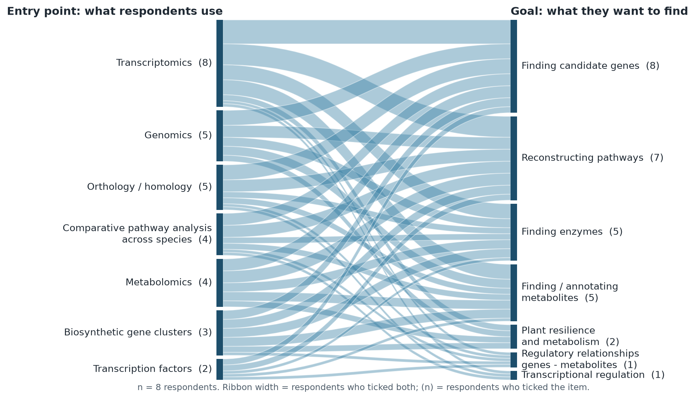
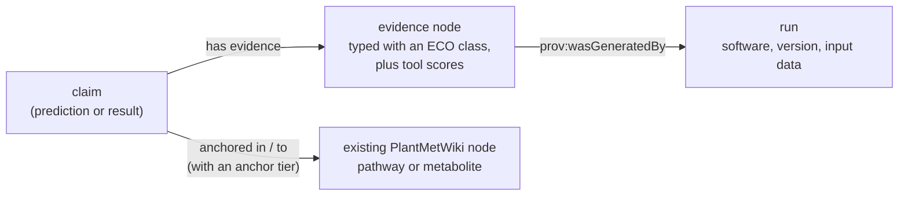

# Introduction

Plant specialized metabolites are a major source of innovative pharmaceuticals, novel foods, and biobased natural products. However, resolving the metabolic pathways that biosynthesize these compounds remains a key scientific challenge, as plant biosynthetic genes are often genomically dispersed and duplicated, resulting in highly branched, diversified, and promiscuous underlying metabolic networks. Additionally, knowledge of plant metabolic pathways remains scattered across disconnected resources, with limited interoperable annotations, and valuable experimental multi-omics datasets remain siloed and underused. To address these gaps, we developed the Linked Open Data knowledge graph PlantMetWiki (<https://plantmetwiki.bioinformatics.nl/>) [@citesAsDataSource:DelPup2026PlantMetWiki], the first semantically enriched knowledge base for querying experimentally validated pathway information for plant biosynthetic reactions, including predictions of biosynthetic gene clusters. Still, researchers lack an open, standardized, and reusable AI-ready format for integrating new datasets with community knowledge in the form of a Minimum Information Standard (MIS). Additionally, there is no framework to apply such a MIS to systematically link computational evidence from bioinformatics tools and paired plant transcriptomics-metabolomics datasets to predict or validate pathway-level knowledge.

## Background

Plant specialized metabolites are a major source of pharmaceuticals, food ingredients, crop protection compounds, and bio-based products [@citesAsAuthority:Huang2023]. Discovery of plant natural products depends on resolving the enzymatic routes that produce them, yet the biosynthesis of the majority remains uncharacterized [@citesAsAuthority:Owen2026]. The obstacle is that plant pathways resist reconstruction from any single data modality: extensive genome duplication distributes pathway genes across large, paralog-rich families that are only partially clustered, the enzymes they encode are catalytically promiscuous, and the resulting networks are highly branched and biosynthesis enzymes are shared with primary metabolism [@citesAsAuthority:Ji2024].

Metabolomics, transcriptomics, and genome sequencing are now generating promising data that can be integrated with dedicated multi-omics analysis pipelines to address this gap [@citesAsAuthority:Wolters2024]. However, this evidence accumulates in domain-specific resources and individual publications that each capture one complementary facet of metabolism, such as enzymatic reactions, metabolite structures, or genomic context [@citesAsAuthority:Singh2022], and that are often curated to different standards and incompatible identifiers. Pathway resources such as the Plant Metabolic Network [@citesAsAuthority:Hawkins2025] are by design restricted to experimentally validated knowledge, and provide no mechanism for recording computational predictions, the evidence supporting them, or their confidence. Predictions are therefore published as static supplementary tables rather than as traceable assertions that can be compared across tools and revised with novel experimental evidence.

To make curated pathway knowledge reusable and machine-actionable, I developed PlantMetWiki [@citesAsDataSource:DelPup2026PlantMetWiki], a semantically enriched and queryable knowledge graph dedicated to plant biosynthetic pathways, integrating experimentally validated pathway information across hundreds of plant taxa with existing ontologies, harmonized chemical annotations, and crosslinks to biosynthetic gene clusters predicted by plantiSMASH [@citesAsDataSource:DelPup2026plantiSMASH]. PlantMetWiki provides a foundation for FAIR data representation and reuse, but there is no open, standardized format for adding new experimental datasets to this curated pool, and no framework for linking computational evidence from bioinformatics tools and from paired transcriptomics-metabolomics experiments. Extending curated knowledge with traceable predictions requires a shared representation of entities, relations, evidence types, provenance, and confidence, and an evaluative framework that the field currently lacks.

During the proposed scientific exchange, I will address this through collaboration with researchers involved in the MetaboLinkAI project at ETH Zurich, which develops FAIR and AI-ready metabolomics workflows based on knowledge graphs, federated data integration, graph machine learning, and large language models. The project will provide me with direct access to state-of-the-art developments in semantic interoperability standards, AI-assisted discovery methods, and metabolomics knowledge representation, and to (part of) the multi-omics communities whose involvement any adopted standard requires.

The work will deliver a community-supported validation schema for aligning and integrating multi-omics datasets, and an evidence-based scoring method for predictions from multi-omics pipelines, interoperable with existing standards. Together, these render plant pathway knowledge FAIR and AI-ready, representing curated pathways, omics evidence, and scored predictions in a single machine-actionable graph. In the future, our proposed workflow will be capable of supporting scalable community annotation, enabling AI-assisted discovery of plant specialized metabolic pathways through graph-based prioritization of candidate pathway components and the generation of experimentally testable biosynthetic hypotheses.

## Objectives

As part of the BioHackathon Europe 2026, in this project we aim to:

1. Co-develop a community-supported Minimum Information Standard (MIS) for predicted plant pathway knowledge representation;
2. Design validation schemas to integrate experimental multi-omics datasets and predictions in alignment with the MIS;
3. Establish methods to align pathway-related predictions across bioinformatics pipelines, and approaches for scoring and prioritization of these predictions based on evidence strength, provenance, and community-defined criteria.

The project expands the plant metabolism knowledge graph PlantMetWiki with predictions from (multi-)omics plant knowledge coming from the community, which requires community-supported standards with feedback from the plant science community. We build an *evidence model* that says, for any prediction or experimental result attached to a PlantMetWiki pathway, enzyme, gene or metabolite, why it is believed (a typed evidence statement), where it comes from (tool, version, input data) and how strongly it is anchored in the knowledge graph. Users can then filter the graph by the kind of support behind a statement. The terms come from existing ontologies wherever possible; what no ontology provides is collected as candidates for new terms. These outcomes will enable scalable community annotation of pathway information, improved integration of multi-omics data, prioritization of candidate pathway components, and more reproducible and transparent bioinformatics analyses.

# Implementation

All work is open and lives in the repository [pathway-lod/lod-pathways-community](https://github.com/pathway-lod/lod-pathways-community): the specification, the discussion workflow, the validation shapes, the pilots and the generated outputs.

## Questionnaire to Plant Science Labs 

To ground the requirements in how the data are used, we interviewed eight core laboratories that generate paired plant omics data, with a questionnaire. It asked for the key research question or goal of each laboratory, what they use to answer it (data types and analyses), which bioinformatics tools they use, and what they would like to ask a knowledge graph such as PlantMetWiki. All four questions allowed several answers. The answers are anonymised and kept in the repository together with the scripts that draw the figures (`paper/figures/`).

All eight laboratories start from transcriptomics and all eight want to find candidate genes; seven want to reconstruct pathways, five to find enzymes and five to find or annotate metabolites (Figure \ref{figureSurvey}). Genomics and orthology are the next most common starting points (five laboratories each), followed by comparative pathway analysis and metabolomics (four each). The tools reflect the same picture (Figure \ref{figureTools}): OrthoFinder, SIRIUS, MZmine and plantiSMASH are named by five laboratories each and DESeq by four; paired-omics tools are named by four laboratories (MEANtools by three, mixOmics by two, an in-house tool by one). Nine answers to the question of what to ask PlantMetWiki contained 14 questions. Most ask for genes or enzymes of a pathway or reaction step, or for comparisons of pathways and orthologs across species; others ask for routes to a compound, for genes linked to a trait or stress, for the physical clustering of genes, and for compounds (novel products, bioactivity, chlorinated products). We use these questions as test cases for the evidence model. They also show needs that the specification does not yet cover, in particular orthology, transcription factors and traits.



{ width=70% }

## The evidence model

Every prediction or experimental result is modelled in the same way, so that predictions of different kinds can be queried together. A *claim* (the prediction or result) has evidence (`sio:SIO_000772`), an evidence node typed with a class of the Evidence and Conclusion Ontology (ECO) and carrying the scores of the tool; the evidence was generated by a *run* (software, version, input data) following PROV-O; and the claim is anchored in an existing PlantMetWiki node (pathway or metabolite) with an *anchor tier* that records how strongly it is tied to the knowledge graph (for example, a gene-level link is stronger than a link only through an EC number).



## Use cases to support

The use cases are the kinds of predictions and data that we want PlantMetWiki to be able to hold. Each has an acronym that is also the prefix of its requirement IDs in the specification (for example `PO-03` is the third requirement of the paired omics use case).

Table: Use cases supported by the framework, with the pilot dataset used to test each. Cases 5 and 6 are emphasised in our working list.

| # | Use case | Specification | Test data | Pilot |
| --- | --- | --- | --- | --- |
| 1 | New pathway from the literature | not yet a use case of its own | Ipecac alkaloid biosynthesis in two evolutionarily distant plants (Colinas et al.) | `pilots/ipecac_overlap` |
| 2 | PlantCyc (PMN) inferred enzyme function | PMN | PlantCyc evidence codes on PlantMetWiki nodes | `shape_constraints/rdf/plantcyc.ttl` |
| 3 | plantiSMASH-predicted biosynthetic gene clusters (BGCs) | BGC | plantiSMASH 2.0 precalculated database, about 30,400 BGCs in 430 genomes | `pilots/plantismash_overlap` |
| 4 | Transcriptomics | TX | covered inside the paired data of cases 1 and 6 | no separate pilot |
| 5 | **Metabolomics** | MET | Brassicaceae metabolic fingerprinting (Wolters et al. 2026) | `pilots/metabolomics_overlap` |
| 6 | **Paired omics** (transcript-metabolite associations) | PO | Tomato data of the MEANtools paper [@citesAsDataSource:Singh2025MEANtools] | `pilots/pairedomics_overlap` |
| 7 | "Unsupervised" graph neural network (GNN) predictions of conversion steps | UN | none yet | none |

## Working groups

The work is organised in four groups, which correspond to the sections of the Results:

1. **Terms.** Discuss and curate the proposed terms and the gaps in the specification, and identify the terms to propose to an existing ontology.
2. **Pilots.** Test the alignment of the use case datasets with PlantMetWiki.
3. **Visualization and extraction of results.** Show what the aligned data say, and rank or score predictions.
4. **Submission system (optional).** Build and test an automated way to submit, integrate and approve new predictions, with decentralised governance.

## The pipeline

The work follows six steps, each with its own folder and documentation in the repository.

Table: The six steps of the pipeline.

| Step | What happens | Where |
| --- | --- | --- |
| 1. Use cases | Choose the kinds of predictions and experimental data to align with PlantMetWiki, and what each needs to say | `specification/` |
| 2. Specification | For each use case: the requirements (what must be said), the candidate ontology terms and the gaps. One row per requirement and term in a table (`ontology_terms.csv`, the source of truth), the text in `SPECIFICATION.md`. Term IDs and labels are checked against the EBI Ontology Lookup Service (OLS) | `specification/` |
| 3. Community discussion | The table is shown as a web dashboard; discussion happens in GitHub issues; maintainers' labels turn decisions into pull requests (see below) | `.github/`, dashboard |
| 4. Shape constraints | The chosen terms become SHACL shapes that say what a statement must contain before it is added to the knowledge graph. Problems are either rejected (violations) or flagged (warnings) | `shape_constraints/` |
| 5. Pilots | Each use case is tried on a real dataset | `pilots/` |
| 6. Outputs | RDF (Turtle) validated against the shapes, a sample graph, a local placeholder vocabulary (`lodp:`) for terms that no ontology provides, and the terms to propose to larger ontologies | `shape_constraints/rdf/`, `examples/` |

## The specification dashboard: how terms are discussed and approved

The specification is shown as an interactive dashboard at <https://pathway-lod.github.io/lod-pathways-community/>. It lists every requirement with its status, decision, owner and candidate terms, with filters by use case, decision, owner, action and ontology, and charts of the number of terms per ontology and of the coverage. Anyone can take part:

1. **Find a requirement** with the search box or the filters, and select its ID to see the candidate terms.
2. **Start a discussion** with the buttons on the requirement. They open a GitHub issue form that is already filled in: *ask a question*, *suggest a term*, or *propose a new requirement*. Issues carry the label `ontology-terms` and the requirement ID in the title (for example `[PMN-03]`).
3. **Take a requirement on** by ticking the volunteering box of the form, or ask a maintainer to assign the issue.
4. **Maintainers decide with labels.** `decision:agreed`, `decision:rejected`, `decision:proposed` or `decision:open` on an issue makes a GitHub Action open a pull request that changes the `decision` of that requirement in the table. The label `accept-term` on a term suggestion adds the term as a new row (its label and IRI are looked up in OLS) and `decision:rejected` marks only that suggested term as rejected.
5. **Review and merge.** Nothing reaches the main branch without a reviewed pull request. Only people with triage or write access can set labels, so only they can trigger a change. The issue text is read as data and is checked against the lists of the specification.
6. **The dashboard is regenerated** from the table when a pull request is merged, and the checks on every pull request keep the generated files and the table in sync.

Terms that no ontology provides are rows of the same table, with the action `local_term` while a local placeholder is used and `request_term` when a term should be proposed to an existing ontology such as ECO, STATO, PSI-MS or EDAM.

## How the candidate terms were found and checked

For each requirement we searched candidate terms in the Ontology Lookup Service (OLS4) through its search API (`https://www.ebi.ac.uk/ols4/api/search`). The query was a free-text phrase taken from the requirement (for example "co-expression", "mass error" or "area under the ROC curve"), usually restricted to one ontology (ECO, PSI-MS, EDAM, SIO, STATO, SO, CHEMINF, CHMO, SWO, AIO, OBI and others), and we read the first four to six hits (identifier, label and sometimes the definition). The searches were run interactively from the command line with the help of an AI coding assistant (Claude Code), and the scripts were not kept. We reconstructed the phrases afterwards from the log of the working session: 223 distinct phrases in 12 rounds (Appendix B). They are the starting point and do not have to match the final terms, because terms were also taken from other sources (the BioCyc evidence ontology for the PlantCyc evidence codes, the papers and supplementary tables of the pilot data sets) and many phrases led to no term or to a term that was not used. The hits were chosen by reading labels and definitions, and the role (primary, alternative, stand-in, local, gap) and coverage (exact, partial, none) of each term were set by hand. The table was then reviewed manually by the project members and is revised by the community through the dashboard (issues, labels and reviewed pull requests, as described above).

The script `check_terms.py` of the repository keeps the term table consistent and generates everything derived from it. It uses only the Python standard library (`requests` for the online check). It performs four tasks:

1. **Validation** of the term table without network access: unique row identifiers; requirement identifiers that match their use case (for example `PMN-03`); allowed values for element type, role, coverage, decision and action; a valid CURIE whose prefix belongs to the named ontology; and the rules between columns (a gap has no term and coverage `none`; a local term belongs to the local vocabulary and has coverage `none`; primary and alternative terms have coverage `exact` or `partial`; a term appears once per requirement; `value_of` points to a term that is in the table).
2. **Online check** (`--online`): every term is looked up in OLS by an exact search on its identifier. A term that is not found or is obsolete is an error; a stored label that differs from the one in OLS is a warning. Vocabularies that are not in OLS (PROV-O, SKOS, Dublin Core Terms, RDF, WikiPathways, identifiers.org and our local placeholder vocabulary) are not looked up.
3. **Update** (`--update`): writes the label, IRI and date of the check of new or changed terms into the table, so that these columns come from OLS and not from typing.
4. **Rendering** (`--render`): regenerates the tables of the specification document and the dashboard from the table, and `--check-render` fails when a generated file is out of date.

GitHub Actions run these steps for every pull request and for every term suggestion that a maintainer accepts with a label, and regenerate the dashboard before it is published, so that the published specification always follows the term table.

## Integrative Ontology Development

Instead of creating a new ontology from scratch, our team decided to build an integrative ontology from existing resources. This idea is built on previous work described in the eNanoMapper project [[ref](https://doi.org/10.1186/s13326-015-0005-5)], uses five ontology agents (Table X), and follows the following steps for the technical implementation (Table Y).

Table X: Ontology agents used to build the integrative ontology

| Number  | Agent Name | Purpose |
|-------|-----|------------|
| 1 | ontology-scoper  | Writes competency questions, sets the scope, lists the source resources to integrate, and recommends an upper-level ontology (e.g. BFO) and naming conventions   |
| 2  | term-reuse-scout  | Searches OLS through OAK before any new term is created; checks definitions and parents, and rates each match as exact, broad, narrow, related or none   |
| 3  | mapping-curator  | Maps terms across your source resources in SSSOM format, and flags conflicts |
| 4  | ontology-modeler  | Adds classes and axioms in OBO style, reusing existing terms, using ROBOT templates for bulk terms   |
| 5  | ontology-qc  | Runs the reasoner and the ROBOT quality report, checks OBO conventions and whether the competency questions are answered, and validates the SSSOM files |

Table Y: Description of technical implementation of the integrative ontology development

| Number  | Title | Details |
|-------|-----|------------|
| 1 | Create a basis for supporting an integrative ontology | The Ontology Development Kit (ODK) [ref](https://doi.org/10.1093/database/baac087) Docker image (obolibrary/odkfull, version: latest) was used to create the main structure for the integrative ontology following the Basic Formal Ontology (BFO) [ref](https://doi.org/10.3233/AO-220262).  |
| 2  |  Integrate SULO to define the meaning of concepts |  tba --> Mappings from SULO to BFO are missing.   |

TODO: integrate rest of text in Table structure.
   
3. Review ontologies to include (not terms specifically).
   
    An integrative ontology requires decisions on the number of ontologies to include (the more different ones, the higher the maintenance load and potential for conflicting statements). In this section, we want to answer the following questions: How many ontologies are required to capture multi-omics evidence for plant metabolism, how complete are these, what are the pros and cons of each ontology, and which restrictions are needed?
  
4. Check specific terms for inclusion.

    For the terms identified as "candidate terms", we analysed how well the match fits the description using the SKOS terminology. We also checked which other terms might be relevant, how the individual terms fit in the overall ontology, availability in BioPortal, version history, description clarity, and match to the described usecases.
   
5. Use ROBOT to extract relevant terms (and parent terms) from ontologies automatically

    tba
   
6. Create GitHub CI/CD pipeline for ROBOT.
    
    tba
    
7. Create placeholders for missing terms.

    tba


# Results

## 1. Discussion and curation of proposed and gap terms

At the time of writing the specification has seven use cases and 119 requirements, described by 188 rows of candidate terms (TODO: update the numbers before submission; they are generated from `ontology_terms.csv`). Of these rows, 75 are a primary term, 37 an alternative, 18 a stand-in, 49 a local term and 9 mark a gap where no term exists. Most requirements still wait for a decision (104 rows proposed, 82 open, 2 rejected). The dashboard makes these numbers current, and is the place where co-authors and the wider community discuss and approve the terms.

**Terms to propose to an existing ontology.** Seven requirements are marked `request_term`: for these we have searched OLS and found no suitable term, and we intend to propose one to an existing ontology (for example EDAM, ECO, STATO or PSI-MS) instead of keeping a local term. An example is metabolite-transcript correlation evidence, for which `ECO:0007590` is only the closest term. TODO: list the final terms to propose, the ontology and the status of each request.

## 2. Test alignment of use case datasets (pilots)

Each pilot checks how much of a real dataset can be aligned with PlantMetWiki, and what evidence is available. TODO: add the headline numbers of the first three pilots from their READMEs.

- **Metabolomics** (`pilots/metabolomics_overlap`): LC-MS/MS annotations of 14 Brassicaceae species (Wolters et al. 2026) matched to PlantMetWiki metabolites on the first InChIKey block, with six evidence tiers from the GNPS library match to MS2Query analogues; the three annotation tools are combined in a consensus (agreement of three tools counts 1.0, two tools 0.5).
- **Paired omics** (`pilots/meantools_overlap`): gene-metabolite associations of MEANtools [@usesMethodIn:Singh2025MEANtools] functional clusters in tomato, with genes mapped to PlantMetWiki pathways in three tiers (locus, UniProt, EC) and metabolite features by exact mass (MS1 only), compared against a chance background.
- **Transcriptomics** (`pilots/transcriptomics`): (...).
- **BGC predictions** (`pilots/plantismash_overlap`): plantiSMASH 2.0 [@citesAsDataSource:DelPup2026plantiSMASH] clusters in 430 genomes linked to PlantMetWiki genes and pathways in three tiers.
- **New pathway from the literature** (`pilots/ipecac_overlap`): the paired ipecac alkaloid data (Colinas et al.). Of the 12 metabolites of the paper, 6 are in PlantMetWiki (secologanin exactly; three with a protonation difference only; two on the connectivity level only) and 6 are absent, among them all those of the acid route. The pathway of emetine biosynthesis (PWY-7135) has 8 conversions, of which 5 are linked to a UniProt enzyme, one only to a PlantCyc monomer, and two to no enzyme. The cloned *Carapichea* genes are 94-98% identical to enzymes already in this pathway, the *Alangium* genes at most 46%. The heterologous expression and infiltration experiments give reaction evidence for the step without an enzyme and for new acid-route compounds (75 comparisons, 41 with a higher product level). The study is targeted metabolomics of known compounds, so it tests reaction-level evidence and not spectral matching.

Pilots on the other use cases (PMN, TX, UN) are still WIP.

### 2a. Building Evidence from multi-omics studies in plant specialised metabolism (pilots/falcarindiol-evidence-pilot)

We contributed to the development of a community-supported Minimum Information Standard (MIS) for representing predicted plant specialized metabolic pathways, focusing on how literature-derived knowledge, experimental evidence, and multi-omics predictions can be integrated into interoperable, machine-actionable knowledge graphs. Using falcarindiol biosynthesis in tomato as a representative case study, we developed an RDF-based framework connecting genes, proteins, metabolites, biochemical reactions, and scientific assertions to their supporting evidence and provenance. Particular emphasis was placed on distinguishing experimentally characterized enzymatic reactions, genetically supported pathway involvement, and computationally predicted functions. We reviewed the existing community ontology-term registry and proposed refinements and additional requirements covering evidence representation, uncertainty, biosynthetic gene clusters, co-expression, gene–metabolite associations, and temporal relationships, prioritizing established vocabularies such as ECO, PROV-O, STATO, and QUDT. To support the validation and integration of experimental multi-omics datasets and pathway predictions, we developed example Turtle/RDF representations and SHACL validation constraints aligned with the proposed MIS requirements. These address biological identifiers, evidence provenance, statistical associations, temporal lag information, and the distinction between validated and hypothetical pathway relationships. SPARQL competency queries were developed to demonstrate how experimental findings and computational predictions can be retrieved and compared, while a preliminary GPML visualization illustrated the connection between pathway diagrams and semantic representations. A reproducible falcarindiol pilot was also prepared for the pathway-lod community repository, providing a practical example for testing and refining the proposed standards. Finally, we explored a claim-centric approach for aligning pathway-related predictions across bioinformatics pipelines, in which predictions of gene function, biochemical reactions, and gene–metabolite relationships can be associated with their originating analyses, datasets, methods, and supporting or conflicting evidence. This provides a conceptual foundation for comparing predictions from different computational workflows and developing future evidence-aware scoring and prioritization strategies based on evidence strength, provenance, statistical support, and community-defined criteria. Although a unified scoring framework remains to be developed and benchmarked, our work establishes reusable semantic representations, validation requirements, and a biological pilot that can support its future implementation. Together, these contributions help bridge the gap between heterogeneous pathway predictions and FAIR, transparent, and community-curated knowledge resources for plant specialized metabolism.

### 2b. Explicit Metabolite Annotation Ambiguity and Paired-Omics Interpretation Worksheet (integrate-annotation-ambiguity-changes)
We worked to make uncertainty in metabolite annotations explicit and provide a starting point for interpreting gene–metabolite correlations biologically. Connectivity-based annotations now record their InChIKey connectivity block, an unresolved identity status, and alternative candidate metabolites, preserving individual stereoisomers while making clear that multiple candidates do not represent separate confirmed detections. Updated SHACL constraints enforce consistent candidate mappings and prevent connectivity-only annotations from claiming resolved identity. An audit report identifies 303 multi-target annotations across 67 connectivity groups, while new SPARQL queries count observations by connectivity and label candidate-derived pathway links as possible support. For the paired-omics pilot, a curation worksheet consolidates repeated cluster memberships into 8,657 unique transcript–feature pairs: 7,512 positively correlated, 570 negatively correlated, and 575 without a recorded direct correlation. It retains statistics, mapping context, and candidate metabolite identities, alongside editable fields for proposed biological explanations, supporting references, rationale, and review status. Biological interpretations remain unassigned pending curation, and the worksheet is not yet exported into RDF. Documentation and regression tests accompany these changes; the updated annotation RDF validated with zero violations and five existing warnings.

## 3. Ranking and Scoring of Predictions 

The pilots already rank evidence in tiers (for example `gene_direct` over `gene_uniprot` over `gene_ec`, and the six tiers of the metabolite annotations) and the consensus of three annotation tools gives a score between 0 and 1. A scoring framework that ranks candidate pathway components by evidence strength, completeness, provenance and reproducibility, and its benchmark against the experimentally validated pathways of PlantMetWiki, is still to be defined (TODO).

## 4. Submission system (optional)

The discussion workflow of the specification (issue forms, labels and Actions that open pull requests) is already an automated, reviewed way to approve *terms*. TODO: test an automated system to submit, validate (against the SHACL shapes) and approve new *predictions*; a design note and a local test of Nanodash, a tool for publishing signed nanopublications, are being explored for this.

**Governance.** We aim to improve decentralised governance: who may propose, who may approve, and how decisions are traced. Today only people with triage or write access to the repository can approve, and every change passes a reviewed pull request. TODO: describe the governance model agreed by the community.

# Discussion

...

## Acknowledgements
We thank Nicola Zamboni and Adriano Rutz for the supervision of Elena Del Pup during the preparation of the BioHackathon and the writing of this report. 
...

## Funding
Kumar Saurabh Singh and Sajal Paudyal are supported by NWO Open Science NL fund (project nr. 500.040.2534)


# References

```{=latex}
\AtEndDocument{%
```

# Appendices

## Appendix A: Original project plan (from the proposal)

The plan consists of three interconnected work packages corresponding to the project objectives. The BioHackathon Europe 2026 (9 - 14 November 2026, Barcelona) extends this work to a broader international community.

### Community requirements and draft semantic framework (Objective 1)

The first month establishes what a minimum information specification for predicted plant biosynthetic pathway knowledge must contain. Requirements will be collected through a structured questionnaire, disseminated to an identified list of stakeholders across European institutions, and through targeted interviews with researchers in metabolomics, plant biology, semantic web technologies, and the relevant ELIXIR communities. Questions will cover data modalities in routine use, metadata that is recorded in practice, analytical workflows, predictive tools, and datasets available for reuse.

In parallel, existing ontologies, controlled vocabularies, and interoperability resources will be reviewed, including WikiPathways [@usesMethodIn:Zdouc2025], BridgeDb [@usesMethodIn:Rutz2026], Identifiers.org, and the Ontology Lookup Service. A gap analysis will identify concepts that no current vocabulary expresses to describe evidence, provenance, and confidence, and will document where existing terms can be reused. The specification will follow the structure of MIBiG [@citesAsDataSource:Singh2025MEANtools] and MITE [@citesForInformation:Sansone2019], which are already familiar to the natural product community, while being built directly on a machine-actionable RDF-based model.

In parallel, I will participate in the meetings of the MetaboLinkAI project and present PlantMetWiki [@citesAsDataSource:DelPup2026PlantMetWiki] and the project objectives to partners to identify synergies with existing tools and involve them in the standard development process. Together with the host laboratory, I will select one paired transcriptomics-metabolomics dataset as the proof-of-concept for Months 2 and 3, prioritizing a species for which PlantMetWiki already holds curated pathways, so that predictions can later be assessed against known biology.

Expected outputs: stakeholder requirements report; gap analysis of existing vocabularies; draft minimum information specification expressed as an RDF data model; selected proof-of-concept dataset.

### Prototype validation schema (Objective 2)

The second month implements and tests the specification to prototype an end-to-end workflow connecting pathway knowledge, metabolomics data, transcriptomics evidence, and computational predictions within a common semantic framework. Semantic data shapes (SHACL or ShEx) will be written to encode the required metadata, provenance, quality criteria, and interoperability constraints, giving machine-actionable validation of multi-omics datasets (transcriptomics and metabolomics).

The selected transcriptomics-metabolomics dataset will be transformed into a semantically enriched representation and linked to pathway entities in PlantMetWiki following Linked Open Data principles and the FAIR guiding principles [@citesForInformation:Agrawal2024]. Achieving this requires resolving identifier mismatches, provenance modeling, and vocabulary alignment between resources, which will be supported by the expertise of the Zamboni Lab and MetaboLinkAI partners.

Interactions with MetaboLinkAI researchers and collaborators from the ELIXIR BioHackathon project "Developing Open Standards for a Semantic Framework in Plant Specialized Metabolism" (9 - 14 November 2026 in Barcelona) will keep the schema aligned with parallel developments in federated querying, semantic enrichment, and FAIRification workflows, and will ensure that what is prototyped here is what the community will later be asked to adopt.

Expected outputs: validation schema implementing the specification; tested end-to-end FAIR integration workflow; semantically enriched proof-of-concept dataset; demonstration of interoperable querying across PlantMetWiki and multi-omics-supported predictions.

### Evidence integration, benchmarking, and dissemination (Objective 3)

The final month focuses on integrating computational predictions and experimental evidence into a unified framework for pathway prioritization and hypothesis generation. Predictions for the proof-of-concept species by plantiSMASH [@citesAsDataSource:DelPup2026plantiSMASH] and MEANtools [@citesForInformation:vanIersel2010] will be mapped to a common semantic representation and aligned with experimental observations.

A scoring framework will be defined to rank candidate pathway components by evidence strength, completeness, provenance, and reproducibility. Its performance will be benchmarked using the experimentally validated pathways already curated in PlantMetWiki as ground truth. This provides an objective measure of whether evidence-based scoring adds discriminative power, and yields a prioritised list of candidate components that are well supported but not yet experimentally described, which are of direct interest for follow-up work in both laboratories.

The resulting workflows, standards, and validation approaches will be reviewed with collaborators from MetaboLinkAI, ELIXIR, and WikiPathways, released openly and registered on FAIRsharing [@citesAsAuthority:Wilkinson2016] to maximize visibility, reuse, and long-term sustainability. The ELIXIR BioHackathon in Barcelona (9-14 November 2026) will extend the outreach to a broader international community to refine, test, and adopt them, beyond the duration of the fellowship.

Expected outputs: benchmarked scoring scheme; prioritized candidate pathway components for the proof-of-concept species; openly released specification, schemas, and workflows.

The three packages are sequential but independently deliverable: the specification and gap analysis stand alone as a community contribution even if integration proves more complex than anticipated, and the validation schema is useful independently of the scoring results. Overall, the work will contribute towards establishing a FAIR and interoperable framework for integrating experimentally validated pathway knowledge, multi-omics evidence, and computational predictions, enabling more reproducible and scalable discovery of plant specialized metabolic pathways.

```{=latex}
}
```

## Appendix B: Phrases searched in the Ontology Lookup Service

The phrases used to start the search for candidate terms (see "How the candidate terms were found and checked"), reconstructed from the log of the working session. The search was restricted to one ontology where one is named, otherwise it covered all ontologies of OLS. The final terms were selected and reviewed manually, so they do not necessarily appear here. The same table is in the repository (`specification/ols_search_phrases.csv`).

Table: Phrases searched in the Ontology Lookup Service, in the order of the search rounds. \label{tableOLS}

| Round | Topic | Search phrase | Ontology |
|---|---|---|---|
| 1 | evidence types, gene clusters, similarity | biosynthetic gene cluster | so |
| 1 | evidence types, gene clusters, similarity | gene cluster | so |
| 1 | evidence types, gene clusters, similarity | computational evidence used in automatic assertion | eco |
| 1 | evidence types, gene clusters, similarity | match to sequence model evidence | eco |
| 1 | evidence types, gene clusters, similarity | sequence similarity evidence | eco |
| 1 | evidence types, gene clusters, similarity | genomic context evidence | eco |
| 1 | evidence types, gene clusters, similarity | correlation evidence | eco |
| 1 | evidence types, gene clusters, similarity | expression pattern evidence | eco |
| 1 | evidence types, gene clusters, similarity | co-expression | eco |
| 1 | evidence types, gene clusters, similarity | mass spectrometry evidence | eco |
| 1 | evidence types, gene clusters, similarity | combinatorial computational and experimental evidence | eco |
| 1 | evidence types, gene clusters, similarity | author inference | eco |
| 1 | evidence types, gene clusters, similarity | curator inference | eco |
| 1 | evidence types, gene clusters, similarity | imported information | eco |
| 1 | evidence types, gene clusters, similarity | biosynthetic gene cluster | mibig |
| 1 | evidence types, gene clusters, similarity | percent identity | sio |
| 1 | evidence types, gene clusters, similarity | overlap | sio |
| 2 | evidence, paired omics, annotation tools | coexpression evidence | eco |
| 2 | evidence, paired omics, annotation tools | statistical association evidence | eco |
| 2 | evidence, paired omics, annotation tools | gene neighbors evidence used in automatic assertion | eco |
| 2 | evidence, paired omics, annotation tools | machine learning | eco |
| 2 | evidence, paired omics, annotation tools | inference from background scientific knowledge | eco |
| 2 | evidence, paired omics, annotation tools | genomic context evidence used in automatic assertion | eco |
| 2 | evidence, paired omics, annotation tools | Pearson correlation coefficient | stato |
| 2 | evidence, paired omics, annotation tools | Spearman | stato |
| 2 | evidence, paired omics, annotation tools | mutual rank | stato |
| 2 | evidence, paired omics, annotation tools | p-value | obi |
| 2 | evidence, paired omics, annotation tools | has version | swo |
| 2 | evidence, paired omics, annotation tools | software version | iao |
| 2 | evidence, paired omics, annotation tools | antiSMASH | edam |
| 2 | evidence, paired omics, annotation tools | gene cluster prediction | edam |
| 2 | evidence, paired omics, annotation tools | metabolic pathway prediction | edam |
| 2 | evidence, paired omics, annotation tools | tandem mass spectrometry | msio |
| 3 | paired omics | coexpression | eco |
| 3 | paired omics | gene expression correlation | eco |
| 3 | paired omics | correlation | eco |
| 3 | paired omics | statistical inference | eco |
| 3 | paired omics | network | eco |
| 3 | paired omics | clustering | eco |
| 3 | paired omics | mutual rank | all |
| 3 | paired omics | co-expression network | all |
| 3 | paired omics | gene-metabolite association | all |
| 3 | paired omics | correlation coefficient | stato |
| 3 | paired omics | association | sio |
| 3 | paired omics | cluster | edam |
| 3 | paired omics | gene-chemical association | sio |
| 3 | paired omics | chemical-gene association | sio |
| 3 | paired omics | has evidence | sio |
| 3 | paired omics | has value | sio |
| 3 | paired omics | refers to | sio |
| 3 | paired omics | p-value | sio |
| 3 | paired omics | gene | sio |
| 3 | paired omics | chemical entity | sio |
| 3 | paired omics | expression pattern evidence used in automatic assertion | eco |
| 3 | paired omics | clustering | edam |
| 3 | paired omics | gene expression correlation analysis | edam |
| 4 | gene clusters, evidence | gene cluster | edam |
| 4 | gene clusters, evidence | biosynthetic gene cluster | edam |
| 4 | gene clusters, evidence | secondary metabolite | edam |
| 4 | gene clusters, evidence | combinatorial computational evidence used in automatic assertion | eco |
| 4 | gene clusters, evidence | imported information used in automatic assertion | eco |
| 4 | gene clusters, evidence | sequence similarity evidence used in automatic assertion | eco |
| 4 | gene clusters, evidence | match to sequence model evidence used in automatic assertion | eco |
| 4 | gene clusters, evidence | has part | ro |
| 4 | gene clusters, evidence | overlaps | ro |
| 4 | gene clusters, evidence | percent identity | all |
| 4 | gene clusters, evidence | similarity score | sio |
| 5 | PlantCyc evidence codes | EV-EXP-IDA | eco |
| 5 | PlantCyc evidence codes | EV-EXP-IEP | eco |
| 5 | PlantCyc evidence codes | EV-COMP-HINF-SEQ-ORTHOLOGY | eco |
| 5 | PlantCyc evidence codes | EV-IC | eco |
| 5 | PlantCyc evidence codes | EV-AS-TAS | eco |
| 5 | PlantCyc evidence codes | EV-COMP-AINF | eco |
| 5 | PlantCyc evidence codes | direct assay evidence used in manual assertion | eco |
| 5 | PlantCyc evidence codes | expression pattern evidence used in manual assertion | eco |
| 5 | PlantCyc evidence codes | sequence orthology evidence used in manual assertion | eco |
| 5 | PlantCyc evidence codes | traceable author statement used in manual assertion | eco |
| 5 | PlantCyc evidence codes | inferred by curator | eco |
| 5 | PlantCyc evidence codes | automatic assertion computational inference | eco |
| 6 | evidence, identification confidence | experimental evidence | eco |
| 6 | evidence, identification confidence | metabolite identification confidence level | all |
| 6 | evidence, identification confidence | metabolomics standards initiative level | all |
| 6 | evidence, identification confidence | machine learning method evidence used in automatic assertion | eco |
| 6 | evidence, identification confidence | spectral library match evidence | eco |
| 6 | evidence, identification confidence | deep learning neural network method evidence used in automatic assertion | eco |
| 6 | evidence, identification confidence | compound identification confidence level | ms |
| 7 | metabolomics, evidence model | spectral library search | all |
| 7 | metabolomics, evidence model | spectral library search | edam |
| 7 | metabolomics, evidence model | mass spectra similarity | edam |
| 7 | metabolomics, evidence model | positive scan | ms |
| 7 | metabolomics, evidence model | negative scan | ms |
| 7 | metabolomics, evidence model | retention time | ms |
| 7 | metabolomics, evidence model | selected ion m/z | ms |
| 7 | metabolomics, evidence model | adduct ion | ms |
| 7 | metabolomics, evidence model | InChIKey | cheminf |
| 7 | metabolomics, evidence model | topic model | all |
| 7 | metabolomics, evidence model | topic modelling | edam |
| 7 | metabolomics, evidence model | substructure | cheminf |
| 7 | metabolomics, evidence model | mass spectrometry feature | all |
| 7 | metabolomics, evidence model | SEPIO | all |
| 7 | metabolomics, evidence model | evidence line | sepio |
| 7 | metabolomics, evidence model | assertion | sepio |
| 7 | metabolomics, evidence model | probability value | sio |
| 7 | metabolomics, evidence model | software | swo |
| 7 | metabolomics, evidence model | evidence | eco |
| 7 | metabolomics, evidence model | nanopublication | all |
| 7 | metabolomics, evidence model | molecular network | all |
| 7 | metabolomics, evidence model | fragmentation pattern | all |
| 8 | evidence (manual assertion) | computational evidence used in manual assertion | eco |
| 8 | evidence (manual assertion) | evidence used in manual assertion | eco |
| 8 | evidence (manual assertion) | computational inference used in manual assertion | eco |
| 8 | evidence (manual assertion) | author statement used in manual assertion | eco |
| 8 | evidence (spectral, unsupervised) | Mass2Motif | all |
| 8 | evidence (spectral, unsupervised) | MS2LDA | all |
| 8 | evidence (spectral, unsupervised) | unsupervised | eco |
| 8 | evidence (spectral, unsupervised) | unsupervised | all |
| 8 | evidence (spectral, unsupervised) | clustering evidence | eco |
| 8 | evidence (spectral, unsupervised) | spectral library | eco |
| 8 | evidence (spectral, unsupervised) | mass spectral library | eco |
| 8 | evidence (spectral, unsupervised) | spectrum matching | eco |
| 8 | evidence (spectral, unsupervised) | molecular family | all |
| 8 | evidence (spectral, unsupervised) | molecular networking | all |
| 8 | evidence (spectral, unsupervised) | mass spectrometry | eco |
| 9 | machine learning predictions | graph neural network | aio |
| 9 | machine learning predictions | link prediction | all |
| 9 | machine learning predictions | knowledge graph embedding | all |
| 9 | machine learning predictions | hyperparameter | all |
| 9 | machine learning predictions | machine learning model | aio |
| 9 | machine learning predictions | model evaluation | all |
| 9 | machine learning predictions | area under the ROC curve | all |
| 9 | machine learning predictions | area under curve | stato |
| 9 | machine learning predictions | average precision | all |
| 9 | machine learning predictions | precision at k | all |
| 9 | machine learning predictions | training data set | all |
| 9 | machine learning predictions | data split | aio |
| 9 | machine learning predictions | cross validation | stato |
| 9 | machine learning predictions | prediction score | all |
| 9 | machine learning predictions | protein language model | all |
| 9 | machine learning predictions | predicted | sio |
| 9 | machine learning predictions | confidence score | all |
| 9 | machine learning predictions | model | iao |
| 9 | machine learning predictions | data transformation | obi |
| 10 | transcriptomics | z-score | all |
| 10 | transcriptomics | z-score | stato |
| 10 | transcriptomics | standard score | all |
| 10 | transcriptomics | DESeq2 | all |
| 10 | transcriptomics | differential expression analysis | edam |
| 10 | transcriptomics | differential gene expression | all |
| 10 | transcriptomics | log fold change | all |
| 10 | transcriptomics | fold change | all |
| 10 | transcriptomics | false discovery rate | stato |
| 10 | transcriptomics | Benjamini-Hochberg | all |
| 10 | transcriptomics | adjusted p-value | all |
| 10 | transcriptomics | Wald test | all |
| 10 | transcriptomics | RNA sequencing assay | obi |
| 10 | transcriptomics | RNA-seq | all |
| 10 | transcriptomics | read count | all |
| 10 | transcriptomics | transcripts per million | all |
| 10 | transcriptomics | RPKM | all |
| 10 | transcriptomics | FPKM | all |
| 10 | transcriptomics | normalized read count | all |
| 10 | transcriptomics | gene expression level | all |
| 10 | transcriptomics | expression profile | all |
| 10 | transcriptomics | RNA-sequencing evidence | eco |
| 10 | transcriptomics | differential expression evidence | eco |
| 10 | transcriptomics | co-expression | all |
| 10 | transcriptomics | coexpression network | all |
| 10 | transcriptomics | rank correlation | all |
| 10 | transcriptomics | variance stabilizing transformation | all |
| 10 | transcriptomics | library size | all |
| 10 | transcriptomics | replicate | all |
| 10 | transcriptomics | biological replicate | obi |
| 10 | transcriptomics | treatment | all |
| 10 | transcriptomics | plant structure | po |
| 10 | transcriptomics | leaf | po |
| 10 | transcriptomics | experimental factor | efo |
| 10 | transcriptomics | base mean | all |
| 10 | transcriptomics | dispersion | stato |
| 10 | transcriptomics | standard error | stato |
| 10 | transcriptomics | mean | stato |
| 10 | transcriptomics | log2 | all |
| 11 | metabolomics acquisition and processing | Orbitrap Exploris 120 | ms |
| 11 | metabolomics acquisition and processing | instrument model | ms |
| 11 | metabolomics acquisition and processing | heated electrospray ionization | ms |
| 11 | metabolomics acquisition and processing | electrospray ionization | ms |
| 11 | metabolomics acquisition and processing | normalized collision energy | ms |
| 11 | metabolomics acquisition and processing | higher energy beam-type collision-induced dissociation | ms |
| 11 | metabolomics acquisition and processing | resolution | ms |
| 11 | metabolomics acquisition and processing | scan window | ms |
| 11 | metabolomics acquisition and processing | data-dependent acquisition | ms |
| 11 | metabolomics acquisition and processing | dynamic exclusion | ms |
| 11 | metabolomics acquisition and processing | exclusion list | ms |
| 11 | metabolomics acquisition and processing | isolation window | ms |
| 11 | metabolomics acquisition and processing | MZmine | ms |
| 11 | metabolomics acquisition and processing | SIRIUS | ms |
| 11 | metabolomics acquisition and processing | feature detection | ms |
| 11 | metabolomics acquisition and processing | peak picking | ms |
| 11 | metabolomics acquisition and processing | alignment | ms |
| 11 | metabolomics acquisition and processing | blank subtraction | ms |
| 11 | metabolomics acquisition and processing | feature-based molecular networking | edam |
| 11 | metabolomics acquisition and processing | molecular networking | edam |
| 11 | metabolomics acquisition and processing | mzmine | swo |
| 11 | metabolomics acquisition and processing | MS2LDA | swo |
| 11 | metabolomics acquisition and processing | liquid chromatography | chmo |
| 11 | metabolomics acquisition and processing | untargeted metabolomics | chmo |
| 11 | metabolomics acquisition and processing | peak area | all |
| 11 | metabolomics acquisition and processing | feature abundance | all |
| 11 | metabolomics acquisition and processing | ion intensity | all |
| 11 | metabolomics acquisition and processing | ClassyFire | all |
| 11 | metabolomics acquisition and processing | NPClassifier | all |
| 11 | metabolomics acquisition and processing | chemical taxonomy | all |
| 11 | metabolomics acquisition and processing | precursor exclusion | all |
| 11 | metabolomics acquisition and processing | mass spectral motif | all |
| 11 | metabolomics acquisition and processing | substructure motif | all |
| 11 | metabolomics acquisition and processing | heated electrospray | all |
| 11 | metabolomics acquisition and processing | blank | all |
| 12 | mass-only annotation | liquid chromatography mass spectrometry evidence | eco |
| 12 | mass-only annotation | accurate mass | ms |
| 12 | mass-only annotation | exact mass | chmo |
| 12 | mass-only annotation | mass-to-charge ratio | ms |
| 12 | mass-only annotation | MS1 spectrum | ms |
| 12 | mass-only annotation | full scan | ms |
| 12 | mass-only annotation | mass error | ms |
