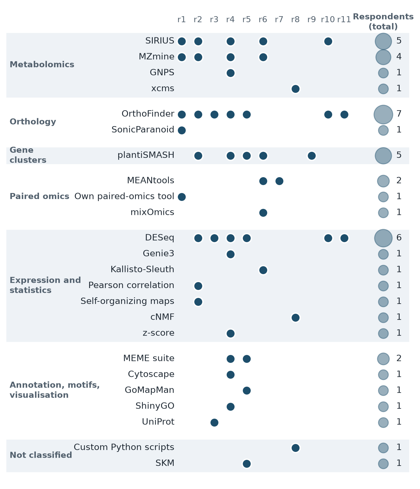
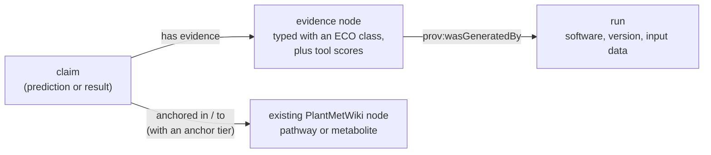
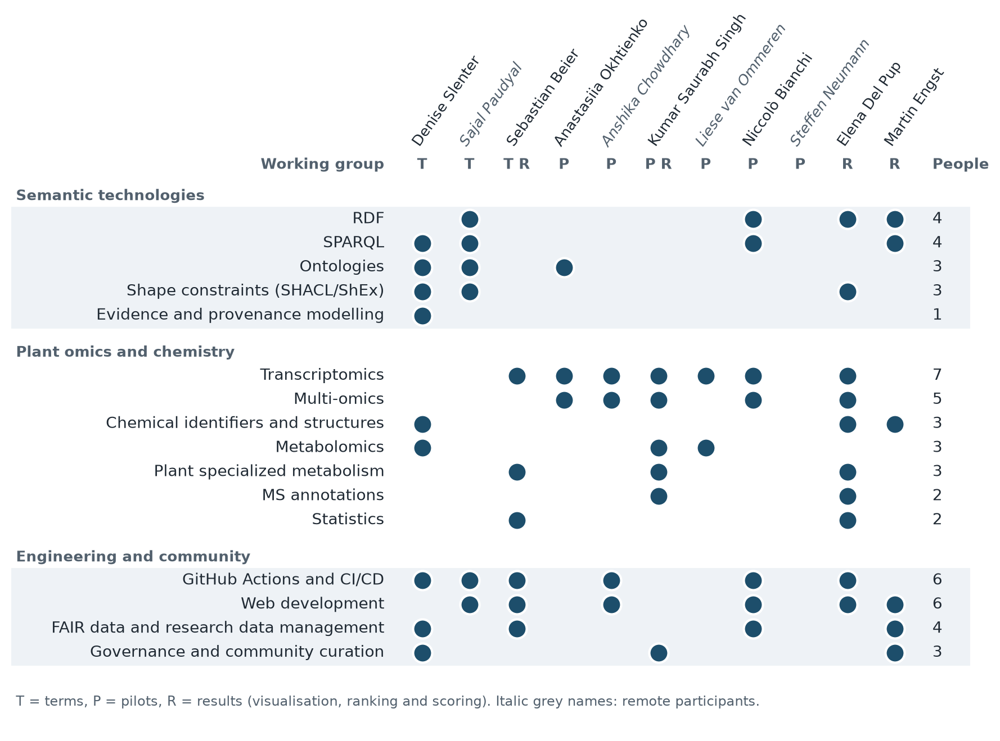

# Abstract 

Predictions of plant specialized metabolic pathways come from many pipelines that use different data, scores and formats, so they are hard to compare, combine or reuse. During BioHackathon Europe 2026, we laid the groundwork for a community-supported minimum information guideline that says what to record for each prediction or experimental result attached to a PlantMetWiki pathway, gene, enzyme or metabolite: a typed evidence statement, provenance (tool, version, input data) and how strongly it is anchored in the knowledge graph. We collected 119 requirements across three omics use cases (metabolomics, paired omics, and transcriptomics) and matched them to terms of existing ontologies. Gap terms are marked for requests to the maintainers of the existing ontologies or kept as placeholders in a local vocabulary. The model was expressed as RDF with SHACL shapes and applied to four pilots (91,926 triples, 4,884 claims). We built a browser-based viewer that validates, visualizes and scores the claims, and a browsable set of SPARQL queries that define evidence tiers and rank reactions, metabolites, and genes accordingly. These outcomes will enable scalable community annotation of pathways following minimum information guidelines, interoperable with existing standards, improved integration of multi-omics data with a community-supported validation schema, an evidence-based scoring method for the prioritization of candidate pathway components, and more reproducible and transparent multi-omics analyses.


# Introduction

Plant specialized metabolites are a major source of pharmaceuticals, food ingredients, crop protection compounds, and bio-based products [@citesAsAuthority:Huang2023]. Discovery of plant natural products depends on resolving the enzymatic routes that produce them, yet the biosynthesis of the majority remains uncharacterized [@citesAsAuthority:Owen2026]. The obstacle is that a single data modality usually does not provide clear enough information to discover a pathway. Extensive genome duplication distributes pathway genes across large, paralog-rich families that are only partially clustered, and the enzymes they encode are often catalytically promiscuous. The metabolic networks these enzymes form are highly branched, and biosynthetic enzymes are shared with primary metabolism [@citesAsAuthority:Ji2024]. Metabolomics adds a further difficulty: from the many metabolite features that an untargeted experiment detects, it is not straightforward to connect the relevant pathway intermediates and end-products.

Metabolomics, transcriptomics, and genome sequencing are now generating promising data that can be integrated with dedicated multi-omics analysis pipelines to address this gap [@citesAsAuthority:Wolters2024]. However, this evidence accumulates in domain-specific resources and individual publications that each capture one complementary facet of metabolism, such as enzymatic reactions, metabolite structures, or genomic context [@citesAsAuthority:Singh2022], and that are often curated to different standards and incompatible identifiers. Pathway resources such as the Plant Metabolic Network [@citesAsAuthority:Hawkins2025] are by design restricted to experimentally validated knowledge, and provide no mechanism for recording computational predictions, the evidence supporting them, or their confidence. Predictions are therefore published as static supplementary tables rather than as traceable assertions that can be compared across tools and revised with novel experimental evidence.

To make curated pathway knowledge reusable and machine-actionable, PlantMetWiki [@citesAsDataSource:DelPup2026PlantMetWiki] was developed as a semantically enriched and queryable knowledge graph dedicated to plant biosynthetic pathways, integrating experimentally validated pathway information across hundreds of plant taxa with existing ontologies, harmonized chemical annotations, and crosslinks to biosynthetic gene clusters predicted by plantiSMASH 2.0 [@citesAsDataSource:DelPup2026plantiSMASH] and experimentally validated in MIBiG 4.0 [@citesAsDataSource:Zdouc2025]. 

PlantMetWiki provides a foundation for FAIR data representation and reuse, but there is no open, standardized format for adding new experimental datasets to this curated pool, and no framework for linking computational evidence from bioinformatics tools and from paired transcriptomics-metabolomics experiments. Extending curated knowledge with traceable predictions requires a shared representation of entities, relations, evidence types, provenance, and confidence, and an evaluative framework that the field currently lacks.. Additionally, there is no framework to systematically link computational evidence from bioinformatics tools and paired plant transcriptomics-metabolomics datasets to predict or validate pathway-level knowledge.

In this report, we report the progress of BioHackathon Europe 2026 (9 - 14 November 2026, Barcelona), we here report about the progress of project 3 "Developing Open Standards for a Semantic Framework in Plant Specialized Metabolism" during the event. 

Our goals during BioHackathon Europe 2026, were :

1. Lay the groundwork for a community-supported minimum information guideline for the representation of predicted plant pathway knowledge, that is, define which information is key to share;
2. Design validation schemas to integrate experimental multi-omics datasets and predictions in alignment with this guideline;
3. Establish methods to align pathway-related predictions across bioinformatics pipelines, and approaches for scoring and prioritization of these predictions based on evidence strength, provenance, and community-defined criteria.


 Together, these render plant pathway knowledge FAIR and AI-ready, representing curated pathways, omics evidence, and scored predictions in a single machine-actionable graph. We hope that in future developments, our proposed workflow will be capable of supporting scalable community annotation, enabling AI-assisted discovery of plant specialized metabolic pathways through graph-based prioritization of candidate pathway components and the generation of experimentally testable biosynthetic hypotheses.


# Implementation

All work is open and lives in the repository [pathway-lod/lod-pathways-community](https://github.com/pathway-lod/lod-pathways-community): the specifications, the discussion workflow, the validation shapes, the pilots, and the generated outputs.

## Collecting Requirements from the Plant Multi Omics Community: Questionnaire to Plant Science Labs 

To ground the requirements in how the data are used, we asked researchers who generate plant omics data to fill in a questionnaire. As of 20 November 2026, fifteen people had answered; eleven of them, from ten institutions (academic groups and industry), also described the key research question or goal of their group, what they use to answer it (data types and analyses), and which bioinformatics tools they use. Thirteen answered the question of what they would like to ask a knowledge graph such as PlantMetWiki. The questions on goals, data and tools allowed several answers. 

Eight of the eleven respondents start from transcriptomics, and nine want to find candidate genes; eight want to reconstruct pathways, six to find or annotate metabolites and four to find enzymes (Figure \ref{figureSurvey}). Orthology is the next most common starting point (six respondents), followed by genomics and metabolomics (five each) and comparative pathway analysis (four); three use transcription factors and two gene clusters, and single respondents named knowledge graphs, mechanistic models and genome-scale metabolic models. Two respondents gave goals that are not about pathways, namely stress responses and improving cultivation conditions to increase the yield of natural products. The tools reflect the same picture (Figure \ref{figureTools}): OrthoFinder is named by seven respondents, DESeq by six, SIRIUS and plantiSMASH by five each and MZmine by four; paired-omics tools are named by three respondents (MEANtools by two, mixOmics by one and an in-house tool by one). Thirteen answers to the question of what to ask PlantMetWiki contained 17 questions. Most ask for genes or enzymes of a pathway or reaction step (five questions); others ask for comparisons of pathways and orthologs across species, for routes to a compound, for genes linked to a trait, a stress or a regulator, and for compounds (novel products, bioactivity, chlorinated products), three each, and for the physical clustering of genes (one). We use these questions as test cases for the evidence model. They also show needs that our current implementation framework does not yet cover, such as transcription factors, traits and regulation.


{ width=70% }

## The evidence model

Every prediction or experimental result is modelled in the same way, so that predictions of different kinds can be queried together. A *claim* (the prediction or result) has evidence (`sio:SIO_000772`), an evidence node typed with a class of the Evidence and Conclusion Ontology (ECO) [@citesAsAuthority:Nadendla2022] and carrying the scores of the tool; the evidence was generated by a *run* (software, version, input data) following PROV-O; and the claim is anchored in an existing PlantMetWiki node (pathway or metabolite) with an *anchor tier* that records how strongly it is tied to the knowledge graph (for example, a gene-level link is stronger than a link only through an EC number).



## Use cases to support

We defined seven use cases, each a type of data or prediction (for example a new pathway from the literature, biosynthetic gene clusters or paired omics) whose evidence can be linked to PlantMetWiki to extend the pathways with evidence from multi-omics information. Each has an acronym that is also the prefix of its requirement IDs in the specification (for example `PO-03` is the third requirement of the paired omics use case). During BioHackathon Europe 2026, we focused on use cases 4-6, but we used the other use cases as references for the discussion. Our GitHub repository offers a starting point (testing data and/or a README with documentation and instructions) for all of the use cases to support future work. 

\begingroup
\footnotesize

Table: Use cases supported by the framework, with the pilot dataset used to test each. Cases 5 and 6 are emphasized in our working list.

| # | Use case | Specification | Test data | Pilot |
| --- | --- | --- | --- | --- |
| 1 | New pathway from the literature | uses existing PlantMetWiki vocabulary | Ipecac alkaloid biosynthesis in two evolutionarily distant plants [@citesAsDataSource:Colinas2025] | `pilots/ipecac_overlap` |
| 2 | PlantCyc (PMN) inferred enzyme function | PMN | PlantCyc evidence codes on PlantMetWiki nodes [@citesAsDataSource:Hawkins2025] | `shape_constraints/rdf/plantcyc.ttl` |
| 3 | plantiSMASH-predicted biosynthetic gene clusters (BGCs) | BGC | plantiSMASH 2.0 precalculated database, about 30,400 BGCs in 430 genomes [@citesAsDataSource:DelPup2026plantiSMASH] | `pilots/plantismash_overlap` |
| 4 | **Transcriptomics** | TX | Tomato co-expression and expression profiles of Jeon et al. [@citesAsDataSource:Jeon2020] (also used in case 6), ATTED-II co-expression matrices [@citesAsDataSource:Obayashi2022] and Expression Atlas E-MTAB-11876 [@citesAsDataSource:Moreno2022] | `pilots/transcriptomics_overlap` |
| 5 | **Metabolomics** | MET | Brassicaceae metabolic fingerprinting [@citesAsDataSource:Wolters2026] | `pilots/metabolomics_overlap` |
| 6 | **Paired omics** (transcript–metabolite, transcript–protein, and protein–metabolite associations) | PO | Tomato data of Jeon et al. [@citesAsDataSource:Jeon2020], analyzed with MEANtools [@usesMethodIn:Singh2025MEANtools]; *Arabidopsis thaliana* heat-stress multi-omics dataset [@citesAsDataSource:Thirumalaikumar2026] | `pilots/pairedomics_overlap` (tomato); `pilots/pairedomics_overlap/arabidopsis_heat_stress` (Arabidopsis) |
| 7 | "Unsupervised" graph neural network (GNN) predictions of conversion steps | UN | PlantMetBench [@citesAsDataSource:DelPup2026PlantMetBench], a benchmark built on PlantMetWiki for enzyme-reaction link prediction (13,682 proteins, 2,741 genes, 4,577 metabolites, 11,980 curated enzyme-reaction pairs; organism-disjoint split) | `pilots/unsupervised_overlap` (planned: its README describes the test data and the proposed alignment, no code yet) |

\endgroup

## The pipeline

Our proposed workflow follows six steps, each with its own folder and documentation in the repository.

\begingroup
\footnotesize

Table: The six steps of the pipeline.

| Step | What happens | Where |
| --- | --- | --- |
| 1. Use cases | Choose the kinds of predictions and experimental data to align with PlantMetWiki, and what each needs to say | `specification/` |
| 2. Specification | For each use case: the requirements (what must be said), the candidate ontology terms and the gaps. One row per requirement and term in a table (`ontology_terms.csv`, the source of truth), the text in `SPECIFICATION.md`. Term IDs and labels are checked against the EBI Ontology Lookup Service (OLS) | `specification/` |
| 3. Community discussion | The table is shown as a web dashboard; discussion happens in GitHub issues; labels set by the repository maintainers (project members with triage or write access) turn decisions into pull requests (see below) | `.github/`, dashboard |
| 4. Shape constraints | The chosen terms become SHACL shapes that say what a statement must contain before it is added to the knowledge graph. Problems are either rejected (violations) or flagged (warnings) | `shape_constraints/` |
| 5. Pilots | Each use case is tried on a real dataset | `pilots/` |
| 6. Outputs | RDF (Turtle, Table \ref{tableTurtle}) validated against the shapes, a sample graph, the local vocabulary `lodp:` with placeholder terms for what no ontology provides (see "The specification dashboard"), and the terms to propose to larger ontologies | `shape_constraints/rdf/`, `examples/` |

\endgroup

## Pilots and generated Turtle files

Pilots with testing data and example turtle files were provided to the participants as described in table turtle. 

\begingroup
\footnotesize

Table: Turtle files generated for the project and available in the community repository (triples counted on the `main` branch). \label{tableTurtle}

| File | Content | Triples | Use |
| --- | --- | --- | --- |
| `shape_constraints/rdf/annotation.ttl` | metabolite annotation claims (use case MET) | 54,097 | testing, viewer |
| `shape_constraints/rdf/association.ttl` | paired-omics associations of the tomato data (use case PO) | 26,338 | testing, viewer |
| `shape_constraints/rdf/bgc.ttl` | BGC evidence of plantiSMASH clusters (use case BGC) | 7,284 | testing, viewer |
| `shape_constraints/rdf/plantcyc.ttl` | PlantCyc inferred evidence (use case PMN) | 4,207 | testing, viewer |
| `visualization_tool/public/data/all_pilots.ttl` | the four files above as one plain Turtle file; the default dataset of the viewer | 91,926 | viewer, SULO checks |
| `examples/sample_evidence_graph.ttl` | a small sample graph that conforms to the shapes | 152 | testing, documentation |
| `shape_constraints/shapes/*.ttl` | the SHACL shapes (common, annotation, association, bgc, plantcyc); copies in `visualization_tool/public/data/validation/` | n/a | validation, also in the browser |
| `shape_constraints/vocab/lodp.ttl` | the local vocabulary `lodp:` (67 terms) | 252 | validation (class hierarchy), viewer |
| `pilots/pairedomics_overlap/results/associations.ttl`, `pilots/plantismash_overlap/results/bgc_evidence.ttl` | earlier exports of the pilots, before `build_rdf.py` (drafts, superseded by the files above) | 47,803 and 6,496 | reference |

\endgroup


## The specification dashboard: how terms are discussed and approved

The specification is shown as an interactive dashboard at <https://pathway-lod.github.io/lod-pathways-community/>. It lists every requirement with its status, decision, owner and candidate terms, with filters by use case, decision, owner, action and ontology, and charts of the number of terms per ontology and of the coverage. Anyone can take part:

1. **Find a requirement** with the search box or the filters, and select its ID to see the candidate terms.
2. **Start a discussion** with the buttons on the requirement. They open a GitHub issue form that is already filled in: *ask a question*, *suggest a term*, or *propose a new requirement*. Issues carry the label `ontology-terms` and the requirement ID in the title (for example `[PMN-03]`).
3. **Take a requirement on** by ticking the volunteering box of the form, or ask a maintainer of the repository to assign the issue.
4. **Maintainers decide with labels.** `decision:agreed`, `decision:rejected`, `decision:proposed` or `decision:open` on an issue makes a GitHub Action open a pull request that changes the `decision` of that requirement in the table. The label `accept-term` on a term suggestion adds the term as a new row (its label and IRI are looked up in OLS) and `decision:rejected` marks only that suggested term as rejected.
5. **Review and merge.** Nothing reaches the main branch without a reviewed pull request. Only the maintainers, that is the people with triage or write access, can set labels, so only they can trigger a change. The issue text is read as data and is checked against the lists of the specification.
6. **The dashboard is regenerated** from the table when a pull request is merged, and the checks on every pull request keep the generated files and the table in sync.

Terms that no ontology provides are rows of the same table. While no suitable ontology term exists, the requirement uses a placeholder term of our local vocabulary `lodp:` (namespace `https://example.org/lod-pathways/pilot/`; 67 terms, 14 classes and 53 properties, of which 45 are rows of the term table), with the action `local_term`. Each local term has a label and a definition, is used in the shapes and in the pilot data, and is meant to be replaced when an existing ontology provides the term. When a term should be proposed to an existing ontology such as ECO, STATO, PSI-MS or EDAM [@citesAsAuthority:Ison2013EDAM], the action is `request_term`.

## How the candidate terms were found and checked

For each requirement we searched candidate terms in the Ontology Lookup Service (OLS4) through its search API (`https://www.ebi.ac.uk/ols4/api/search`). The query was a free-text phrase taken from the requirement (for example "co-expression", "mass error" or "area under the ROC curve"), usually restricted to one ontology (ECO, PSI-MS, EDAM, SIO [@citesAsAuthority:Dumontier2014SIO], STATO, SO, CHEMINF, CHMO, SWO, AIO, OBI and others), and we read the first four to six hits (identifier, label and sometimes the definition). The searches were run interactively from the command line with the help of an AI coding assistant (Claude Code), and the scripts were not kept. We reconstructed the phrases afterwards from the log of the working session: 223 distinct phrases in 12 rounds, which are listed in the file `specification/ols_search_phrases.csv` of the community repository (<https://github.com/pathway-lod/lod-pathways-community/blob/main/specification/ols_search_phrases.csv>). They are the starting point and do not have to match the final terms, because terms were also taken from other sources (the BioCyc evidence ontology for the PlantCyc evidence codes, the papers and supplementary tables of the pilot data sets) and many phrases led to no term or to a term that was not used. The hits were chosen by reading labels and definitions, and the role (primary, alternative, stand-in, local, gap) and coverage (exact, partial, none) of each term were set by hand. A requirement for which no candidate fits and no term can be taken from the data sources is a *gap*; it is given a placeholder term of our local vocabulary `lodp:`, as a *local* term, so that the pilots can already use it, or it is marked for a request to an existing ontology. The table was then reviewed manually by the project members and is revised by the community through the dashboard (issues, labels and reviewed pull requests, as described above).

The script `check_terms.py` of the repository keeps the term table consistent and generates everything derived from it. It uses only the Python standard library (`requests` for the online check). It performs four tasks:

1. **Validation** of the term table without network access: unique row identifiers; requirement identifiers that match their use case (for example `PMN-03`); allowed values for element type, role, coverage, decision and action; a valid CURIE whose prefix belongs to the named ontology; and the rules between columns (a gap has no term and coverage `none`; a local term belongs to the local vocabulary `lodp:` and has coverage `none`; primary and alternative terms have coverage `exact` or `partial`; a term appears once per requirement; `value_of` points to a term that is in the table).
2. **Online check** (`--online`): every term is looked up in OLS by an exact search on its identifier. A term that is not found or is obsolete is an error; a stored label that differs from the one in OLS is a warning. Vocabularies that are not in OLS (PROV-O, SKOS, Dublin Core Terms, RDF, WikiPathways, identifiers.org and our local vocabulary `lodp:`) are not looked up.
3. **Update** (`--update`): writes the label, IRI and date of the check of new or changed terms into the table, so that these columns come from OLS and not from typing.
4. **Rendering** (`--render`): regenerates the tables of the specification document and the dashboard from the table, and `--check-render` fails when a generated file is out of date.

GitHub Actions run these steps for every pull request and for every term suggestion that a maintainer accepts with a label, and regenerate the dashboard before it is published, so that the published specification always follows the term table.

The coverage of the requirements by the candidate terms can be seen in the dashboard and is summarized here (Figures \ref{figureOntologies} and \ref{figureCoverage}; the term table of 3 November 2026). The 158 distinct terms of the table come from 27 vocabularies. Of these, 45 are terms of our local vocabulary `lodp:`, and the other 113 come from 26 existing ontologies: ECO (26 terms), PSI-MS (24), STATO (14), EDAM (8), OBI and SIO (7 each); the remaining 20 ontologies contribute one to three terms each. Of the 119 requirements, 59 are covered by a term of an existing ontology, 19 partly and 41 are a gap. Metabolomics has the most requirements (31) and PlantCyc (PMN) the best coverage (10 of 14 covered), while half of the requirements of paired omics (PO) and of the unsupervised predictions (UN) are a gap. Of the 130 candidate terms from existing ontologies, 75 are an exact fit and 55 a partial fit; the 49 rows of local terms are the ones without a fit.

![Distinct terms of the specification per ontology, split by use case (PMN: PlantCyc inferred, BGC: gene clusters, MET: metabolomics, PO: paired omics, UN: unsupervised predictions, TX: transcriptomics, COM: shared by all). The bars count terms, not requirements: one requirement can have several candidate terms, and a term that is used by several use cases is counted once in each, so the bars of a use case add up to more than its number of requirements (for example MET: 31 requirements in Figure \ref{figureCoverage}A, 59 distinct terms) and the bars of an ontology can be longer than its number of distinct terms. The legend gives the number of requirements and of distinct terms of each use case; MS is the PSI-MS ontology. \label{figureOntologies}](./figures/ontology_terms_per_ontology.png)


## BioHackathon Europe Project 3 Working Groups

The work is organized in four groups, which correspond to the sections of the Results:

1. **Terms.** Discuss and curate the proposed terms and the gaps in the specification, and identify the terms to propose to an existing ontology.
2. **Pilots.** Test the alignment of the use case datasets with PlantMetWiki.
3. **Visualization and extraction of results.** Show what the aligned data say, and rank or score predictions.
4. **Submission system (optional).** Build and test an automated way to submit, integrate and approve new predictions, with decentralized governance.

Eleven people took part in the project: seven face-to-face at the BioHackathon and four remotely, one of them part time. They declared expertise in sixteen areas (Figure \ref{figureParticipants}). Semantic technologies were covered by RDF and SPARQL (four participants each), ontologies and shape constraints with SHACL or ShEx (three each) and evidence and provenance modelling (one). The plant omics and chemistry expertise was led by transcriptomics (seven) and multi-omics (five), followed by chemical identifiers and structures, metabolomics and plant specialized metabolism (three each), mass spectrometry annotation and statistics (two each). Engineering and community skills were GitHub Actions and CI/CD and web development (six each), FAIR data and research data management (four) and governance and community curation (three). Evidence and provenance modelling rests on one person, and mass spectrometry annotation and statistics on two, which shows where the project depends on few participants.

The participants joined the working groups according to this expertise (Table \ref{tableGroups}). Elena Del Pup, Denise Slenter, and Kumar Saurabh Singh co-led the project.

\begingroup
\footnotesize

Table: Working groups of the BioHackathon project and their participants (a participant can be in more than one group). \label{tableGroups}

| Working group | Participants |
| --- | --- |
| Terms | Denise Slenter, Sajal Paudyal, Sebastian Beier |
| Pilots | Genomics and transcriptomics: Niccolò Bianchi. Metabolomics: Liese van Ommeren, Kumar Saurabh Singh, Anshika Chowdhary, Steffen Neumann. Paired omics: Kumar Saurabh Singh, Anastasiia Okhtienko. |
| Visualization and extraction of results | Martin Engst, Kumar Saurabh Singh, Elena Del Pup, Sebastian Beier (partly) |
| Submission system | This was part of a collective discussion and brainstorming. |

\endgroup



# Results of the BioHackathon Europe 2026

The results of working groups were organized in three different objectives/topics: 

1. Ontology modelling: new proposed ontology terms and integrative ontology prototype with CI/CD  
2. Data integration and modelling: validation framework for transcriptomics, paired omics, and metabolite evidence 
3. Prioritization and querying: visualization tool for multi-omics evidence and scoring method prototype 
4. Reflections on the implementation of a submission system, governance, and integration with other repositories 

## 1. Ontology modelling: new proposed ontology terms and integrative ontology prototype with CI/CD  

This section describes how the terms of the specification were curated, mapped and tested. It reports the state of the term table (119 requirements, 188 candidate terms) and the terms that we intend to propose to existing ontologies, in particular where the gap analysis found no suitable term. It then shows how the requirements map to the ISA metadata framework, so that the sample, protocol and data-file information can be reused in public repositories. Finally, it describes the prototype of an integrative ontology built from existing resources: the steps of its development, the alignment of our local vocabulary (`lodp:`) and of the borrowed classes with the upper-level ontology SULO, and the automated checks (ROBOT and GitHub Actions) that keep the vocabulary consistent.

### Discussion and curation of proposed and gap ontology terms

As of 20 November 2026, the specification (`specification/ontology_terms.csv` in the community repository) covers six use cases (PMN, BGC, MET, PO, UN and TX) and a shared part that applies to all of them (COM). It has 119 requirements, described by 188 rows of candidate terms; the numbers are generated from the term table. Of these rows, 75 are a primary term, 37 an alternative, 18 a stand-in, 49 a local term (a term of the `lodp:` vocabulary) and 9 mark a gap where no term exists. At the level of the requirements, 59 of the 119 are covered by existing terms, 19 partly, and 41 are a gap. Most rows still wait for a decision (104 proposed, 82 open, 2 rejected). The dashboard keeps these numbers current and is the place where co-authors and the wider community discuss and approve the terms.

**Terms to propose to an existing ontology.** Seven requirements are marked `request_term`: for these we searched the Ontology Lookup Service and found no suitable term, and we intend to propose a term to an existing ontology (for example ECO, STATO, EDAM or PSI-MS) instead of keeping a local one. They are the evidence that transcript and metabolite abundances are correlated (PO-03) and that a spectral library match supports an annotation (MET-04), for which requests to ECO are drafted; the mutual rank of a gene pair (PO-06 and TX-16), for which a request to STATO is drafted; a crosswalk between PlantCyc evidence codes and ECO (PMN-12); the list of precursor masses excluded from fragmentation (MET-22); and the compound class of a proposed structure (MET-26). An example from the gap analysis is metabolite-transcript correlation evidence, for which `ECO:0007590` is only the closest term. 

### Mapping of the requirements to ISA

To reuse the data in other resources, we mapped the requirements of the specification to the ISA (Investigation, Study, Assay) metadata framework [@citesAsAuthority:Sansone2012], which MetaboLights and other EBI repositories use. The table `specification/isa/isa_mapping.csv` gives, for each requirement, the ISA-Tab file and field, the ISA-JSON path and how ISA covers it (Table \ref{tableISA}). It has 123 rows: the 119 requirements of the term table and four proposed rows for developmental stage and growth conditions (TX-23, TX-24, MET-32, MET-33).

\begingroup
\footnotesize

Table: How ISA covers the requirements of the specification. \label{tableISA}

| Coverage | Meaning | Rows |
| --- | --- | --- |
| `isa_field` | ISA has a field for it, for example `Characteristics[Organism]`, `Factor Value[...]` or `Study Assay Measurement Type` | 21 |
| `parameter` | ISA has no field for it; it goes into a `Parameter Value[...]` or `Comment[...]` of the protocol that produced the data | 22 |
| `data_file` | The values are inside a data file that ISA points to, such as a count matrix or a feature table | 22 |
| `assignment_file` | A column of the MetaboLights Metabolite Assignment File | 5 |
| `not_in_isa` | A claim or its evidence; it stays in the RDF evidence model | 53 |

\endgroup

ISA describes how the data were produced: the samples, the protocols, the assays and the data files. The requirements about samples, protocols and runs map to ISA. The requirements about claims and evidence do not, for example the attachment to PlantMetWiki, the anchor tier or the PlantCyc evidence codes. All 14 PlantCyc rows and 12 of the 16 BGC rows are `not_in_isa`. Of the 21 `isa_field` rows, 9 are metabolomics and 8 transcriptomics rows. Where ISA leaves the name of a characteristic open, we followed MetaboLights study MTBLS1039 and MIAPPE [@citesAsAuthority:Papoutsoglou2020]. Two gaps remain: ISA has no fixed field for software and its version, so we use protocol components and parameter values, and the Metabolite Assignment File has no column for the InChIKey or the adduct.

### Integrative Ontology Development

Instead of creating a new ontology from scratch, our team decided to build an integrative ontology from existing resources. This idea is built on previous work described in the eNanoMapper project [@citesAsAuthority:Hastings2015eNanoMapper], uses five ontology agents (Table \ref{tableAgents}), and follows the following steps for the technical implementation (Table \ref{tableImplementation}).

\begingroup
\footnotesize

Table: Ontology agents used to build the integrative ontology. \label{tableAgents}

| Number  | Agent Name | Purpose |
|-------|-----|------------|
| 1 | ontology-scoper  | Writes competency questions, sets the scope, lists the source resources to integrate, and recommends an upper-level ontology (e.g. BFO) and naming conventions   |
| 2  | term-reuse-scout  | Searches OLS through OAK before any new term is created; checks definitions and parents, and rates each match as exact, broad, narrow, related or none   |
| 3  | mapping-curator  | Maps terms across your source resources in SSSOM format [@usesMethodIn:Matentzoglu2022SSSOM], and flags conflicts |
| 4  | ontology-modeler  | Adds classes and axioms in OBO style, reusing existing terms, using ROBOT templates for bulk terms   |
| 5  | ontology-qc  | Runs the reasoner and the ROBOT quality report, checks OBO conventions and whether the competency questions are answered, and validates the SSSOM files |

\endgroup

\begingroup
\footnotesize

Table: Description of the technical implementation of the integrative ontology development. \label{tableImplementation}

| Number  | Title | Details |
|-------|-----|------------|
| 1 | Create a basis for supporting an integrative ontology | The Ontology Development Kit (ODK) [@usesMethodIn:Matentzoglu2022ODK] Docker image (obolibrary/odkfull, version: latest) was used to create the main structure for the integrative ontology following the Basic Formal Ontology (BFO) [@citesAsAuthority:Otte2022BFO]. The class hierarchy was manually inspected using Protege (v 5.6.9)  |
| 2  |  Integrate SULO to define the meaning of concepts | The Simplified Upper Level Ontology (SULO) [ref](https://ceur-ws.org/Vol-4176/foust-7.pdf) was used to create a layer between the formal ontology from BFO and expected future requests for new terms from domain experts. Mappings from SULO to BFO were integrated based on work described here [ref](https://github.com/AIDAVA-DEV/sulo/blob/main/docs/papers/FOUST2025/SULO_FOUST2025-as-published.pdf). Our local vocabulary `lodp:` and the classes used in the pilot data shared from established ontologies (ECO, SO and EDAM) were aligned to SULO, so that every class present in the pilot data has an established meaning outside the project. |
| 3 | Review ontologies to include | An integrative ontology requires decisions on the number of ontologies to include (the more different ones, the higher the maintenance load and the potential for conflicting statements). We asked how many ontologies are required to capture multi-omics evidence for plant metabolism, how complete each is, what the pros and cons of each are, and which restrictions are needed. |
| 4 | Check specific terms for inclusion | For the terms identified as candidate terms, we analyzed how well the match fits the description using the SKOS terminology. We also checked which other terms might be relevant, how the individual terms fit in the overall ontology, their availability in BioPortal, version history, clarity of the description, and the match to the described use cases. |
| 5 | Extract relevant terms and their parents automatically | For the alignment with SULO, the parents of the shared classes are already fetched by a script (`fetch_alignment.py`); ROBOT is planned for the integrated ontology, to extract the relevant terms and their parent terms from the source ontologies automatically. The ROBOT extraction is not implemented yet. |
| 6 | Create a GitHub CI/CD pipeline for ROBOT | GitHub Actions workflows check the local vocabulary `lodp:` and the borrowed terms whenever the specification changes (see "Continuous checks with ROBOT" below). |
| 7 | Create placeholders for missing terms | When no existing term fits a requirement, a placeholder term is defined in the local vocabulary `lodp:` (`shape_constraints/vocab/lodp.ttl`; 67 terms, 14 classes and 53 properties). Terms that exist in other ontologies are not redefined there. The namespace is a placeholder (`example.org`) until a permanent one is chosen, for example under w3id.org. The class hierarchy is used by the shapes, which target `lodp:Claim` and `lodp:Run`. Each placeholder is a candidate for replacement, or for a request to an existing ontology (action `local_term` or `request_term` in the term table); before a term is proposed, the ROBOT checks require a standard definition, a parent class and the ontology metadata. |

\endgroup

**Integrating SULO**

The pilots describe their results using the local vocabulary `lodp:` introduced above, whose terms are defined only within this project. A program that is unaware of these files cannot tell whether a claim is a physical thing, an event, or a piece of information. To state this, we placed each local term under a class or relation  of SULO, a small upper-level ontology with simple names. Claims and mass spectrometry features became information objects, tool runs were classified  as processes, and the relations that anchor a claim to a pathway or a metabolite became kinds of `refers to`. All the 14 classes of `lodp:` are mapped to SULO, and five of its eight object properties have a parent relation; the other three are not used in the pilots yet. The pilot data also uses 17 classes that are borrowed from ECO, SO, and EDAM. These ontologies were not mapped one by one. Each class was followed up the hierarchy of its ontology, and only the top class was placed in SULO i.e. evidence as an information object, a sequence feature as a spatial object and an operation as a process. Finding the shared classes, retrieving their parents and placing them is automated, so the manual work grows with the addition of ontologies rather than the number of terms. 

The alignment was checked against the rules of SULO (which classes exclude each other, and what can stand on either side of the relation as domain and range) and against all 91,926 triples of the pilots. All checks pass, and each one fails when intentional mistakes are introduced, for example when a claim is falsely classified as a process. With RDFS inference, a query only written in SULO terms finds 13,170 information objects, 57 spatial objects, and 9 processes in the pilot data; without the alignment it finds **none**. 

Three questions remain open. The first one is how values should be modeled. SULO allows one value per thing, but in the pilot data 9,461 of 13,236 nodes carry two or more values, for example, an anchor tier and a match level on the same annotation. Following the SOLID pattern set by SULO fully would turn every value into a small typed node of its own. Every evidence tier and score would then have a class that can be defined and linked to an existing ontology. The second question concerns the relations borrowed from the shared ontologies. They cannot be placed through their parents as the classes were, hence each relation needs its own decision. The third takes into account the nodes that the data refers to without a type, such as PlantMetWiki pathways and metabolites. They have no place in SULO until they are explicitly typed.

<!-- TODO: (1) the scripts of the SULO alignment are in shape_constraints/sulo_alignment on the branch sulo-alignment of the community repository, which is not merged into main yet: merge it, or cite the branch. -->


*Figure: Classes borrowed from ECO, SO and EDAM before (left) and after (right) the alignment to SULO. SULO classes are the orange nodes.*

**Continuous checks with ROBOT**

To check the consistency of the vocabulary and the shapes with external references whenever changes are added to the specification, GitHub Actions workflows were created. The first workflow runs ROBOT (`robot-checks.yml`) [@usesMethodIn:robot] on the local vocabulary `lodp:` whenever new shapes or specifications are added. The ROBOT check on the current vocabulary file identified three errors (no ontology title, description or license). It also identified 67 terms without a standard definition in the OBO-standard property (55 with an `rdfs:comment`, 12 without any description), and 3 terms without a superclass. The missing superclasses show where the vocabulary still needs to be placed under an upper-level ontology such as BFO, and the missing definitions must be added before any placeholder term can be proposed for inclusion in an established ontology such as ECO or PSI-MS. The second workflow (`borrowed-terms.yml`) identifies the terms that are borrowed from external ontologies and checks whether they are still in use or obsolete. A script (`list_borrowed_terms.py`), run on every pull request, collects the borrowed terms from all the Turtle files, after which ROBOT looks each one up in the current releases of the source ontologies (ECO, PSI-MS, SIO, EDAM, BFO, OBI, RO, SO, STATO and SWO). Of the 31 borrowed terms identified, 30 were found and are current. One term from the WikiPathways vocabulary could not be checked, because that vocabulary could not be loaded as an ontology. Both checks will be extended to the integrated ontology developed within the project, so that it is validated in the same way as the local vocabulary `lodp:`.

<!-- TODO: the workflows robot-checks.yml and borrowed-terms.yml and the script list_borrowed_terms.py were not found in the community repository or in this repository; add the location or push them. -->

## 2. Data integration and modelling: validation framework for transcriptomics, paired omics, and metabolite evidence 

Each pilot checks how much of a real dataset can be aligned with PlantMetWiki, and what evidence is available. The headline results are the following. Transcriptomics: 619 claims on 21 tomato genes, all valid against the SHACL shapes. Metabolomics: with strong evidence (a library match or a consensus of at least two tools), 139 of the 2,732 PlantMetWiki metabolites (5.1%) were detected, and 567 (20.8%) when every tier counts; 129 library-identified structures are not yet in PlantMetWiki. Paired omics: 311 of 3,406 clustered genes (9%) and 43 of 137 clustered features (31%) reach a PlantMetWiki pathway, but none of the 721 fully mapped gene-metabolite pairs shares a pathway, where about 5 are expected by chance.

- **Transcriptomics** (`pilots/transcriptomics_overlap`): differential expression (Expression Atlas E-MTAB-11876, jasmonate vs mock), response profiles and gene and pathway co-expression (the tomato expression matrix of Jeon et al. [@citesAsDataSource:Jeon2020], as used in MEANtools [@usesMethodIn:Singh2025MEANtools], and ATTED-II tomato matrices) of the 21 PlantMetWiki tomato genes with a Solyc locus, processed through [nf-core/rnaseq](https://github.com/nf-core/RNAseq) and [nf-core/differentialabundance](https://github.com/nf-core/differentialabundance) outputs; each claim is an RDF statement whose subject is the PlantMetWiki gene (or the PlantCyc pathway), with no anchor tier; 619 claims in the pilots (_i.e._ 19 differential-expression, 432 response-profile, 163 gene-pair and 5 pathway co-expression claims) were validated against the SHACL shapes (Figure \ref{figureTXcoexpression}).
- **Metabolomics** (`pilots/metabolomics_overlap`): LC-MS/MS annotations of 14 Brassicaceae species [@citesAsDataSource:Wolters2026] matched to PlantMetWiki metabolites on the first InChIKey block, with six evidence tiers from the GNPS library match [@usesMethodIn:Wang2016GNPS] to MS2Query analogues [@usesMethodIn:deJonge2023MS2Query]; the three annotation tools (SIRIUS [@usesMethodIn:Duhrkop2019SIRIUS], MS2Query and DreaMS [@usesMethodIn:Bushuiev2025DreaMS]) are combined in a consensus whose claims carry an agreement score (1.0 when all three tools agree on the structure, 0.5 when two do).
- **Paired omics** (`pilots/meantools_overlap`, `pilots/pairedomics_overlap/arabidopsis_heat_stress`): Gene-metabolite associations in the tomato data of Jeon et al. [@citesAsDataSource:Jeon2020], grouped into functional clusters by MEANtools [@usesMethodIn:Singh2025MEANtools], with genes mapped to PlantMetWiki pathways in three tiers (locus, UniProt, EC) and metabolite features by exact mass (MS1 only), compared against a chance background. An additional *Arabidopsis thaliana* heat-stress multi-omics pilot [@citesAsDataSource:Thirumalaikumar2026] evaluated Pearson-based transcript–protein, transcript–metabolite and protein–metabolite correlations across 22 matched samples, using tiered identifier mapping to PlantMetWiki/PlantCyc. Of 1,838 significant correlations, 57 had pathway mappings for both features. PlantCyc hierarchy and reaction comparisons identified three transcript–protein associations with shared pathway reactions despite different pathway IDs. Correlation statistics, mapping provenance and pathway assignments were preserved in RDF/Turtle exports.

### Transcriptomics experimental data modelling

The transcriptomics pilot tests the evidence model on measured –not predicted– data (details in Appendix A).

**Inputs:** Output files of two nf-core pipelines, [nf-core/rnaseq](https://github.com/nf-core/rnaseq) 3.27.0 and [nf-core/differentialabundance](https://github.com/nf-core/differentialabundance) 2.0.0 [@usesMethodIn:Ewels2020] are converted into RDF by dedicated `to_turtle.py` and `build_rdf.py` scripts. We used published datasets that were not processed with them (*i.e.* Expression Atlas results [@citesAsDataSource:Moreno2022], the RPKM matrix of the tomato data of Jeon et al. [@citesAsDataSource:Jeon2020], as used in MEANtools [@usesMethodIn:Singh2025MEANtools], ATTED-II co-expression matrices [@citesAsDataSource:Obayashi2022]) for testing, thus we first had to convert them in the same format as the outputs from the nf-core pipelines via `adapters.py`.

**Four statements:** Each claim is an `rdf:Statement` whose IRI is built from its 'subject-predicate-object' triple: a gene is differentially expressed in a contrast; a gene's expression deviates in a condition; two genes are correlated in expression, with the gene IRIs in alphabetical; and a pathway's genes are co-expressed more than random gene sets of the same size. One claim can be supported by several datasets, thus it will show as one node with several evidence nodes. Since the contrast or condition are the object of the triple, its details (_i.e._ treatment, plant structure, replicates) are statements on the claim –not separate nodes.

**Evidence and run:** For each dataset, the values are added as an ECO-typed evidence node [@citesAsAuthority:Nadendla2022], linked (`prov:wasGeneratedBy`) to a run node that holds the provenance (_i.e._ software, versions, parameters, input matrix and its unit, normalization method). Both are written by `to_turtle.py` from the tables and provenance files of four scripts:
- `export_differential.py` reads the [nf-core/differentialabundance](https://github.com/nf-core/differentialabundance) output folder (DESeq2 results [@usesMethodIn:Love2014], plus the parameters and versions in `pipeline_info/`);
- `coexpression_table.py`, `pathway_coexpression_table.py` and `expression_profile_table.py` read the expression matrix of [nf-core/rnaseq](https://github.com/nf-core/RNAseq) (`salmon.merged.gene_tpm.tsv` [@usesMethodIn:Patro2017]).

**Direction on the evidence:** The direction of the effect (_i.e._ over- or under-expressed, positively or negatively correlated, as RO relations) is an edge of the evidence node, not part of the claim. This is necessary so that when datasets disagree, it results on a warning for conflicting evidences based the shapes –instead of two opposite claims.

**Reference instead of anchor:** The claims refer directly to PlantMetWiki gene nodes, and to PlantCyc pathway ID nodes. They should **not** carry an anchor tier: the pathways and organism of a gene are found by queries. We added an exception in `common.ttl` for transcriptomics claims to pass without direct anchors.


### Paired-multi-omics Data Modelling

The *Arabidopsis thaliana* heat-stress case study [@citesAsDataSource:Thirumalaikumar2026] extended the paired-omics pilot beyond the original tomato MEANtools dataset. Transcriptomic, proteomic, and metabolomic measurements from 22 matched samples were integrated using Pearson and Spearman correlations. The resulting molecular associations were represented as evidence-supported connections between biological features, retaining correlation coefficients, significance measures, and association direction (positive or negative).

Molecular features were mapped to PlantMetWiki/PlantCyc using hierarchical identifier matching: AGI loci, UniProt accessions, and EC numbers for transcripts and proteins, and exact or connectivity-level InChIKeys for metabolites. Only the first successful mapping tier was retained, preserving all pathway assignments within that tier and their provenance. Associations were linked to pathway knowledge through PlantCyc identifiers. Of 1,838 significant Pearson correlations, 57 had pathway annotations for both features. To identify relationships beyond exact pathway matches, we extracted 295 parent–subpathway relationships and 5,199 pathway–reaction memberships from PlantCyc. Reaction-level comparison revealed three additional transcript–protein associations whose mapped pathways shared biochemical reactions despite having different pathway identifiers.

The pilot informed proposed extensions to the LODP paired-omics requirements (PO-01–PO-22). In particular, PO-04/15 should support explicitly typed quantitative metrics with defined scopes, accommodating correlation coefficients as well as factor loadings, explained variance, and network weights generated by methods such as MOFA and network-based integration. PO-11/12 should distinguish identifier-mapping provenance from pathway relationships, including exact matches, hierarchy, and shared reactions. Further requirements address pairwise and non-pairwise integration results, evidence direction, experimental conditions, timepoints, matched samples, statistical models, and computational provenance (PO-01/13, PO-16–20). These extensions remain to be implemented and evaluated against LODP SHACL constraints.

### Building Evidence from multi-omics studies in plant specialized metabolism (pilots/falcarindiol-evidence-pilot)

We contributed to the groundwork towards a minimum information guideline for representing predicted plant specialized metabolic pathways, that is, which information is key to share, focusing on how literature-derived knowledge, experimental evidence, and multi-omics predictions can be integrated into interoperable, machine-actionable knowledge graphs. Using falcarindiol biosynthesis in tomato as a representative case study, we developed an RDF-based framework connecting genes, proteins, metabolites, biochemical reactions, and scientific assertions to their supporting evidence and provenance. Particular emphasis was placed on distinguishing experimentally characterized enzymatic reactions, genetically supported pathway involvement, and computationally predicted functions. We reviewed the existing community ontology-term registry and proposed refinements and additional requirements covering evidence representation, uncertainty, biosynthetic gene clusters, co-expression, gene–metabolite associations, and temporal relationships, prioritizing established vocabularies such as ECO, PROV-O, STATO, and QUDT. To support the validation and integration of experimental multi-omics datasets and pathway predictions, we developed example Turtle/RDF representations and SHACL validation constraints aligned with the proposed requirements. These address biological identifiers, evidence provenance, statistical associations, temporal lag information, and the distinction between validated and hypothetical pathway relationships. SPARQL competency queries were developed to demonstrate how experimental findings and computational predictions can be retrieved and compared, while a preliminary GPML visualization illustrated the connection between pathway diagrams and semantic representations. A reproducible falcarindiol pilot was also prepared for the pathway-lod community repository, providing a practical example for testing and refining the proposed standards. Finally, we explored a claim-centric approach for aligning pathway-related predictions across bioinformatics pipelines, in which predictions of gene function, biochemical reactions, and gene–metabolite relationships can be associated with their originating analyses, datasets, methods, and supporting or conflicting evidence. This provides a conceptual foundation for comparing predictions from different computational workflows and developing future evidence-aware scoring and prioritization strategies based on evidence strength, provenance, statistical support, and community-defined criteria. Although a unified scoring framework remains to be developed and benchmarked, our work establishes reusable semantic representations, validation requirements, and a biological pilot that can support its future implementation. Together, these contributions help bridge the gap between heterogeneous pathway predictions and FAIR, transparent, and community-curated knowledge resources for plant specialized metabolism.

### Explicit Metabolite Annotation Ambiguity and Paired-Omics Interpretation Worksheet (integrate-annotation-ambiguity-changes)
We worked to make uncertainty in metabolite annotations explicit and provide a starting point for interpreting gene–metabolite correlations biologically. Connectivity-based annotations now record their InChIKey connectivity block, an unresolved identity status, and alternative candidate metabolites, preserving individual stereoisomers while making clear that multiple candidates do not represent separate confirmed detections. Updated SHACL constraints enforce consistent candidate mappings and prevent connectivity-only annotations from claiming resolved identity. An audit report identifies 303 multi-target annotations across 67 connectivity groups, while new SPARQL queries count observations by connectivity and label candidate-derived pathway links as possible support. For the paired-omics pilot, a curation worksheet consolidates repeated cluster memberships into 8,657 unique transcript–feature pairs: 7,512 positively correlated, 570 negatively correlated, and 575 without a recorded direct correlation. It retains statistics, mapping context, and candidate metabolite identities, alongside editable fields for proposed biological explanations, supporting references, rationale, and review status. Biological interpretations remain unassigned pending curation, and the worksheet is not yet exported into RDF. Documentation and regression tests accompany these changes; the updated annotation RDF validated with zero violations and five existing warnings.

### 2.1. Metabolomics Classes Modelling 

Within the Metabolomics pilot, the aim was to explore the NPClassifier classification [@usesMethodIn:Kim2021NPClassifier] for potential integration into [PlantMetWiki](https://plantmetwiki.bioinformatics.nl), by measuring the coverage of its three levels. 

NPClassifier classifies natural products based on their chemical structure using a deep neural network [@usesMethodIn:Kim2021NPClassifier]. NPClassifier developed its own ontology for classification, based on natural products found in plants, fungi, marine organisms, and microorganisms. The classification is performed on three levels: pathway (n=7), superclass (n=70) and class (n=672). A metabolite can be classified more than once on the same level, or not at all if there is not enough evidence.

**Inputs:** The PlantMetWiki generated in the Metabolomics pilot workflow is the data used as input for the coverage calculation. From there, InChIKeys were translated into SMILES to allow classification by NPClassifier.

**Workflow:** PlantMetWiki contains over 3000 metabolites as of 12 November 2026; of these metabolites, 2974 have an InChIKey annotation. As NPClassifier requires SMILES, the InChIKeys were first translated into SMILES notation. During this step, some InChIKeys could not be translated to SMILES using the PubChem database. All metabolites with a SMILES were then classified with NPClassifier v1.5 on all three levels.

**Results:** The percentages are shares of the 2,974 PlantMetWiki metabolites that have an InChIKey (100%). A metabolite counts as covered at a level when NPClassifier returned exactly one class for its structure at that level; metabolites with no SMILES, no answer or several classes at that level count as not covered. For 2,889 metabolites (97.1%) a SMILES was found (85 could not be translated). Figure \ref{figureNPC} shows the coverage across the three levels: 2,324 metabolites (78.1%) have a class at the broadest level (pathway), 2,178 (73.2%) at the superclass level and 1,953 (65.7%) at the most specific level (class). So most PlantMetWiki metabolites can be placed in an NPClassifier class, and the coverage decreases as the classification becomes more specific. Two choices of this first analysis make the coverage conservative. We wanted to retrieve one single class per level, so a metabolite with several classes at a level is counted as not covered, which understates the coverage. In addition, a request that timed out after 30 seconds was counted as having no class, so some of the metabolites that are not covered may be network failures. We did not record how many metabolites are affected by each. Counting them separately (for example the share that is classified and the share that is ambiguous) is a task for future work.

{ width=85% }

**Discussion and outlook:** Similarly to other chemical classification tools, NPClassifier uses its own ontology, with defined terms. Some of them correspond to terms of other resources, for example MIBiG [@citesForInformation:Zdouc2025], and some do not. A comparison of where the terms agree and disagree is still missing and needs to be expanded in the future, as does the integration of the NPClassifier terms into PlantMetWiki.

### Visualization tool

To facilitate exploration of claim-evidence data anchored to PlantMetWiki as well as the development of the evidence ontology we have built a browser-based viewer. It is part of the work repository (`visualization_tool/`, MIT license) and is published with its GitHub Pages site (<https://pathway-lod.github.io/lod-pathways-community/visualization_tool/>). Users can open their own Turtle file, that is then read and processed in the browser; the Turtle files of the pilots (Table \ref{tableTurtle}) are available as example data. Three central areas are covered by the viewer: the global view and the scoring (Figure \ref{figureScore}), the detail view (Figure \ref{figureDetail}) and the SHACL validation.

1. **Data connection to PlantMetWiki** A global view displays all claims of the file around a representation of PlantMetWiki [@citesAsDataSource:DelPup2026PlantMetWiki] built statically from a snapshot of PlantMetWiki SPARQL endpoint (release r17.0.0). The pathways the claims are anchored to are highlighted. Claims are linked based on their shared PlantMetWiki annotation, data point or source. Selections of nodes can further be opened in detail view. The claims can be filtered by different scoring methods linked to their evidence (see below and Figure \ref{figureScore}).
2. **Detailed visualization of the data** The detail view draws one card per resource, with literal values and types as rows and only links between resources as edges, in columns that follow the evidence model (runs, data and evidence, claims, PlantMetWiki). Clicking a card shows its Turtle and a selection of cards, or everything shown, can be exported as Turtle. The picture can be saved as PNG or SVG.

3. **SHACL violations** The viewer validates the opened file against the SHACL [@citesAsAuthority:SHACL2017] shapes of the repository directly in the browser and shows violations and warnings on the cards, including required properties that are missing. Claims are listed with violations first, then warnings. The validated data and the report can be saved together and reopened later.

The viewer is written in JavaScript with React Flow [@usesMethodIn:ReactFlow] for the detail view, Cytoscape.js [@usesMethodIn:Franz2016] for the global view and N3.js [@usesMethodIn:N3js] for parsing RDF. SHACL validation in the browser uses shacl-engine [@usesMethodIn:ShaclEngine], which evaluates SPARQL-based constraints with Comunica [@usesMethodIn:Taelman2018], the example data and the precomputed reports are built in Python with RDFLib [@usesMethodIn:RDFLib] and pySHACL [@usesMethodIn:pySHACL].

{ width=100% }

**Scoring of the claims.** The claims can be ranked by a strength metric that comes with their evidence, in the score panel of the global view (Figure \ref{figureScore}). Three metrics are implemented at present: the DreaMS similarity of the top hit of the metabolite annotations (1,798 claims), the confidence score reported by SIRIUS (its approximate-mode score, `ConfidenceScoreApproximate`; 585 claims) and the p-value of the omics feature abundance-based correlation between a gene and a metabolite, that is, the correlation of the abundance of the transcript and of the metabolite feature across samples (1,293 claims); each claim carries at most the metrics of its own evidence, so a claim passes only the metrics that apply to it. For the chosen metric the panel gives the property, whether higher or lower values are better, the theoretical range (marked as assumed when it is not defined by the method), the range and median in the file, and the number of claims with the score, together with a histogram of the values over the theoretical range. The user then sets a cut-off as the number of best claims (top 100 in the figure), the claims above the cut-off are circled in the global view around the pathways they are anchored to, and they can be opened in the detail view. The three metrics are not comparable and are not combined here; combining them is the aim of the scoring method described in Section 3.

{ width=100% }


## 3. Prioritization and querying: visualization tool for multi-omics evidence and scoring method prototype 

After modelling, generating the Turtle files (Table \ref{tableTurtle}) and validating them, we want to prioritise the modelled multi-omics results, that is, to decide which candidate metabolites, reactions and genes are best supported and should be tested experimentally first. 

### Prioritization framework 

Our prioritization framework has five steps:

1. define evidence tiers;
2. write queries that encode the tiers as optional branches, using also federated services;
3. query the new multi-omics graph together with PlantMetWiki;
4. score the resulting reactions, genes and metabolites;
5. rank them by score, for experimental validation.

We defined each kind of evidence as a *tier*, written as one SPARQL query that returns a pathway component (a metabolite, a reaction or a gene), its type, the pathway and the supporting evidence as metadata. Examples are an annotation match to a pathway metabolite, a gene listed in the pathway, two genes in the same biosynthetic gene cluster (BGC, the weakest gene tier) or a Rhea identifier on the reaction [@citesAsDataSource:Bansal2022Rhea]. The tiers model the evidence at the level of the graph, and some use federated services inside the query: PlantMetWiki (pathways, reactions, metabolites), Rhea (reaction participants), UniProt [@citesAsDataSource:UniProt2025] (enzymes), OrthoDB (orthologs) and the IDSM service [@usesMethodIn:Kratochvil2019IDSM] (chemical similarity to a pathway metabolite). 

### Modelling queries as graphs 

The evidence tiers of the prioritization are written as SPARQL queries and published as a browsable resource at <https://pathway-lod.github.io/sparql-examples-pmw/> (source: <https://github.com/pathway-lod/sparql-examples-pmw>). We modelled each query as a Turtle file with the SHACL vocabulary, following the template of the SIB sparql-examples collection [@usesMethodIn:Bolleman2025]. The landing page has two groups: the evidence tiers of PlantMetWiki (EC number, Rhea, UniProt, enzyme nodes, orthologs; folder `examples/PlantMetWiki`) and the 20 queries of the *minimum information tiers* (folder `examples/MinimumInformationTiers`), which define the levels of evidence for the results of the pilots: one file per tier and the three ranked queries `ranked-pathway-metabolites`, `ranked-pathway-reactions` and `ranked-pathway-genes`. Each file holds a description, the query itself, and keywords for what it uses (for example Rhea, co-expression, gene-metabolite association, biosynthetic gene cluster) and for the use case it belongs to, so that the tiers can be filtered by case or by data source. Every tier query returns the pathway components (reactions, metabolites or genes) that reach its level of evidence, with the putative pathway and the support as extra columns, and the ranked queries combine the tiers into the score described above. The resource demonstrates interoperable querying and visualization across PlantMetWiki and the multi-omics-supported predictions.

Because the tiers are queries over a graph, the levels of evidence and the connectivity layers they use can also be inspected. The page of each query shows the query as a graph: the variables, classes and properties of its triple patterns are drawn as nodes and labelled edges, the variables that the query returns are highlighted, and filters and bindings are shown as separate nodes, so that a reader can see which part of the evidence model a tier uses without reading the SPARQL. The same page offers the query to download as `.rq` or Turtle and lists where it can be used. In this way the tiers can be navigated as graphs and compared with the data model of the evidence graphs. Figures \ref{figureQueryLocal} and \ref{figureQueryFederated} show two examples, one query on the local evidence graph and one that calls a federated service.


![Graph view of the tier query `metabolite-similar-to-pathway-metabolite-idsm`, which calls a federated service. A detected metabolite (given by its SMILES) is searched in the IDSM Sachem service for similar ChEBI compounds (similarity of at least 0.9); the ChEBI identifier is then matched to the metabolites of PlantMetWiki, which gives the pathways. The two frames are the two endpoints. Colors as in Figure \ref{figureQueryLocal}; simplified from the generated graph (the string functions that build the identifiers are shown as one dotted link). \label{figureQueryFederated}](./figures/sparql_graph_idsm-federated.png)

The definitions of the tiers, the explanation of how to read the score, the draft weights and the notebooks that run all queries and keep their outputs are in the `minimum_information/` folder of the community repository ([lod-pathways-community](https://github.com/pathway-lod/lod-pathways-community/tree/main/minimum_information); `scoring.md` explains the score, `notebooks/05_ranked_components.ipynb` runs the ranked queries, `notebooks/weights.csv` holds the weights).

### Versioned example queries in PlantMetWiki 
In addition to the multi-omics evidence tier queries, also the 36 example queries of the PlantMetWiki SPARQL Explorer have been converted to Turtle files in the SIB sparql-examples format [@usesMethodIn:Bolleman2025]  (pull request #18 of pathway-lod/SPARQLQueries). Besides the query and its description, each file holds a persistent identifier (PMWQ001 to PMWQ036) with a resolvable IRI, the creators by ORCID, a creation date, a licence, a category, keywords and a version number. A CI job checks the files against a SHACL profile, runs them through the SIB test tools and publishes an index with every version of every query. A second pull request (#17 of pathway-lod/Snorql-UI) rebuilds the explorer as a thin configuration layer on the Snorql-UI engine that WikiPathways [@citesForInformation:Agrawal2024] and AOP-Wiki [@citesForInformation:Martens2022AOPWiki] also use. The explorer reads that index, shows the metadata next to each query, lets users pick an older version of a query, so that earlier versions can be retrieved and run again (the index keeps every version of every query), and opens a query from a link with its parameters filled in, for example from a tutorial. The tier queries in sparql-examples-pmw use the same SIB format and could be added to the explorer in the same way.

### Defining a scoring method 
 Tiers that are not independent are put in one *family*: a gene that is in a pathway and in a BGC with a partner also in that pathway is one piece of evidence, not two. A component takes the weight of the strongest tier it passes in each family, and the families are combined with a noisy-OR (Figure \ref{figureScoring}), so that a further independent family can only raise the score and the score never exceeds 1:

$$\mathrm{score} = 1 - \prod_{f}\,(1 - w_f), \qquad w_f = \max_{t \in f}\; w_t$$

For metabolites the identity weight is also multiplied by a support factor that depends on the number of annotation tools that agree (0.65 for one tool, 0.80 for two, 1.0 from three); this factor is computed by the ranked query and is separate from the agreement score of the consensus claims. One ranked query per scope (metabolites, reactions, genes) holds all tiers as optional branches, so a component keeps the evidence it has and none is required. The weights (Appendix B) are drafts to establish an ordering of the evidence, but they are not yet calibrated to reflect a probability.


### The Resulting ranked metabolites, genes, and reactions 
The three ranked queries were run on PlantMetWiki r17.0.0_20260605-171052 and the evidence graphs of the pilots (Table \ref{tableRanked}; run dates, row counts and run times in `minimum_information/notebooks/results/summary.csv`):

\begingroup
\footnotesize

Table: Results of the ranked queries (run on 2026-11-18). \label{tableRanked}

| Scope | Rows scored | Run time | What the evidence is |
|---|---|---|---|
| Metabolites | 3,688 metabolite-pathway pairs (492 metabolites, 674 pathways) | about 11 min | annotation matches of the metabolomics pilot (exact InChIKey or first block), a formula-layer proxy for structure similarity (934 pairs only by this tier) and IDSM similarity to the substrates of one pathway (19) |
| Reactions | 7,772 (all PlantMetWiki reactions): 1,062 with a UniProt enzyme (score 0.70 to 0.88), 592 with Rhea but no enzyme (0.60), 4,513 with EC only (0.40), 1,605 with none (0) | 2 s | Rhea identifier, EC number and UniProt enzyme of the reaction |
| Genes | 266 gene-pathway pairs (62 genes, 213 pathways) | about 2 min | the gene tiers of the pilot: locus (4 genes: GAME17 of tomato and three genes of the Arabidopsis cluster of the sample graph), UniProt entry (none), EC number of the gene (47 genes, weak), OrthoDB ortholog of a pathway enzyme (23 genes), and the genes of the tomato and Arabidopsis gene clusters |

\endgroup

Two worked examples: a reaction with an Rhea identifier (0.60) and a UniProt enzyme (0.70) in different families scores 1 - 0.40 x 0.30 = 0.88, and one with an EC number only scores 0.40; a gene in a pathway (0.90) that is also in a BGC with a partner (0.70) keeps 0.90, because both tiers belong to the same family. Changing all weights by up to 20% hardly changed the order (rank correlation above 0.99).

The model works end to end: the tiers are queries that run over the pilot graphs and PlantMetWiki, and every score can be traced to the list of tiers it comes from. For the reactions the ranking gives a result by itself: of the 7,772 reactions of PlantMetWiki, 1,062 (14%) have a UniProt enzyme (601 of them also with an Rhea identifier, 430 with an EC number only, 31 with the enzyme alone), 592 (8%) have an Rhea identifier without an enzyme, 4,513 (58%) only an EC number, and 1,605 (21%) none of the three. The 4,513 reactions with an EC number only and the 1,605 without evidence are the first candidates for curation or experimental validation. For metabolites, the ranking is only as strong as the annotation tools, and because the exact-InChIKey tier is inflated in the current annotation graph (it stores the PlantMetWiki key that the pilot matched) we do not claim a hit rate. For genes, the first version found almost nothing (12 rows) because the graph had only the Solyc locus of each gene and PlantMetWiki lists about 30 tomato genes by locus. After adding the UniProt entry, the EC numbers and the OrthoDB orthologs of the genes (supporting graphs of the pilot), 266 gene-pathway pairs are scored: 62 genes reach a pathway, most of them (111 pairs) only through an EC number (score 0.40, weak because an EC number is shared by many genes) or only through an ortholog of a pathway enzyme (0.50), 35 pairs through both (0.70), and 5 through the locus (0.90), among them the gene GAME17 of the alpha-tomatine pathway. We cannot yet say that a gene belongs to a pathway on this evidence alone, because the combined tier does not fire: none of the 721 fully mapped gene-metabolite pairs shares a PlantMetWiki pathway (the same result as the pilot, where about 5 are expected by chance), and only 6 of the 350 genes of the associations lie in a tomato biosynthetic gene cluster. Some tiers find nothing because their data are not in the graphs yet (chemical classes, similarity links, machine-learning predictions), so zero rows there say nothing about the biology; others return zero as a computed result and the notebooks document why.


## 4. Reflections on the implementation of a submission system, governance, and integration with other repositories 

### Reuse of data in public repositories

The ISA mapping separates the information that can go to a public repository (samples, protocols, runs and data files) from the information that stays in PlantMetWiki (claims and their evidence). A paired omics dataset described with our specification can therefore also be described in ISA-JSON. ISA-JSON is the metadata format of MARS (Multi-omics Adapter for Repository Submissions) [@usesMethodIn:MARS], a framework for submitting multi-omics studies to several EMBL-EBI repositories. Its command-line tool, MARS-CLI, submits the ISA-JSON and adds the accession numbers that the repositories return. At the time of writing, MARS has proof-of-concept adapters for BioSamples, ENA and MetaboLights, none of them deployed yet. MARS was started at BioHackathon Europe 2022 [@citesAsAuthority:DAnna2023]. BioHackathon Europe 2026 project #2, "Enhancing AI-readiness of multi-modal data submission: a reference workflow" [@citesForInformation:BHEU26Project2], builds a documented reference workflow for submission with MARS.

### Submission system 

Users can already interact with the discussion workflow of the specification (issue forms, labels and Actions that open pull requests). That is already an automated, reviewed way to approve *terms*, which passes through a reviewed pull request. In the future, we will work towards an automated system to submit new multiomics datasets, validate (against the SHACL shapes) and approve new *predictions*. A submission system will require further reflection on governance and the potential for decentralized governance [@citesForInformation:kuhn2026robust]: who may propose, who may approve, and how decisions are traced. During the BioHackathon, we investigated the potential use of Nanopublications. 


# Discussion


Our project expands the plant metabolism knowledge graph PlantMetWiki with predictions and experimental results from (multi-)omics plant science, which requires community-supported standards with feedback from the plant science community. We built an *evidence model* that says, for any prediction or experimental result attached to a PlantMetWiki pathway, enzyme, gene or metabolite, why it is believed (a typed evidence statement), where it comes from (tool, version, input data) and how strongly it is anchored in the knowledge graph. Users can then filter the graph by the kind of support behind a statement. The terms come from existing ontologies wherever possible; what no ontology provides is collected as candidates for new terms. The work produced a gap analysis of existing vocabularies, a draft minimum information specification expressed as an RDF data model (119 requirements in six use cases and a shared part), SHACL shapes that validate it, proof-of-concept datasets converted to Turtle (91,926 triples in four pilots) and linked to PlantMetWiki, a browser-based viewer that visualizes and scores their claims, and SPARQL queries that retrieve and rank candidate pathway components. Together they show an end-to-end workflow that connects pathway knowledge, metabolomics data, transcriptomics evidence and computational predictions within one semantic framework, following the Linked Open Data and FAIR principles [@citesForInformation:Agrawal2024].

The paired-omics use cases revealed gaps in both evidence classification and reporting requirements. Existing ECO terms do not clearly distinguish the cross-omics abundance associations considered here, motivating evaluation of a new term, provisionally named *cross-omics abundance association evidence*. At the same time, the LODP specification must accommodate methods producing different result structures and metrics: correlations generate molecular pairs and coefficients, MOFA produces latent factors, feature weights, and explained variance, while network approaches generate modules and connectivity scores. We therefore propose a common representation of integration results with method-specific, typed metrics linked to their appropriate scope, rather than a fixed set of correlation-related properties. Experimental conditions, matched samples, timepoints, preprocessing, and analysis parameters must remain traceable through the computational provenance. Where applicable, evidence direction should be represented separately from the biological assertion, distinguishing negative correlations, signed factor weights, and differential abundance effects without equating them with biological inhibition or activation.

We built a scoring framework for pathway prioritization and hypothesis generation. The predictions for the proof-of-concept species are mapped to a common semantic representation and aligned with experimental observations. The ranking of candidate components is transparent, because every score is the list of tiers passed and their weights, but it is not yet calibrated. A scoring framework that ranks candidates by evidence strength, completeness, provenance and reproducibility will be benchmarked using the experimentally validated pathways already curated in PlantMetWiki as ground truth. This gives a measure of whether evidence-based scoring adds discriminative power, and yields a prioritised list of candidate components pending experimental validation by the plant sciences community. 

## Limitations

The specification dashboard presents a proposal that will remain open for user input and discussions: 82 of the 188 rows of the term table are still marked as "proposed". The local `lodp:` terms are placeholders until the requested terms are accepted by the ontologies. The weights of the scoring tiers are drafts and the ranking has not been benchmarked. The pilots cover a few datasets and species, so how well the approach generalizes to other datasets and species is not yet tested. Any scoring and prioritization measure will be biased by what the omics technologies can measure (which depends on the experimental design, the instrument settings and the data processing) and by which pathways have been studied and curated so far. The evidence we model is also biased by its input data: what an omics experiment can detect depends on the experimental design, the instrument and its settings, the sample preparation and the data processing, so absent evidence for a pathway component does not mean that the component is absent, and the weights and scores inherit this bias. We record the experimental conditions and the provenance of every result so that the bias can be traced, but we do not correct for it. 


## Outlook

In the future, we hope that our workflow will establish minimum information guidelines for the representation of multi-omics evidence for pathway reconstruction. Other minimum information criteria in the natural product community are MIBiG [@citesAsDataSource:Zdouc2025] and MITE [@citesForInformation:Rutz2026]. Unlike these, our framework is built directly on a machine-actionable RDF-based model, so that the description can be validated, queried and visualized without conversion, and reuses terms of existing ontologies instead of defining a new vocabulary. The alignment of our Turtle files with SULO shows how the model relates to other upper-level resources.

We intend to submit the seven term requests of section 1 of the Results to the maintainers of the existing ontologies, mainly ECO and STATO, and to replace the local `lodp:` terms by the accepted ones in the specification and the shapes. The alignment with SULO and the ROBOT checks are to be added to the community repository. The viewer ranks claims by three strength metrics only (the DreaMS similarity, the approximate-mode confidence score of SIRIUS and the p-value of the abundance-based correlation of a gene and a metabolite); further scores that the tools report, such as the exact confidence score of SIRIUS, the model score of MS2Query and the mutual rank of the MEANtools correlations, still need to be implemented in the visualization tool. The minimum information guidelines will be released openly and registered on FAIRsharing [@citesAsAuthority:Wilkinson2016] to maximize visibility, reuse and long-term sustainability, and machine-actionable validation of multi-omics datasets (transcriptomics and metabolomics) is the next use of the shapes. Overall, the work contributes towards a FAIR and interoperable framework for integrating experimentally validated pathway knowledge, multi-omics evidence and computational predictions, enabling more reproducible and scalable discovery of plant specialized metabolic pathways.

## Funding 
Elena Del Pup and Denise Slenter were supported by the ELIXIR Europe BioHackathon travel grant as co-leaders. Kumar Saurabh Singh and Sajal Paudyal are supported by NWO Open Science NL fund (project nr. 500.040.2534). Marnix Medema's work on this project is funded by grant Netherlands Organization for Scientific Research (NWO), Vidi Grant VI.Vidi.213.183

## Acknowledgements
We thank Nicola Zamboni and Adriano Rutz (ETH) for supervising Elena Del Pup during the preparation of the BioHackathon and the writing of this report. We thank Panayiotis Smeros (SIB) for helping with the SIB SPARQL examples interface, and Dominik Martinát (Palacký University Olomouc) for pointing us to the documentation of the correct IDSM queries for the evidence tier queries. We also thank the other BioHackathon 2026 project participants for the feedback provided during the brainstorming and poster session, and ELIXIR Europe for selecting our project and supporting us with two travel grants for onsite participation.


```{=latex}
\AtEndDocument{%
```

# Appendices

## Appendix A: Transcriptomics pilot

The `pilots/transcriptomics_overlap` in `lod-pathways-community` covers the 21 PlantMetWiki tomato genes that carry a Solyc locus. Table \ref{tableTXclaims} shows its claims.

\begingroup
\footnotesize

Table: Claims of the transcriptomics pilot, with the datasets they come from. \label{tableTXclaims}

| Claim | Triple (subject, predicate, object) | Data | Claims | Evidence nodes |
|---|---|---|---|---|
| differential expression | gene `lodp:differentiallyExpressedIn` contrast | Expression Atlas E-MTAB-11876 [@citesAsDataSource:Moreno2022] (tomato hairy roots, 50 µM jasmonate vs untreated, 3 + 3 samples), processed in three ways: reads run with nf-core, Atlas counts rerun with nf-core, Atlas published results reshaped | 19 | 55 |
| response profile | gene `lodp:expressionDeviatesIn` condition | Tomato RPKM matrix of Jeon et al. [@citesAsDataSource:Jeon2020], as used in MEANtools [@usesMethodIn:Singh2025MEANtools], 27 conditions | 432 | 432 |
| gene co-expression | gene `RO:0002610` gene | MEANtools, ATTED-II `Sly-r.c6-0` [@citesAsDataSource:Obayashi2022] (1,608 RNA-seq runs), E-MTAB-11876 | 163 | 334 |
| pathway co-expression | PlantCyc pathway `rdf:type` `lodp:CoexpressedGenePathway` | MEANtools, ATTED-II | 5 | 10 |
| total | | | 619 | 831 |

\endgroup

The pilot keeps every result rather than filtering by significance –thus weak results are expected. The shapes accept them and flag them as warnings instead of rejecting them: validation of the transcriptomics pilot gives 0 violations and 1,009 warnings (_e.g._ z-score below 2, p-value greater or equal than 0.05, disagreement in direction).

Table \ref{tableTXterms} shows how the pilot uses each TX requirement of the specification, and the changes it suggests.

\begingroup
\footnotesize

Table: The 22 transcriptomics (TX) requirements in the pilot. \label{tableTXterms}

| Requirement | In the pilot | Suggested change |
|---|---|---|
| TX-01 RNA-seq assay | not used: the ECO class of the evidence (TX-02) states the assay | remove |
| TX-02 RNA-seq evidence | `ECO:0006069` on every evidence node; co-expression also `ECO:0007590` | add `ECO:0007590`, and `ECO:0007301` for microarrays |
| TX-03 raw read count | input unit of a DESeq2 run (`STATO:0000064`) | the term is defined for one count, not a matrix |
| TX-04 normalized value | input unit of the run (TPM or RPKM) | – |
| TX-05 normalization method | normalization method of a DESeq2 run (`STATO:0000590`) | `STATO:0000590` as the primary term |
| TX-06 z-score | response profile claims (gene `lodp:expressionDeviatesIn` condition) | state what the z-score is computed against |
| TX-07 differential expression method | run type; claims gene `lodp:differentiallyExpressedIn` contrast | – |
| TX-08 log2 fold change | on the evidence, unshrunken | state whether it is shrunken |
| TX-09 to TX-11 Wald statistic, lfcSE, baseMean | on the evidence | – |
| TX-12 adjusted p-value | on the evidence | note that the Expression Atlas `p-value` column is adjusted |
| TX-13 multiple-testing correction | run type `OBI:0200036` | – |
| TX-14 correlation | Pearson and Spearman on co-expression evidence; mean pairwise r for pathway claims | Spearman (`STATO:0000201`) as an accepted alternative |
| TX-15 two genes are co-expressed | claims gene `RO:0002610` (correlated with) gene | `RO:0002610` instead of `INO:0000231`, which is a process |
| TX-16 mutual rank | on co-expression evidence [@usesMethodIn:Obayashi2009] | state over which genes it is computed |
| TX-17 contrast | the claim’s object; test and reference condition stated on the claim | add a time point |
| TX-18 replicates | a replicate count on the claim (test and reference for a contrast) | ask for a count, not a class for samples |
| TX-19 plant structure | a PO term [@citesAsAuthority:Cooper2013] on the claim | name the property; hairy root has no PO term |
| TX-20 treatment | condition type treatment (`EFO:0000727`) on the claim | allow a control and the applied substance |
| TX-21 sequencing dataset | covered by `prov:used` on the run | remove |
| TX-22 gene identifiers | only needed to find the PlantMetWiki gene node | remove |

\endgroup

We decide that pathway claims should refer to the PlantCyc ID rather than the PlantMetWiki pathway number, because these numbers change between builds: α-tomatine biosynthesis is PC1159 in the snapshot of 2026-09-29 and PC968 on the live endpoint (2026-11-12), where PC1159 is now coenzyme A biosynthesis I.

## Appendix B: Tier weights of the ranked queries

Table \ref{tableWeights} gives the draft weights of the evidence tiers (see "3. Ranking and Scoring of Predictions"), generated from `minimum_information/notebooks/weights.csv`. "Live" marks tiers that are part of the ranked query on the endpoint; "Data" says whether the tier finds anything in the current data. The score is read as described in `minimum_information/scoring.md`. The last column gives the query that defines the tier, in `examples/MinimumInformationTiers` of sparql-examples-pmw. A tier that has no file of its own is a branch of the ranked query of its scope (`ranked-pathway-metabolites`, `-reactions` or `-genes`), where its family and weight are written in the comments; the standalone queries of the reaction tiers (EC, Rhea, UniProt) are in `examples/PlantMetWiki`.

\begingroup
\footnotesize

Table: Evidence tiers, families and draft weights of the ranked queries. \label{tableWeights}

| Scope | Family | Tier | Weight | Live | Data | Query file |
|---|---|---|---|---|---|---|
| metabolite | identity | inchikey-exact | 0.95 | yes | data | ranked-pathway-metabolites |
| metabolite | identity | inchikey-first-block | 0.80 | yes | data | ranked-pathway-metabolites |
| metabolite | relatedness | shared-chemical-class | 0.20 | yes | no data yet | shared-chemical-class |
| metabolite | relatedness | similarity-link | 0.40 | yes | no data yet | similarity-link |
| metabolite | relatedness | structure-similarity | 0.30 | yes | data (about 10 min) | structure-similarity |
| metabolite | relatedness | idsm-similar-metabolites-in-pathway | 0.50 | yes | data (pathway PC968 only) | idsm-similar-metabolites-in-pathway |
| metabolite | reaction | rhea-step-between-metabolites | 0.70 | no | too slow for the endpoint (60 s proxy limit) | rhea-step-between-metabolites |
| reaction | database identifiers | rhea | 0.60 | yes | data | ranked-pathway-reactions |
| reaction | database identifiers | ec | 0.40 | yes | data | ranked-pathway-reactions |
| reaction | enzyme | uniprot | 0.70 | yes | data | ranked-pathway-reactions |
| reaction | omics | gene-catalyses-the-transformation | 0.70 | yes | no data yet | gene-catalyses-the-transformation |
| reaction | omics | rhea-step-between-metabolites | 0.60 | no | too slow for the endpoint (60 s proxy limit) | rhea-step-between-metabolites |
| reaction | omics | idsm-similar-metabolite-with-coexpressed-catalysing-gene | 0.50 | no | example only | idsm-similar-metabolite-with-coexpressed-catalysing-gene |
| reaction | prediction | ml-predicted-reaction | 0.30 | yes | no data yet | ranked-pathway-reactions |
| gene | membership | gene-in-plantmetwiki-pathway | 0.90 | yes | data | gene-in-plantmetwiki-pathway |
| gene | membership | bgc-both-in-pathway | 0.70 | yes | data (sample graph) | ranked-pathway-genes |
| gene | membership | bgc-partner-in-pathway | 0.50 | yes | data (sample graph) | ranked-pathway-genes |
| gene | membership | genes-in-same-bgc | 0.30 | yes | data (sample graph) | genes-in-same-bgc |
| gene | omics | coexpressed-with-pathway-gene | 0.50 | yes | data | ranked-pathway-genes |
| gene | sequence | ortholog-in-pathway-species | 0.50 | yes | no data yet | ortholog-in-pathway-species |
| gene | omics | gene-and-metabolite-in-same-pathway | 0.60 | yes | no data yet | gene-and-metabolite-in-same-pathway |

\endgroup

```{=latex}
}
```
