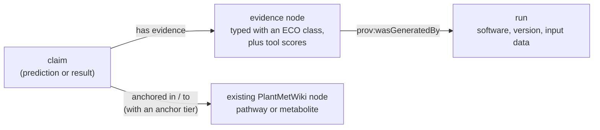
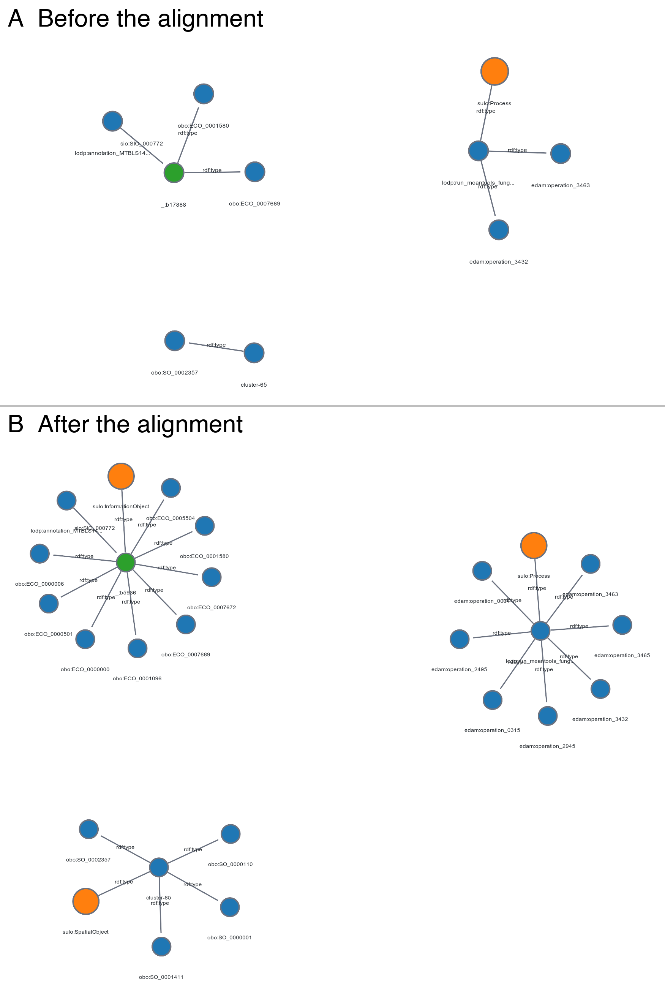
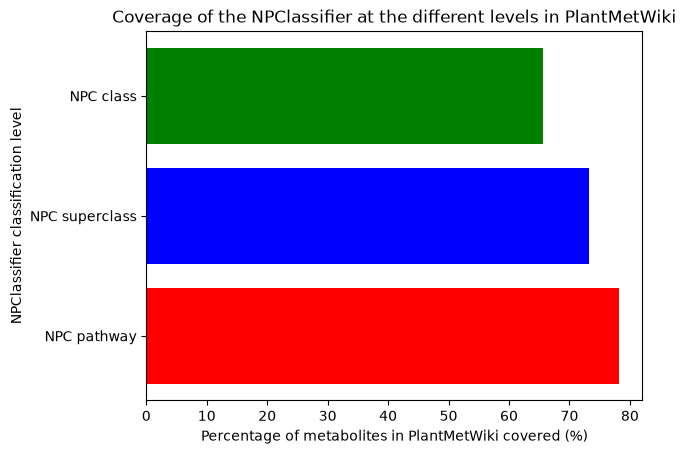
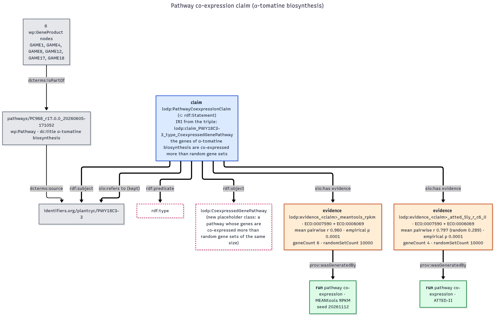

# Abstract 

Minimum Information guideline for the integration of pathway multi-omics evidence 

The work will deliver a community-supported validation schema for aligning and integrating multi-omics datasets, and an evidence-based scoring method for predictions from multi-omics pipelines, interoperable with existing standards.

These outcomes will enable scalable community annotation of pathway information, improved integration of multi-omics data, prioritization of candidate pathway components, and more reproducible and transparent bioinformatics analyses.


# Introduction

Plant specialized metabolites are a major source of pharmaceuticals, food ingredients, crop protection compounds, and bio-based products [@citesAsAuthority:Huang2023]. Discovery of plant natural products depends on resolving the enzymatic routes that produce them, yet the biosynthesis of the majority remains uncharacterized [@citesAsAuthority:Owen2026]. The obstacle is that plant pathways resist reconstruction from any single data modality: extensive genome duplication distributes pathway genes across large, paralog-rich families that are only partially clustered, the enzymes they encode are catalytically promiscuous, and the resulting networks are highly branched and biosynthesis enzymes are shared with primary metabolism [@citesAsAuthority:Ji2024].

Metabolomics, transcriptomics, and genome sequencing are now generating promising data that can be integrated with dedicated multi-omics analysis pipelines to address this gap [@citesAsAuthority:Wolters2024]. However, this evidence accumulates in domain-specific resources and individual publications that each capture one complementary facet of metabolism, such as enzymatic reactions, metabolite structures, or genomic context [@citesAsAuthority:Singh2022], and that are often curated to different standards and incompatible identifiers. Pathway resources such as the Plant Metabolic Network [@citesAsAuthority:Hawkins2025] are by design restricted to experimentally validated knowledge, and provide no mechanism for recording computational predictions, the evidence supporting them, or their confidence. Predictions are therefore published as static supplementary tables rather than as traceable assertions that can be compared across tools and revised with novel experimental evidence.

To make curated pathway knowledge reusable and machine-actionable, PlantMetWiki [@citesAsDataSource:DelPup2026PlantMetWiki] was developed as a semantically enriched and queryable knowledge graph dedicated to plant biosynthetic pathways, integrating experimentally validated pathway information across hundreds of plant taxa with existing ontologies, harmonized chemical annotations, and crosslinks to biosynthetic gene clusters predicted by plantiSMASH 2.0 [@citesAsDataSource:DelPup2026plantiSMASH] and experimentally validated in MIBiG 4.0 [@citesAsDataSource:Zdouc2025]. 

PlantMetWiki provides a foundation for FAIR data representation and reuse, but there is no open, standardized format for adding new experimental datasets to this curated pool, and no framework for linking computational evidence from bioinformatics tools and from paired transcriptomics-metabolomics experiments. Extending curated knowledge with traceable predictions requires a shared representation of entities, relations, evidence types, provenance, and confidence, and an evaluative framework that the field currently lacks.. Additionally, there is no framework to systematically link computational evidence from bioinformatics tools and paired plant transcriptomics-metabolomics datasets to predict or validate pathway-level knowledge.

In this report, we report the progress of BioHackathon Europe 2026, we here report about the progress of project 3 "Developing Open Standards for a Semantic Framework in Plant Specialized Metabolism" during the event. 

Our goals during BioHackathon Europe 2026, were :

1. Co-develop a community-supported Minimum Information Standard (MIS) for predicted plant pathway knowledge representation;
2. Design validation schemas to integrate experimental multi-omics datasets and predictions in alignment with the MIS;
3. Establish methods to align pathway-related predictions across bioinformatics pipelines, and approaches for scoring and prioritization of these predictions based on evidence strength, provenance, and community-defined criteria.


 Together, these render plant pathway knowledge FAIR and AI-ready, representing curated pathways, omics evidence, and scored predictions in a single machine-actionable graph. We hope that in future developments, our proposed workflow will be capable of supporting scalable community annotation, enabling AI-assisted discovery of plant specialized metabolic pathways through graph-based prioritization of candidate pathway components and the generation of experimentally testable biosynthetic hypotheses.

## Objectives


The project expands the plant metabolism knowledge graph PlantMetWiki with predictions from (multi-)omics plant knowledge coming from the community, which requires community-supported standards with feedback from the plant science community. We build an *evidence model* that says, for any prediction or experimental result attached to a PlantMetWiki pathway, enzyme, gene or metabolite, why it is believed (a typed evidence statement), where it comes from (tool, version, input data) and how strongly it is anchored in the knowledge graph. Users can then filter the graph by the kind of support behind a statement. The terms come from existing ontologies wherever possible; what no ontology provides is collected as candidates for new terms. 

# Implementation

All work is open and lives in the repository [pathway-lod/lod-pathways-community](https://github.com/pathway-lod/lod-pathways-community): the specifications, the discussion workflow, the validation shapes, the pilots, and the generated outputs.

## Collecting Requirements from the Plant Multi Omics Community: Questionnaire to Plant Science Labs 

To ground the requirements in how the data are used, we asked researchers who generate plant omics data to fill in a questionnaire. As of 20 November 2026, fifteen people had answered; eleven of them, from ten institutions (academic groups and industry), also described the key research question or goal of their group, what they use to answer it (data types and analyses), and which bioinformatics tools they use. Thirteen answered the question of what they would like to ask a knowledge graph such as PlantMetWiki. The questions on goals, data and tools allowed several answers. 

Eight of the eleven respondents start from transcriptomics, and nine want to find candidate genes; eight want to reconstruct pathways, six to find or annotate metabolites and four to find enzymes (Figure \ref{figureSurvey}). Orthology is the next most common starting point (six respondents), followed by genomics and metabolomics (five each) and comparative pathway analysis (four); three use transcription factors and two gene clusters, and single respondents named knowledge graphs, mechanistic models and genome-scale metabolic models. Two respondents gave goals that are not about pathways, namely stress responses and improving cultivation conditions to increase the yield of natural products. The tools reflect the same picture (Figure \ref{figureTools}): OrthoFinder is named by seven respondents, DESeq by six, SIRIUS and plantiSMASH by five each and MZmine by four; paired-omics tools are named by three respondents (MEANtools by two, mixOmics by one and an in-house tool by one). Thirteen answers to the question of what to ask PlantMetWiki contained 17 questions. Most ask for genes or enzymes of a pathway or reaction step (five questions); others ask for comparisons of pathways and orthologs across species, for routes to a compound, for genes linked to a trait, a stress or a regulator, and for compounds (novel products, bioactivity, chlorinated products), three each, and for the physical clustering of genes (one). We use these questions as test cases for the evidence model. They also show needs that our current implementation framework does not yet cover, such as transcription factors, traits and regulation.


{ width=70% }

## The evidence model

Every prediction or experimental result is modelled in the same way, so that predictions of different kinds can be queried together. A *claim* (the prediction or result) has evidence (`sio:SIO_000772`), an evidence node typed with a class of the Evidence and Conclusion Ontology (ECO) and carrying the scores of the tool; the evidence was generated by a *run* (software, version, input data) following PROV-O; and the claim is anchored in an existing PlantMetWiki node (pathway or metabolite) with an *anchor tier* that records how strongly it is tied to the knowledge graph (for example, a gene-level link is stronger than a link only through an EC number).



## Use cases to support

We defined seven use cases, each a type of data or prediction (for example a new pathway from the literature, biosynthetic gene clusters or paired omics) whose evidence can be linked to PlantMetWiki to extend the pathways with evidence from multi-omics information. Each has an acronym that is also the prefix of its requirement IDs in the specification (for example `PO-03` is the third requirement of the paired omics use case). During BioHackathon Europe 2026, we focused on use cases 4-6, but we used the other use cases as references for the discussion. Our GitHub repository offers a starting point (testing data and/or a README with documentation and instructions) for all of the use cases to support future work. 

\begingroup
\footnotesize

Table: Use cases supported by the framework, with the pilot dataset used to test each. Cases 5 and 6 are emphasised in our working list.

| # | Use case | Specification | Test data | Pilot |
| --- | --- | --- | --- | --- |
| 1 | New pathway from the literature | not yet a use case of its own | Ipecac alkaloid biosynthesis in two evolutionarily distant plants [@citesAsDataSource:Colinas2025] | `pilots/ipecac_overlap` |
| 2 | PlantCyc (PMN) inferred enzyme function | PMN | PlantCyc evidence codes on PlantMetWiki nodes [@citesAsDataSource:Hawkins2025] | `shape_constraints/rdf/plantcyc.ttl` |
| 3 | plantiSMASH-predicted biosynthetic gene clusters (BGCs) | BGC | plantiSMASH 2.0 precalculated database, about 30,400 BGCs in 430 genomes [@citesAsDataSource:DelPup2026plantiSMASH] | `pilots/plantismash_overlap` |
| 4 | **Transcriptomics** | TX | covered inside the paired data of cases 1 and 6 | no separate pilot |
| 5 | **Metabolomics** | MET | Brassicaceae metabolic fingerprinting [@citesAsDataSource:Wolters2026] | `pilots/metabolomics_overlap` |
| 6 | **Paired omics** (transcript–metabolite, transcript–protein, and protein–metabolite associations) | PO | Tomato data of Jeon et al. [@citesAsDataSource:Jeon2020], analysed with MEANtools [@usesMethodIn:Singh2025MEANtools]; *Arabidopsis thaliana* heat-stress multi-omics dataset [@citesAsDataSource:Thirumalaikumar2026] | `pilots/pairedomics_overlap` (tomato); `pilots/pairedomics_overlap/arabidopsis_heat_stress` (Arabidopsis) |
| 7 | "Unsupervised" graph neural network (GNN) predictions of conversion steps | UN | none yet | none |

\endgroup

## BioHackathon Europe Project 3 Working Groups

The work is organised in four groups, which correspond to the sections of the Results:

1. **Terms.** Discuss and curate the proposed terms and the gaps in the specification, and identify the terms to propose to an existing ontology.
2. **Pilots.** Test the alignment of the use case datasets with PlantMetWiki.
3. **Visualization and extraction of results.** Show what the aligned data say, and rank or score predictions.
4. **Submission system (optional).** Build and test an automated way to submit, integrate and approve new predictions, with decentralised governance.

The expertise of the participants 

## The pipeline

The work follows six steps, each with its own folder and documentation in the repository.

Table: The six steps of the pipeline.

| Step | What happens | Where |
| --- | --- | --- |
| 1. Use cases | Choose the kinds of predictions and experimental data to align with PlantMetWiki, and what each needs to say | `specification/` |
| 2. Specification | For each use case: the requirements (what must be said), the candidate ontology terms and the gaps. One row per requirement and term in a table (`ontology_terms.csv`, the source of truth), the text in `SPECIFICATION.md`. Term IDs and labels are checked against the EBI Ontology Lookup Service (OLS) | `specification/` |
| 3. Community discussion | The table is shown as a web dashboard; discussion happens in GitHub issues; maintainers' labels turn decisions into pull requests (see below) | `.github/`, dashboard |
| 4. Shape constraints | The chosen terms become SHACL shapes that say what a statement must contain before it is added to the knowledge graph. Problems are either rejected (violations) or flagged (warnings) | `shape_constraints/` |
| 5. Pilots | Each use case is tried on a real dataset | `pilots/` |
| 6. Outputs | RDF (Turtle) validated against the shapes, a sample graph, a local placeholder vocabulary (`lodp:`) for terms that no ontology provides, and the terms to propose to larger ontologies | `shape_constraints/rdf/`, `examples/` |

## The specification dashboard: how terms are discussed and approved

The specification is shown as an interactive dashboard at <https://pathway-lod.github.io/lod-pathways-community/>. It lists every requirement with its status, decision, owner and candidate terms, with filters by use case, decision, owner, action and ontology, and charts of the number of terms per ontology and of the coverage. Anyone can take part:

1. **Find a requirement** with the search box or the filters, and select its ID to see the candidate terms.
2. **Start a discussion** with the buttons on the requirement. They open a GitHub issue form that is already filled in: *ask a question*, *suggest a term*, or *propose a new requirement*. Issues carry the label `ontology-terms` and the requirement ID in the title (for example `[PMN-03]`).
3. **Take a requirement on** by ticking the volunteering box of the form, or ask a maintainer to assign the issue.
4. **Maintainers decide with labels.** `decision:agreed`, `decision:rejected`, `decision:proposed` or `decision:open` on an issue makes a GitHub Action open a pull request that changes the `decision` of that requirement in the table. The label `accept-term` on a term suggestion adds the term as a new row (its label and IRI are looked up in OLS) and `decision:rejected` marks only that suggested term as rejected.
5. **Review and merge.** Nothing reaches the main branch without a reviewed pull request. Only people with triage or write access can set labels, so only they can trigger a change. The issue text is read as data and is checked against the lists of the specification.
6. **The dashboard is regenerated** from the table when a pull request is merged, and the checks on every pull request keep the generated files and the table in sync.

Terms that no ontology provides are rows of the same table, with the action `local_term` while a local placeholder is used and `request_term` when a term should be proposed to an existing ontology such as ECO, STATO, PSI-MS or EDAM.

## How the candidate terms were found and checked

For each requirement we searched candidate terms in the Ontology Lookup Service (OLS4) through its search API (`https://www.ebi.ac.uk/ols4/api/search`). The query was a free-text phrase taken from the requirement (for example "co-expression", "mass error" or "area under the ROC curve"), usually restricted to one ontology (ECO, PSI-MS, EDAM, SIO, STATO, SO, CHEMINF, CHMO, SWO, AIO, OBI and others), and we read the first four to six hits (identifier, label and sometimes the definition). The searches were run interactively from the command line with the help of an AI coding assistant (Claude Code), and the scripts were not kept. We reconstructed the phrases afterwards from the log of the working session: 223 distinct phrases in 12 rounds (Appendix B). They are the starting point and do not have to match the final terms, because terms were also taken from other sources (the BioCyc evidence ontology for the PlantCyc evidence codes, the papers and supplementary tables of the pilot data sets) and many phrases led to no term or to a term that was not used. The hits were chosen by reading labels and definitions, and the role (primary, alternative, stand-in, local, gap) and coverage (exact, partial, none) of each term were set by hand. The table was then reviewed manually by the project members and is revised by the community through the dashboard (issues, labels and reviewed pull requests, as described above).

The script `check_terms.py` of the repository keeps the term table consistent and generates everything derived from it. It uses only the Python standard library (`requests` for the online check). It performs four tasks:

1. **Validation** of the term table without network access: unique row identifiers; requirement identifiers that match their use case (for example `PMN-03`); allowed values for element type, role, coverage, decision and action; a valid CURIE whose prefix belongs to the named ontology; and the rules between columns (a gap has no term and coverage `none`; a local term belongs to the local vocabulary and has coverage `none`; primary and alternative terms have coverage `exact` or `partial`; a term appears once per requirement; `value_of` points to a term that is in the table).
2. **Online check** (`--online`): every term is looked up in OLS by an exact search on its identifier. A term that is not found or is obsolete is an error; a stored label that differs from the one in OLS is a warning. Vocabularies that are not in OLS (PROV-O, SKOS, Dublin Core Terms, RDF, WikiPathways, identifiers.org and our local placeholder vocabulary) are not looked up.
3. **Update** (`--update`): writes the label, IRI and date of the check of new or changed terms into the table, so that these columns come from OLS and not from typing.
4. **Rendering** (`--render`): regenerates the tables of the specification document and the dashboard from the table, and `--check-render` fails when a generated file is out of date.

GitHub Actions run these steps for every pull request and for every term suggestion that a maintainer accepts with a label, and regenerate the dashboard before it is published, so that the published specification always follows the term table.

# Results of the BioHackathon Europe 2026

## 1. Discussion and curation of proposed and gap terms

At the time of writing the specification has seven use cases and 119 requirements, described by 188 rows of candidate terms (TODO: update the numbers before submission; they are generated from `ontology_terms.csv`). Of these rows, 75 are a primary term, 37 an alternative, 18 a stand-in, 49 a local term and 9 mark a gap where no term exists. Most requirements still wait for a decision (104 rows proposed, 82 open, 2 rejected). The dashboard makes these numbers current, and is the place where co-authors and the wider community discuss and approve the terms.

**Terms to propose to an existing ontology.** Seven requirements are marked `request_term`: for these we have searched OLS and found no suitable term, and we intend to propose one to an existing ontology (for example EDAM, ECO, STATO or PSI-MS) instead of keeping a local term. An example is metabolite-transcript correlation evidence, for which `ECO:0007590` is only the closest term. TODO: list the final terms to propose, the ontology and the status of each request.

### Mapping of the requirements to ISA

To reuse the data in other resources, we mapped the requirements of the specification to the ISA (Investigation, Study, Assay) metadata framework [@citesAsAuthority:Sansone2012], which MetaboLights and other EBI repositories use. The table `specification/isa/isa_mapping.csv` gives, for each requirement, the ISA-Tab file and field, the ISA-JSON path and how ISA covers it (Table XX \ref{tableISA}. It has 123 rows: the 119 requirements of the term table and four proposed rows for developmental stage and growth conditions (TX-23, TX-24, MET-32, MET-33).

Table XX: How ISA covers the requirements of the specification. \label{tableISA}

| Coverage | Meaning | Rows |
| --- | --- | --- |
| `isa_field` | ISA has a field for it, for example `Characteristics[Organism]`, `Factor Value[...]` or `Study Assay Measurement Type` | 21 |
| `parameter` | ISA has no field for it; it goes into a `Parameter Value[...]` or `Comment[...]` of the protocol that produced the data | 22 |
| `data_file` | The values are inside a data file that ISA points to, such as a count matrix or a feature table | 22 |
| `assignment_file` | A column of the MetaboLights Metabolite Assignment File | 5 |
| `not_in_isa` | A claim or its evidence; it stays in the RDF evidence model | 53 |

ISA describes how the data were produced: the samples, the protocols, the assays and the data files. The requirements about samples, protocols and runs map to ISA. The requirements about claims and evidence do not, for example the attachment to PlantMetWiki, the anchor tier or the PlantCyc evidence codes. All 14 PlantCyc rows and 12 of the 16 BGC rows are `not_in_isa`. Of the 21 `isa_field` rows, 9 are metabolomics and 8 transcriptomics rows. Where ISA leaves the name of a characteristic open, we followed MetaboLights study MTBLS1039 and MIAPPE [@citesAsAuthority:Papoutsoglou2020]. Two gaps remain: ISA has no fixed field for software and its version, so we use protocol components and parameter values, and the Metabolite Assignment File has no column for the InChIKey or the adduct.

### Integrative Ontology Development

Instead of creating a new ontology from scratch, our team decided to build an integrative ontology from existing resources. This idea is built on previous work described in the eNanoMapper project [[ref](https://doi.org/10.1186/s13326-015-0005-5)], uses five ontology agents (Table X), and follows the following steps for the technical implementation (Table Y).

Table X: Ontology agents used to build the integrative ontology

| Number  | Agent Name | Purpose |
|-------|-----|------------|
| 1 | ontology-scoper  | Writes competency questions, sets the scope, lists the source resources to integrate, and recommends an upper-level ontology (e.g. BFO) and naming conventions   |
| 2  | term-reuse-scout  | Searches OLS through OAK before any new term is created; checks definitions and parents, and rates each match as exact, broad, narrow, related or none   |
| 3  | mapping-curator  | Maps terms across your source resources in SSSOM format, and flags conflicts |
| 4  | ontology-modeler  | Adds classes and axioms in OBO style, reusing existing terms, using ROBOT templates for bulk terms   |
| 5  | ontology-qc  | Runs the reasoner and the ROBOT quality report, checks OBO conventions and whether the competency questions are answered, and validates the SSSOM files |

Table Y: Description of technical implementation of the integrative ontology development

| Number  | Title | Details |
|-------|-----|------------|
| 1 | Create a basis for supporting an integrative ontology | The Ontology Development Kit (ODK) [ref](https://doi.org/10.1093/database/baac087) Docker image (obolibrary/odkfull, version: latest) was used to create the main structure for the integrative ontology following the Basic Formal Ontology (BFO) [ref](https://doi.org/10.3233/AO-220262). The class hierarchy was manually inspected using Protege (v 5.6.9)  |
| 2  |  Integrate SULO to define the meaning of concepts | The Simplified Upper Level Ontology (SULO) [ref](https://ceur-ws.org/Vol-4176/foust-7.pdf) was used to create a layer between the formal ontology from BFO and expected future requests for new terms from domain experts. Mappings from SULO to BFO were integrated based on work described here [ref](https://github.com/AIDAVA-DEV/sulo/blob/main/docs/papers/FOUST2025/SULO_FOUST2025-as-published.pdf). The local vocabulary `lodp` and the classes used in the pilot data shared from established ontologies (ECO, SO and EDAM) were aligned to SULO, so that every class present in the pilot data has an established meaning outside the project. |

**Integrating SULO**

The pilots describe their results using a local vocabulary (`lodp:`) whose terms are defined only within this project. A program that is unaware of these files cannot tell whether a claim is a physical thing, an event, or a piece of information. To state this, we placed each local term under a class or relation  of SULO, a small upper-level ontology with simple names. Claims and mass spectrometry features became information objects, tool runs were classified  as processes, and the relations that anchor a claim to a pathway or a metabolite became kinds of `refers to`. All the 14 classes used in `lodp` are mapped to SULO and five out of eight local relations have a parent relation and the other three are not used across the pilot yet. The pilot data also uses 17 classes that are borrowed from ECO, SO, and EDAM. These ontologies were not mapped one by one. Each class was followed up the hierarchy of its ontology, and only the top class was placed in SULO i.e. evidence as an information object, a sequence feature as a spatial object and an operation as a process. Finding the shared classes, retrieving their parents and placing them is automated, so the manual work grows with the addition of ontologies rather than the number of terms. 

The alignment was checked against the rules of SULO (which classes exclude each other, and what can stand on either side of the relation as domain and range) and against all 91,926 triples of the pilots. All checks pass, and each one fails when intentional mistakes are introduced, for example when a claim is falsely classified as a process. With RDFS inference, a query only written in SULO terms finds 13,172 information objects, 57 spatial objects, and 9 processes in the pilot data; without the alignment it finds **none**. 

Three questions remain open. The first one is how values should be modeled. SULO allows one value per thing, but in the pilot data 9,461 of 13,236 nodes carry two or more values, for example, an anchor tier and a match level on the same annotation. Following the SOLID pattern set by SULO fully would turn every value into a small typed node of its own. Every evidence tier and score would then have a class that can be defined and linked to an existing ontology. The second question concerns the relations borrowed from the shared ontologies. They cannot be placed through their parents as the classes were, hence each relation needs its own decision. The third takes into account the nodes that the data refers to without a type, such as PlantMetWiki pathways and metabolites. They have no place in SULO until they are explicitly typed.



*Figure: Classes borrowed from ECO, SO and EDAM before (left) and after (right) the alignment to SULO. SULO classes are the orange nodes.*

TODO: integrate rest of text in Table structure.
   
3. Review ontologies to include (not terms specifically).
   
    An integrative ontology requires decisions on the number of ontologies to include (the more different ones, the higher the maintenance load and potential for conflicting statements). In this section, we want to answer the following questions: How many ontologies are required to capture multi-omics evidence for plant metabolism, how complete are these, what are the pros and cons of each ontology, and which restrictions are needed?
  
4. Check specific terms for inclusion.

    For the terms identified as "candidate terms", we analysed how well the match fits the description using the SKOS terminology. We also checked which other terms might be relevant, how the individual terms fit in the overall ontology, availability in BioPortal, version history, description clarity, and match to the described usecases.
   
5. Use ROBOT to extract relevant terms (and parent terms) from ontologies automatically

    tba
   
6. Create GitHub CI/CD pipeline for ROBOT.
    
In order to check the consistency of the vocabulary and shapes with external references whenever there are new changes added in the specifications, github Action workflows were created and added. The first workflow runs ROBOT (robot-checks.yml) [@usesMethodIn:robot] on the placeholders vocabulary whenever new shapes or specifications are added. The ROBOT check on the current vocabulary file identified three errors (no ontology title, description, license). Also, 67 terms without a standard definition in the OBO-standard property (55 with rdfs:comment, 12 without any description, 3 without a superclass specification) were identified. The missing superclasses show where the vocabulary still needs to be placed
under an upper-level ontology such as BFO, and the missing definitions must be added before any placeholder term can be proposed for inclusion in an established ontology such as ECO or PSI-MS. The second workflow(borrowed-terms.yml) identifies the terms that are borrowed from external ontologies and checks whether they are still in use or obsolete. A script(list_borrowed_terms.py) run on every pull request collects the borrowed terms from all the ttl files following which ROBOT  looks each one up in the current releases/versions of the source ontologies (ECO, PSI-MS, SIO, EDAM, BFO, OBI, RO, SO, STATO and SWO).  31 borrowed terms were identified,of which 30 were found and current in the present references. One term from the WikiPathways vocabulary could not be checked,which vocabulary could not be loaded as an ontology .  Both checks will be extended to the integrated ontology developed within the project, so that it is validated in the same way as the placeholder vocabulary. 
    
7. Create placeholders for missing terms.

    tba


## 2. Modelling: Test alignment of use case datasets (pilots)

Each pilot checks how much of a real dataset can be aligned with PlantMetWiki, and what evidence is available. TODO: add the headline numbers of the first three pilots from their READMEs.

- **Metabolomics** (`pilots/metabolomics_overlap`): LC-MS/MS annotations of 14 Brassicaceae species [@citesAsDataSource:Wolters2026] matched to PlantMetWiki metabolites on the first InChIKey block, with six evidence tiers from the GNPS library match to MS2Query analogues; the three annotation tools are combined in a consensus (agreement of three tools counts 1.0, two tools 0.5).
- **Paired omics** (`pilots/meantools_overlap`, `pilots/pairedomics_overlap/arabidopsis_heat_stress`): Gene-metabolite associations in the tomato data of Jeon et al. [@citesAsDataSource:Jeon2020], grouped into functional clusters by MEANtools [@usesMethodIn:Singh2025MEANtools], with genes mapped to PlantMetWiki pathways in three tiers (locus, UniProt, EC) and metabolite features by exact mass (MS1 only), compared against a chance background. An additional *Arabidopsis thaliana* heat-stress multi-omics pilot [@citesAsDataSource:Thirumalaikumar2026] evaluated Pearson-based transcript–protein, transcript–metabolite and protein–metabolite correlations across 22 matched samples, using tiered identifier mapping to PlantMetWiki/PlantCyc. Of 1,838 significant correlations, 57 had pathway mappings for both features. PlantCyc hierarchy and reaction comparisons identified three transcript–protein associations with shared pathway reactions despite different pathway IDs. Correlation statistics, mapping provenance and pathway assignments were preserved in RDF/Turtle exports.
- **Transcriptomics** (`pilots/transcriptomics_overlap`): differential expression (Expression Atlas E-MTAB-11876, jasmonate vs mock), response profiles and gene and pathway co-expression (the tomato expression matrix of Jeon et al. [@citesAsDataSource:Jeon2020], as used in MEANtools [@usesMethodIn:Singh2025MEANtools], and ATTED-II tomato matrices) of the 21 PlantMetWiki tomato genes with a Solyc locus, processed through [nf-core/rnaseq](https://github.com/nf-core/RNAseq) and [nf-core/differentialabundance](https://github.com/nf-core/differentialabundance) outputs; each claim is an RDF statement whose subject is the PlantMetWiki gene (or the PlantCyc pathway), with no anchor tier; 619 claims in the pilots (_i.e._ 19 differential-expression, 432 response-profile, 163 gene-pair and 5 pathway co-expression claims) were validated against the SHACL shapes (Figure \ref{figureTXcoexpression}).
- **BGC predictions** (`pilots/plantismash_overlap`): plantiSMASH 2.0 [@citesAsDataSource:DelPup2026plantiSMASH] clusters in 430 genomes linked to PlantMetWiki genes and pathways in three tiers.
- **New pathway from the literature** (`pilots/ipecac_overlap`): the paired ipecac alkaloid data [@citesAsDataSource:Colinas2025]. Of the 12 metabolites of the paper, 6 are in PlantMetWiki (secologanin exactly; three with a protonation difference only; two on the connectivity level only) and 6 are absent, among them all those of the acid route. The pathway of emetine biosynthesis (PWY-7135) has 8 conversions, of which 5 are linked to a UniProt enzyme, one only to a PlantCyc monomer, and two to no enzyme. The cloned *Carapichea* genes are 94-98% identical to enzymes already in this pathway, the *Alangium* genes at most 46%. The heterologous expression and infiltration experiments give reaction evidence for the step without an enzyme and for new acid-route compounds (75 comparisons, 41 with a higher product level). The study is targeted metabolomics of known compounds, so it tests reaction-level evidence and not spectral matching.

Pilots on the other use cases (PMN, UN) are still WIP. The evidence of all pilots is ranked with the tier queries of `minimum_information/` (see "3. Ranking and Scoring of Predictions").

### 2.1. Metabolomics Classes Modelling 

Within the Metabolomics pilot, the aim was to explore the [NPClassifier](https://doi.org/10.1021/acs.jnatprod.1c00399) classification for potential integration into [PlantMetWiki](https://plantmetwiki.bioinformatics.nl), by measuring the coverage of its three levels. 

NPClassifier classifies natural products based on their chemical structure using a deep neural network [@usesMethodIn:Kim2021NPClassifier]. NPClassifier developed its own ontology for classification, based on natural products found in plants, fungi, marine organisms, and microorganisms. The classification is performed on three levels: pathway (n=7), superclass (n=70) and class (n=672). A metabolite can be classified more than once on the same level, or not at all if there is not enough evidence.

**Inputs:** The PlantMetWiki generated in the Metabolomics pilot workflow is the data used as input for the coverage calculation. From there, InChIKeys were translated into SMILES to allow classification by NPClassifier.

**Workflow:** PlantMetWiki contains over 3000 metabolites as of 12 November 2026; of these metabolites, 2974 have an InChIKey annotation. As NPClassifier requires SMILES, the InChIKeys were first translated into SMILES notation. During this step, some InChIKeys could not be translated to SMILES using the PubChem database. All metabolites with a SMILES were then classified with NPClassifier v1.5 on all three levels.

**Results:** 85 metabolites with an InChIKey could not be translated to a SMILES. Figure X shows the coverage across the three levels, with a more specific classification level having lower coverage in PlantMetWiki. Even at the broadest level, pathway, coverage is less than 80%.

<!-- TODO: NPClassifier coverage figure (Figure X). The HackMD upload is not reachable by the PDF build; save the image as paper/figures/npclassifier_coverage.png and use  -->

**Discussion:** Similarly to other chemical classification tools, NPClassifier uses its own ontology.

### 2.2. Transcriptomics experimental data modelling

The transcriptomics pilot tests the evidence model on measured –not predicted– data (details in Appendix C).

**Inputs:** Output files of two nf-core pipelines, [nf-core/rnaseq](https://github.com/nf-core/rnaseq) 3.27.0 and [nf-core/differentialabundance](https://github.com/nf-core/differentialabundance) 2.0.0 [@usesMethodIn:Ewels2020] are converted into RDF by dedicated `to_turtle.py` and `build_rdf.py` scripts. We used published datasets that were not processed with them (*i.e.* Expression Atlas results [@citesAsDataSource:Moreno2022], the RPKM matrix of the tomato data of Jeon et al. [@citesAsDataSource:Jeon2020], as used in MEANtools [@usesMethodIn:Singh2025MEANtools], ATTED-II co-expression matrices [@citesAsDataSource:Obayashi2022]) for testing, thus we first had to convert them in the same format as the outputs from the nf-core pipelines via `adapters.py`.

**Four statements:** Each claim is an `rdf:Statement` whose IRI is built from its 'subject-predicate-object' triple: a gene is differentially expressed in a contrast; a gene's expression deviates in a condition; two genes are correlated in expression, with the gene IRIs in alphabetical; and a pathway's genes are co-expressed more than random gene sets of the same size. One claim can be supported by several datasets, thus it will show as one node with several evidence nodes. Since the contrast or condition are the object of the triple, its details (_i.e._ treatment, plant structure, replicates) are statements on the claim –not separate nodes.

**Evidence and run:** For each dataset, the values are added as an ECO-typed evidence node [@citesAsAuthority:Nadendla2022], linked (`prov:wasGeneratedBy`) to a run node that holds the provenance (_i.e._ software, versions, parameters, input matrix and its unit, normalisation method). Both are written by `to_turtle.py` from the tables and provenance files of four scripts:
- `export_differential.py` reads the [nf-core/differentialabundance](https://github.com/nf-core/differentialabundance) output folder (DESeq2 results [@usesMethodIn:Love2014], plus the parameters and versions in `pipeline_info/`);
- `coexpression_table.py`, `pathway_coexpression_table.py` and `expression_profile_table.py` read the expression matrix of [nf-core/rnaseq](https://github.com/nf-core/RNAseq) (`salmon.merged.gene_tpm.tsv` [@usesMethodIn:Patro2017]).

**Direction on the evidence:** The direction of the effect (_i.e._ over- or under-expressed, positively or negatively correlated, as RO relations) is an edge of the evidence node, not part of the claim. This is necessary so that when datasets disagree, it results on a warning for conflicting evidences based the shapes –instead of two opposite claims.

**Reference instead of anchor:** The claims refer directly to PlantMetWiki gene nodes, and to PlantCyc pathway ID nodes. They should **not** carry an anchor tier: the pathways and organism of a gene are found by queries. We added an exception in `common.ttl` for transcriptomics claims to pass without direct anchors.



### 2.3. Paired-multi-omics Data Modelling

The *Arabidopsis thaliana* heat-stress case study [@citesAsDataSource:Thirumalaikumar2026] extended the paired-omics pilot beyond the original tomato MEANtools dataset. Transcriptomic, proteomic, and metabolomic measurements from 22 matched samples were integrated using Pearson and Spearman correlations. The resulting molecular associations were represented as evidence-supported connections between biological features, retaining correlation coefficients, significance measures, and association direction (positive or negative).

Molecular features were mapped to PlantMetWiki/PlantCyc using hierarchical identifier matching: AGI loci, UniProt accessions, and EC numbers for transcripts and proteins, and exact or connectivity-level InChIKeys for metabolites. Only the first successful mapping tier was retained, preserving all pathway assignments within that tier and their provenance. Associations were linked to pathway knowledge through PlantCyc identifiers. Of 1,838 significant Pearson correlations, 57 had pathway annotations for both features. To identify relationships beyond exact pathway matches, we extracted 295 parent–subpathway relationships and 5,199 pathway–reaction memberships from PlantCyc. Reaction-level comparison revealed three additional transcript–protein associations whose mapped pathways shared biochemical reactions despite having different pathway identifiers.

The pilot informed proposed extensions to the LODP paired-omics requirements (PO-01–PO-22). In particular, PO-04/15 should support explicitly typed quantitative metrics with defined scopes, accommodating correlation coefficients as well as factor loadings, explained variance, and network weights generated by methods such as MOFA and network-based integration. PO-11/12 should distinguish identifier-mapping provenance from pathway relationships, including exact matches, hierarchy, and shared reactions. Further requirements address pairwise and non-pairwise integration results, evidence direction, experimental conditions, timepoints, matched samples, statistical models, and computational provenance (PO-01/13, PO-16–20). These extensions remain to be implemented and evaluated against LODP SHACL constraints.

### 2a. Building Evidence from multi-omics studies in plant specialised metabolism (pilots/falcarindiol-evidence-pilot)

We contributed to the development of a community-supported Minimum Information Standard (MIS) for representing predicted plant specialized metabolic pathways, focusing on how literature-derived knowledge, experimental evidence, and multi-omics predictions can be integrated into interoperable, machine-actionable knowledge graphs. Using falcarindiol biosynthesis in tomato as a representative case study, we developed an RDF-based framework connecting genes, proteins, metabolites, biochemical reactions, and scientific assertions to their supporting evidence and provenance. Particular emphasis was placed on distinguishing experimentally characterized enzymatic reactions, genetically supported pathway involvement, and computationally predicted functions. We reviewed the existing community ontology-term registry and proposed refinements and additional requirements covering evidence representation, uncertainty, biosynthetic gene clusters, co-expression, gene–metabolite associations, and temporal relationships, prioritizing established vocabularies such as ECO, PROV-O, STATO, and QUDT. To support the validation and integration of experimental multi-omics datasets and pathway predictions, we developed example Turtle/RDF representations and SHACL validation constraints aligned with the proposed MIS requirements. These address biological identifiers, evidence provenance, statistical associations, temporal lag information, and the distinction between validated and hypothetical pathway relationships. SPARQL competency queries were developed to demonstrate how experimental findings and computational predictions can be retrieved and compared, while a preliminary GPML visualization illustrated the connection between pathway diagrams and semantic representations. A reproducible falcarindiol pilot was also prepared for the pathway-lod community repository, providing a practical example for testing and refining the proposed standards. Finally, we explored a claim-centric approach for aligning pathway-related predictions across bioinformatics pipelines, in which predictions of gene function, biochemical reactions, and gene–metabolite relationships can be associated with their originating analyses, datasets, methods, and supporting or conflicting evidence. This provides a conceptual foundation for comparing predictions from different computational workflows and developing future evidence-aware scoring and prioritization strategies based on evidence strength, provenance, statistical support, and community-defined criteria. Although a unified scoring framework remains to be developed and benchmarked, our work establishes reusable semantic representations, validation requirements, and a biological pilot that can support its future implementation. Together, these contributions help bridge the gap between heterogeneous pathway predictions and FAIR, transparent, and community-curated knowledge resources for plant specialized metabolism.

### 2b. Explicit Metabolite Annotation Ambiguity and Paired-Omics Interpretation Worksheet (integrate-annotation-ambiguity-changes)
We worked to make uncertainty in metabolite annotations explicit and provide a starting point for interpreting gene–metabolite correlations biologically. Connectivity-based annotations now record their InChIKey connectivity block, an unresolved identity status, and alternative candidate metabolites, preserving individual stereoisomers while making clear that multiple candidates do not represent separate confirmed detections. Updated SHACL constraints enforce consistent candidate mappings and prevent connectivity-only annotations from claiming resolved identity. An audit report identifies 303 multi-target annotations across 67 connectivity groups, while new SPARQL queries count observations by connectivity and label candidate-derived pathway links as possible support. For the paired-omics pilot, a curation worksheet consolidates repeated cluster memberships into 8,657 unique transcript–feature pairs: 7,512 positively correlated, 570 negatively correlated, and 575 without a recorded direct correlation. It retains statistics, mapping context, and candidate metabolite identities, alongside editable fields for proposed biological explanations, supporting references, rationale, and review status. Biological interpretations remain unassigned pending curation, and the worksheet is not yet exported into RDF. Documentation and regression tests accompany these changes; the updated annotation RDF validated with zero violations and five existing warnings.

## 3. Ranking and Scoring of Predictions 

After modelling, generating the Turtle files and validating them, we want to prioritise the modelled multi-omics results, that is, to decide which candidate metabolites, reactions and genes are best supported and should be tested experimentally first. The approach has five steps:

1. define evidence tiers;
2. write queries that encode the tiers as optional branches, using also federated services;
3. query the new multi-omics graph together with PlantMetWiki;
4. score the resulting reactions, genes and metabolites;
5. rank them by score, for experimental validation.

**Evidence tiers.** Each kind of evidence is a *tier*, written as one SPARQL query that returns a pathway component (a metabolite, a reaction or a gene), its type, the pathway and the supporting evidence as metadata. Examples are an annotation match to a pathway metabolite, a gene listed in the pathway, two genes in the same biosynthetic gene cluster (BGC, the weakest gene tier) or a Rhea identifier on the reaction. The tiers model the evidence at the level of the graph, and some use federated services inside the query: PlantMetWiki (pathways, reactions, metabolites), Rhea (reaction participants), UniProt (enzymes), OrthoDB (orthologs) and the Sachem/IDSM service (chemical similarity to a pathway metabolite). Because the tiers are queries over a graph, the levels of evidence and the connectivity layers they use can also be inspected in the SPARQL examples visualiser of the SIB.

**Resources.** The tier queries are SPARQL examples in the SIB format, in the repository [sparql-examples-pmw](https://github.com/pathway-lod/sparql-examples-pmw) (folder `examples/MinimumInformationTiers`, one file per tier and the three ranked queries `ranked-pathway-metabolites`, `ranked-pathway-reactions` and `ranked-pathway-genes`), published with their descriptions and keywords at <https://pathway-lod.github.io/sparql-examples-pmw/>. The definitions of the tiers, the explanation of how to read the score, the draft weights and the notebooks that run all queries and keep their outputs are in the `minimum_information/` folder of the community repository ([lod-pathways-community](https://github.com/pathway-lod/lod-pathways-community/tree/edp-visualization/minimum_information); `scoring.md` explains the score, `notebooks/05_ranked_components.ipynb` runs the ranked queries, `notebooks/weights.csv` holds the weights).

**Score.** Tiers that are not independent are put in one *family*: a gene that is in a pathway and in a BGC with a partner also in that pathway is one piece of evidence, not two. A component takes the weight of the strongest tier it passes in each family, and the families are combined with a noisy-OR, so that a further independent family can only raise the score and the score never exceeds 1:

$$\mathrm{score} = 1 - \prod_{f}\,(1 - w_f), \qquad w_f = \max_{t \in f}\; w_t$$

For metabolites the identity weight is also multiplied by the number of annotation tools that agree (0.65 for one tool, 0.80 for two, 1.0 from three). One ranked query per scope (metabolites, reactions, genes) holds all tiers as optional branches, so a component keeps the evidence it has and none is required. The weights (Appendix D) are drafts, and until they are calibrated the score is an ordering of the evidence, not a probability.


**What we have.** The three ranked queries were run on PlantMetWiki r17.0.0_20260605-171052 and the evidence graphs of the pilots (TODO: update the numbers before submission; `minimum_information/notebooks/results/summary.csv`):

Table: Results of the ranked queries (run on 2026-11-12). \label{tableRanked}

| Scope | Rows scored | Run time | What the evidence is |
|---|---|---|---|
| Metabolites | 3,688 metabolite-pathway pairs (492 metabolites, 674 pathways) | about 10 min | annotation matches of the metabolomics pilot (exact InChIKey or first block), a formula-layer proxy for structure similarity (934 pairs only by this tier) and IDSM similarity to the substrates of one pathway (19) |
| Reactions | 7,772 (all PlantMetWiki reactions): 1,062 with a UniProt enzyme (score 0.70 to 0.88), 592 with Rhea but no enzyme (0.60), 4,513 with EC only (0.40), 1,605 with none (0) | 3 s | Rhea identifier, EC number and UniProt enzyme of the reaction |
| Genes | 266 gene-pathway pairs (62 genes, 213 pathways) | about 2 min | the gene tiers of the pilot: locus (4 genes: GAME17 of tomato and three genes of the Arabidopsis cluster of the sample graph), UniProt entry (none), EC number of the gene (47 genes, weak), OrthoDB ortholog of a pathway enzyme (23 genes), and the genes of the tomato and Arabidopsis gene clusters |

Two worked examples: a reaction with an Rhea identifier (0.60) and a UniProt enzyme (0.70) in different families scores 1 - 0.40 x 0.30 = 0.88, and one with an EC number only scores 0.40; a gene in a pathway (0.90) that is also in a BGC with a partner (0.70) keeps 0.90, because both tiers belong to the same family. Changing all weights by up to 20% hardly changed the order (rank correlation above 0.99).

The model works end to end: the tiers are queries that run over the pilot graphs and PlantMetWiki, and every score can be traced to the list of tiers it comes from. For the reactions the ranking gives a result by itself: of the 7,772 reactions of PlantMetWiki, 1,062 (14%) have a UniProt enzyme (601 of them also with an Rhea identifier, 430 with an EC number only, 31 with the enzyme alone), 592 (8%) have an Rhea identifier without an enzyme, 4,513 (58%) only an EC number, and 1,605 (21%) none of the three. The 4,513 reactions with an EC number only and the 1,605 without evidence are the first candidates for curation or experimental validation. For metabolites, the ranking is only as strong as the annotation tools, and because the exact-InChIKey tier is inflated in the current annotation graph (it stores the PlantMetWiki key that the pilot matched) we do not claim a hit rate. For genes, the first version found almost nothing (12 rows) because the graph had only the Solyc locus of each gene and PlantMetWiki lists about 30 tomato genes by locus. After adding the UniProt entry, the EC numbers and the OrthoDB orthologs of the genes (supporting graphs of the pilot), 266 gene-pathway pairs are scored: 62 genes reach a pathway, most of them (111 pairs) only through an EC number (score 0.40, weak because an EC number is shared by many genes) or only through an ortholog of a pathway enzyme (0.50), 35 pairs through both (0.70), and 5 through the locus (0.90), among them the gene GAME17 of the alpha-tomatine pathway. We cannot yet say that a gene belongs to a pathway on this evidence alone, because the combined tier does not fire: none of the 721 fully mapped gene-metabolite pairs shares a PlantMetWiki pathway (the same result as the pilot, where about 5 are expected by chance), and only 6 of the 350 genes of the associations lie in a tomato biosynthetic gene cluster. The weights are uncalibrated. Some tiers find nothing because their data are not in the graphs yet (chemical classes, similarity links, machine-learning predictions), so zero rows there say nothing about the biology; others return zero as a computed result and the notebooks say why, and the Rhea step is too slow for the public endpoint (60 s limit) and is not part of the ranked queries. The next steps are to calibrate the weights (holding out one validated PlantMetWiki pathway, a shuffled null model, and the ipecac pilot as a positive control), to fill the data gaps, and to review the top candidates with curators.

### Visualization tool

To facilitate exploration of claim-evidence data anchored to PlantMetWiki as well as the development of the evidence ontology we have built a browser-based viewer. It is part of the work repository (`visualization_tool/`, MIT license) and is published with its GitHub Pages site (<https://pathway-lod.github.io/lod-pathways-community/visualization_tool/>). Users can open their own Turtle file, that is then read and processed in the browser. Three central areas are covered by the viewer.

1. **Data connection to PlantMetWiki** A global view displays all claims of the file around a representation of PlantMetWiki [@citesAsDataSource:DelPup2026PlantMetWiki] built statically from a snapshot of PlantMetWiki SPARQL endpoint (release r17.0.0). The pathways the claims are anchored to are highlighted. Claims are linked based on their shared PlantMetWiki annotation, data point or source. Selections of nodes can further be opened in detail view. The claims can be filtered by different scoring methods linked to their evidence.
2. **Detailed visualization of the data** The detail view draws one card per resource, with literal values and types as rows and only links between resources as edges, in columns that follow the evidence model (runs, data and evidence, claims, PlantMetWiki). Clicking a card shows its Turtle and a selection of cards, or everything shown, can be exported as Turtle. The picture can be saved as PNG or SVG.
3. **SHACL violations** The viewer validates the opened file against the SHACL [@citesAsAuthority:SHACL2017] shapes of the repository directly in the browser and shows violations and warnings on the cards, including required properties that are missing. Claims are listed with violations first, then warnings. The validated data and the report can be saved together and reopened later.

The viewer is written in JavaScript with React Flow [@usesMethodIn:ReactFlow] for the detail view, Cytoscape.js [@usesMethodIn:Franz2016] for the global view and N3.js [@usesMethodIn:N3js] for parsing RDF. SHACL validation in the browser uses shacl-engine [@usesMethodIn:ShaclEngine], which evaluates SPARQL-based constraints with Comunica [@usesMethodIn:Taelman2018], the example data and the precomputed reports are built in Python with RDFLib [@usesMethodIn:RDFLib] and pySHACL [@usesMethodIn:pySHACL].

### Modelling queries as graphs 
(Marvin)

### Ranking and scoring 

The ranking of candidate components is transparent (every score is the list of tiers passed and their weights) but not yet calibrated; calibration and curator review are the next step.


# Discussion


The paired-omics use cases revealed gaps in both evidence classification and reporting requirements. Existing ECO terms do not clearly distinguish the cross-omics abundance associations considered here, motivating evaluation of a new term, provisionally named *cross-omics abundance association evidence*. At the same time, the LODP specification must accommodate methods producing different result structures and metrics: correlations generate molecular pairs and coefficients, MOFA produces latent factors, feature weights, and explained variance, while network approaches generate modules and connectivity scores. We therefore propose a common representation of integration results with method-specific, typed metrics linked to their appropriate scope, rather than a fixed set of correlation-related properties. Experimental conditions, matched samples, timepoints, preprocessing, and analysis parameters must remain traceable through the computational provenance. Where applicable, evidence direction should be represented separately from the biological assertion, distinguishing negative correlations, signed factor weights, and differential abundance effects without equating them with biological inhibition or activation.


## Reuse of data in public repositories

The ISA mapping separates the information that can go to a public repository (samples, protocols, runs and data files) from the information that stays in PlantMetWiki (claims and their evidence). A paired omics dataset described with our specification can therefore also be described in ISA-JSON. ISA-JSON is the metadata format of MARS (Multi-omics Adapter for Repository Submissions) [@usesMethodIn:MARS], a framework for submitting multi-omics studies to several EMBL-EBI repositories. Its command-line tool, MARS-CLI, submits the ISA-JSON and adds the accession numbers that the repositories return. At the time of writing, MARS has proof-of-concept adapters for BioSamples, ENA and MetaboLights, none of them deployed yet. MARS was started at BioHackathon Europe 2022 [@citesAsAuthority:DAnna2023]. BioHackathon Europe 2026 project #2, "Enhancing AI-readiness of multi-modal data submission: a reference workflow" [@citesForInformation:BHEU26Project2], builds a documented reference workflow for submission with MARS.

## Submission system 

The discussion workflow of the specification (issue forms, labels and Actions that open pull requests) is already an automated, reviewed way to approve *terms*. TODO: test an automated system to submit, validate (against the SHACL shapes) and approve new *predictions*; a design note and a local test of Nanodash, a tool for publishing signed nanopublications, are being explored for this.

**Governance.** We aim to improve decentralised governance: who may propose, who may approve, and how decisions are traced. Today only people with triage or write access to the repository can approve, and every change passes a reviewed pull request. TODO: describe the governance model agreed by the community.

## Funding 
Elena Del Pup and Denise Slenter were supported by the ELIXIR Europe BioHackathon travel grant as co-leaders. Kumar Saurabh Singh and Sajal Paudyal are supported by NWO Open Science NL fund (project nr. 500.040.2534).

## Acknowledgements
We thank Nicola Zamboni and Adriano Rutz for the supervision of Elena Del Pup during the preparation of the BioHackathon and the writing of this report. We also thank the other BioHackathon 2026 project participants for the feedback provided during the brainstorming and poster session. We thank ELIXIR Europe for selecting our project and supporting us with 2 travel grants for onsite participation. 


# References

```{=latex}
\AtEndDocument{%
```

# Appendices

## Appendix A: Original project plan (from the proposal)

The plan consists of three interconnected work packages corresponding to the project objectives. The BioHackathon Europe 2026 (9 - 14 November 2026, Barcelona) extends this work to a broader international community.

### Community requirements and draft semantic framework (Objective 1)

The first month establishes what a minimum information specification for predicted plant biosynthetic pathway knowledge must contain. Requirements will be collected through a structured questionnaire, disseminated to an identified list of stakeholders across European institutions, and through targeted interviews with researchers in metabolomics, plant biology, semantic web technologies, and the relevant ELIXIR communities. Questions will cover data modalities in routine use, metadata that is recorded in practice, analytical workflows, predictive tools, and datasets available for reuse.

In parallel, existing ontologies, controlled vocabularies, and interoperability resources will be reviewed, including WikiPathways [@usesMethodIn:Agrawal2024], BridgeDb [@usesMethodIn:vanIersel2010], Identifiers.org, and the Ontology Lookup Service. A gap analysis will identify concepts that no current vocabulary expresses to describe evidence, provenance, and confidence, and will document where existing terms can be reused. The specification will follow the structure of MIBiG [@citesAsDataSource:Zdouc2025] and MITE [@citesForInformation:Rutz2026], which are already familiar to the natural product community, while being built directly on a machine-actionable RDF-based model.

In parallel, I will participate in the meetings of the MetaboLinkAI project and present PlantMetWiki [@citesAsDataSource:DelPup2026PlantMetWiki] and the project objectives to partners to identify synergies with existing tools and involve them in the standard development process. Together with the host laboratory, I will select one paired transcriptomics-metabolomics dataset as the proof-of-concept for Months 2 and 3, prioritizing a species for which PlantMetWiki already holds curated pathways, so that predictions can later be assessed against known biology.

Expected outputs: stakeholder requirements report; gap analysis of existing vocabularies; draft minimum information specification expressed as an RDF data model; selected proof-of-concept dataset.

### Prototype validation schema (Objective 2)

The second month implements and tests the specification to prototype an end-to-end workflow connecting pathway knowledge, metabolomics data, transcriptomics evidence, and computational predictions within a common semantic framework. Semantic data shapes (SHACL or ShEx) will be written to encode the required metadata, provenance, quality criteria, and interoperability constraints, giving machine-actionable validation of multi-omics datasets (transcriptomics and metabolomics).

The selected transcriptomics-metabolomics dataset will be transformed into a semantically enriched representation and linked to pathway entities in PlantMetWiki following Linked Open Data principles and the FAIR guiding principles [@citesForInformation:Agrawal2024]. Achieving this requires resolving identifier mismatches, provenance modeling, and vocabulary alignment between resources, which will be supported by the expertise of the Zamboni Lab and MetaboLinkAI partners.

Interactions with MetaboLinkAI researchers and collaborators from the ELIXIR BioHackathon project "Developing Open Standards for a Semantic Framework in Plant Specialized Metabolism" (9 - 14 November 2026 in Barcelona) will keep the schema aligned with parallel developments in federated querying, semantic enrichment, and FAIRification workflows, and will ensure that what is prototyped here is what the community will later be asked to adopt.

Expected outputs: validation schema implementing the specification; tested end-to-end FAIR integration workflow; semantically enriched proof-of-concept dataset; demonstration of interoperable querying across PlantMetWiki and multi-omics-supported predictions.

### Evidence integration, benchmarking, and dissemination (Objective 3)

The final month focuses on integrating computational predictions and experimental evidence into a unified framework for pathway prioritization and hypothesis generation. Predictions for the proof-of-concept species by plantiSMASH [@citesAsDataSource:DelPup2026plantiSMASH] and MEANtools [@citesForInformation:vanIersel2010] will be mapped to a common semantic representation and aligned with experimental observations.

A scoring framework will be defined to rank candidate pathway components by evidence strength, completeness, provenance, and reproducibility. Its performance will be benchmarked using the experimentally validated pathways already curated in PlantMetWiki as ground truth. This provides an objective measure of whether evidence-based scoring adds discriminative power, and yields a prioritised list of candidate components that are well supported but not yet experimentally described, which are of direct interest for follow-up work in both laboratories.

The resulting workflows, standards, and validation approaches will be reviewed with collaborators from MetaboLinkAI, ELIXIR, and WikiPathways, released openly and registered on FAIRsharing [@citesAsAuthority:Wilkinson2016] to maximize visibility, reuse, and long-term sustainability. The ELIXIR BioHackathon in Barcelona (9-14 November 2026) will extend the outreach to a broader international community to refine, test, and adopt them, beyond the duration of the fellowship.

Expected outputs: benchmarked scoring scheme; prioritized candidate pathway components for the proof-of-concept species; openly released specification, schemas, and workflows.

The three packages are sequential but independently deliverable: the specification and gap analysis stand alone as a community contribution even if integration proves more complex than anticipated, and the validation schema is useful independently of the scoring results. Overall, the work will contribute towards establishing a FAIR and interoperable framework for integrating experimentally validated pathway knowledge, multi-omics evidence, and computational predictions, enabling more reproducible and scalable discovery of plant specialized metabolic pathways.

```{=latex}
}
```

## Appendix B: Phrases searched in the Ontology Lookup Service

The phrases used to start the search for candidate terms (see "How the candidate terms were found and checked"), reconstructed from the log of the working session. The search was restricted to one ontology where one is named, otherwise it covered all ontologies of OLS. The final terms were selected and reviewed manually, so they do not necessarily appear here. The same table is in the repository (`specification/ols_search_phrases.csv`).

Table: Phrases searched in the Ontology Lookup Service, in the order of the search rounds. \label{tableOLS}

| Round | Topic | Search phrase | Ontology |
|---|---|---|---|
| 1 | evidence types, gene clusters, similarity | biosynthetic gene cluster | so |
| 1 | evidence types, gene clusters, similarity | gene cluster | so |
| 1 | evidence types, gene clusters, similarity | computational evidence used in automatic assertion | eco |
| 1 | evidence types, gene clusters, similarity | match to sequence model evidence | eco |
| 1 | evidence types, gene clusters, similarity | sequence similarity evidence | eco |
| 1 | evidence types, gene clusters, similarity | genomic context evidence | eco |
| 1 | evidence types, gene clusters, similarity | correlation evidence | eco |
| 1 | evidence types, gene clusters, similarity | expression pattern evidence | eco |
| 1 | evidence types, gene clusters, similarity | co-expression | eco |
| 1 | evidence types, gene clusters, similarity | mass spectrometry evidence | eco |
| 1 | evidence types, gene clusters, similarity | combinatorial computational and experimental evidence | eco |
| 1 | evidence types, gene clusters, similarity | author inference | eco |
| 1 | evidence types, gene clusters, similarity | curator inference | eco |
| 1 | evidence types, gene clusters, similarity | imported information | eco |
| 1 | evidence types, gene clusters, similarity | biosynthetic gene cluster | mibig |
| 1 | evidence types, gene clusters, similarity | percent identity | sio |
| 1 | evidence types, gene clusters, similarity | overlap | sio |
| 2 | evidence, paired omics, annotation tools | coexpression evidence | eco |
| 2 | evidence, paired omics, annotation tools | statistical association evidence | eco |
| 2 | evidence, paired omics, annotation tools | gene neighbors evidence used in automatic assertion | eco |
| 2 | evidence, paired omics, annotation tools | machine learning | eco |
| 2 | evidence, paired omics, annotation tools | inference from background scientific knowledge | eco |
| 2 | evidence, paired omics, annotation tools | genomic context evidence used in automatic assertion | eco |
| 2 | evidence, paired omics, annotation tools | Pearson correlation coefficient | stato |
| 2 | evidence, paired omics, annotation tools | Spearman | stato |
| 2 | evidence, paired omics, annotation tools | mutual rank | stato |
| 2 | evidence, paired omics, annotation tools | p-value | obi |
| 2 | evidence, paired omics, annotation tools | has version | swo |
| 2 | evidence, paired omics, annotation tools | software version | iao |
| 2 | evidence, paired omics, annotation tools | antiSMASH | edam |
| 2 | evidence, paired omics, annotation tools | gene cluster prediction | edam |
| 2 | evidence, paired omics, annotation tools | metabolic pathway prediction | edam |
| 2 | evidence, paired omics, annotation tools | tandem mass spectrometry | msio |
| 3 | paired omics | coexpression | eco |
| 3 | paired omics | gene expression correlation | eco |
| 3 | paired omics | correlation | eco |
| 3 | paired omics | statistical inference | eco |
| 3 | paired omics | network | eco |
| 3 | paired omics | clustering | eco |
| 3 | paired omics | mutual rank | all |
| 3 | paired omics | co-expression network | all |
| 3 | paired omics | gene-metabolite association | all |
| 3 | paired omics | correlation coefficient | stato |
| 3 | paired omics | association | sio |
| 3 | paired omics | cluster | edam |
| 3 | paired omics | gene-chemical association | sio |
| 3 | paired omics | chemical-gene association | sio |
| 3 | paired omics | has evidence | sio |
| 3 | paired omics | has value | sio |
| 3 | paired omics | refers to | sio |
| 3 | paired omics | p-value | sio |
| 3 | paired omics | gene | sio |
| 3 | paired omics | chemical entity | sio |
| 3 | paired omics | expression pattern evidence used in automatic assertion | eco |
| 3 | paired omics | clustering | edam |
| 3 | paired omics | gene expression correlation analysis | edam |
| 4 | gene clusters, evidence | gene cluster | edam |
| 4 | gene clusters, evidence | biosynthetic gene cluster | edam |
| 4 | gene clusters, evidence | secondary metabolite | edam |
| 4 | gene clusters, evidence | combinatorial computational evidence used in automatic assertion | eco |
| 4 | gene clusters, evidence | imported information used in automatic assertion | eco |
| 4 | gene clusters, evidence | sequence similarity evidence used in automatic assertion | eco |
| 4 | gene clusters, evidence | match to sequence model evidence used in automatic assertion | eco |
| 4 | gene clusters, evidence | has part | ro |
| 4 | gene clusters, evidence | overlaps | ro |
| 4 | gene clusters, evidence | percent identity | all |
| 4 | gene clusters, evidence | similarity score | sio |
| 5 | PlantCyc evidence codes | EV-EXP-IDA | eco |
| 5 | PlantCyc evidence codes | EV-EXP-IEP | eco |
| 5 | PlantCyc evidence codes | EV-COMP-HINF-SEQ-ORTHOLOGY | eco |
| 5 | PlantCyc evidence codes | EV-IC | eco |
| 5 | PlantCyc evidence codes | EV-AS-TAS | eco |
| 5 | PlantCyc evidence codes | EV-COMP-AINF | eco |
| 5 | PlantCyc evidence codes | direct assay evidence used in manual assertion | eco |
| 5 | PlantCyc evidence codes | expression pattern evidence used in manual assertion | eco |
| 5 | PlantCyc evidence codes | sequence orthology evidence used in manual assertion | eco |
| 5 | PlantCyc evidence codes | traceable author statement used in manual assertion | eco |
| 5 | PlantCyc evidence codes | inferred by curator | eco |
| 5 | PlantCyc evidence codes | automatic assertion computational inference | eco |
| 6 | evidence, identification confidence | experimental evidence | eco |
| 6 | evidence, identification confidence | metabolite identification confidence level | all |
| 6 | evidence, identification confidence | metabolomics standards initiative level | all |
| 6 | evidence, identification confidence | machine learning method evidence used in automatic assertion | eco |
| 6 | evidence, identification confidence | spectral library match evidence | eco |
| 6 | evidence, identification confidence | deep learning neural network method evidence used in automatic assertion | eco |
| 6 | evidence, identification confidence | compound identification confidence level | ms |
| 7 | metabolomics, evidence model | spectral library search | all |
| 7 | metabolomics, evidence model | spectral library search | edam |
| 7 | metabolomics, evidence model | mass spectra similarity | edam |
| 7 | metabolomics, evidence model | positive scan | ms |
| 7 | metabolomics, evidence model | negative scan | ms |
| 7 | metabolomics, evidence model | retention time | ms |
| 7 | metabolomics, evidence model | selected ion m/z | ms |
| 7 | metabolomics, evidence model | adduct ion | ms |
| 7 | metabolomics, evidence model | InChIKey | cheminf |
| 7 | metabolomics, evidence model | topic model | all |
| 7 | metabolomics, evidence model | topic modelling | edam |
| 7 | metabolomics, evidence model | substructure | cheminf |
| 7 | metabolomics, evidence model | mass spectrometry feature | all |
| 7 | metabolomics, evidence model | SEPIO | all |
| 7 | metabolomics, evidence model | evidence line | sepio |
| 7 | metabolomics, evidence model | assertion | sepio |
| 7 | metabolomics, evidence model | probability value | sio |
| 7 | metabolomics, evidence model | software | swo |
| 7 | metabolomics, evidence model | evidence | eco |
| 7 | metabolomics, evidence model | nanopublication | all |
| 7 | metabolomics, evidence model | molecular network | all |
| 7 | metabolomics, evidence model | fragmentation pattern | all |
| 8 | evidence (manual assertion) | computational evidence used in manual assertion | eco |
| 8 | evidence (manual assertion) | evidence used in manual assertion | eco |
| 8 | evidence (manual assertion) | computational inference used in manual assertion | eco |
| 8 | evidence (manual assertion) | author statement used in manual assertion | eco |
| 8 | evidence (spectral, unsupervised) | Mass2Motif | all |
| 8 | evidence (spectral, unsupervised) | MS2LDA | all |
| 8 | evidence (spectral, unsupervised) | unsupervised | eco |
| 8 | evidence (spectral, unsupervised) | unsupervised | all |
| 8 | evidence (spectral, unsupervised) | clustering evidence | eco |
| 8 | evidence (spectral, unsupervised) | spectral library | eco |
| 8 | evidence (spectral, unsupervised) | mass spectral library | eco |
| 8 | evidence (spectral, unsupervised) | spectrum matching | eco |
| 8 | evidence (spectral, unsupervised) | molecular family | all |
| 8 | evidence (spectral, unsupervised) | molecular networking | all |
| 8 | evidence (spectral, unsupervised) | mass spectrometry | eco |
| 9 | machine learning predictions | graph neural network | aio |
| 9 | machine learning predictions | link prediction | all |
| 9 | machine learning predictions | knowledge graph embedding | all |
| 9 | machine learning predictions | hyperparameter | all |
| 9 | machine learning predictions | machine learning model | aio |
| 9 | machine learning predictions | model evaluation | all |
| 9 | machine learning predictions | area under the ROC curve | all |
| 9 | machine learning predictions | area under curve | stato |
| 9 | machine learning predictions | average precision | all |
| 9 | machine learning predictions | precision at k | all |
| 9 | machine learning predictions | training data set | all |
| 9 | machine learning predictions | data split | aio |
| 9 | machine learning predictions | cross validation | stato |
| 9 | machine learning predictions | prediction score | all |
| 9 | machine learning predictions | protein language model | all |
| 9 | machine learning predictions | predicted | sio |
| 9 | machine learning predictions | confidence score | all |
| 9 | machine learning predictions | model | iao |
| 9 | machine learning predictions | data transformation | obi |
| 10 | transcriptomics | z-score | all |
| 10 | transcriptomics | z-score | stato |
| 10 | transcriptomics | standard score | all |
| 10 | transcriptomics | DESeq2 | all |
| 10 | transcriptomics | differential expression analysis | edam |
| 10 | transcriptomics | differential gene expression | all |
| 10 | transcriptomics | log fold change | all |
| 10 | transcriptomics | fold change | all |
| 10 | transcriptomics | false discovery rate | stato |
| 10 | transcriptomics | Benjamini-Hochberg | all |
| 10 | transcriptomics | adjusted p-value | all |
| 10 | transcriptomics | Wald test | all |
| 10 | transcriptomics | RNA sequencing assay | obi |
| 10 | transcriptomics | RNA-seq | all |
| 10 | transcriptomics | read count | all |
| 10 | transcriptomics | transcripts per million | all |
| 10 | transcriptomics | RPKM | all |
| 10 | transcriptomics | FPKM | all |
| 10 | transcriptomics | normalized read count | all |
| 10 | transcriptomics | gene expression level | all |
| 10 | transcriptomics | expression profile | all |
| 10 | transcriptomics | RNA-sequencing evidence | eco |
| 10 | transcriptomics | differential expression evidence | eco |
| 10 | transcriptomics | co-expression | all |
| 10 | transcriptomics | coexpression network | all |
| 10 | transcriptomics | rank correlation | all |
| 10 | transcriptomics | variance stabilizing transformation | all |
| 10 | transcriptomics | library size | all |
| 10 | transcriptomics | replicate | all |
| 10 | transcriptomics | biological replicate | obi |
| 10 | transcriptomics | treatment | all |
| 10 | transcriptomics | plant structure | po |
| 10 | transcriptomics | leaf | po |
| 10 | transcriptomics | experimental factor | efo |
| 10 | transcriptomics | base mean | all |
| 10 | transcriptomics | dispersion | stato |
| 10 | transcriptomics | standard error | stato |
| 10 | transcriptomics | mean | stato |
| 10 | transcriptomics | log2 | all |
| 11 | metabolomics acquisition and processing | Orbitrap Exploris 120 | ms |
| 11 | metabolomics acquisition and processing | instrument model | ms |
| 11 | metabolomics acquisition and processing | heated electrospray ionization | ms |
| 11 | metabolomics acquisition and processing | electrospray ionization | ms |
| 11 | metabolomics acquisition and processing | normalized collision energy | ms |
| 11 | metabolomics acquisition and processing | higher energy beam-type collision-induced dissociation | ms |
| 11 | metabolomics acquisition and processing | resolution | ms |
| 11 | metabolomics acquisition and processing | scan window | ms |
| 11 | metabolomics acquisition and processing | data-dependent acquisition | ms |
| 11 | metabolomics acquisition and processing | dynamic exclusion | ms |
| 11 | metabolomics acquisition and processing | exclusion list | ms |
| 11 | metabolomics acquisition and processing | isolation window | ms |
| 11 | metabolomics acquisition and processing | MZmine | ms |
| 11 | metabolomics acquisition and processing | SIRIUS | ms |
| 11 | metabolomics acquisition and processing | feature detection | ms |
| 11 | metabolomics acquisition and processing | peak picking | ms |
| 11 | metabolomics acquisition and processing | alignment | ms |
| 11 | metabolomics acquisition and processing | blank subtraction | ms |
| 11 | metabolomics acquisition and processing | feature-based molecular networking | edam |
| 11 | metabolomics acquisition and processing | molecular networking | edam |
| 11 | metabolomics acquisition and processing | mzmine | swo |
| 11 | metabolomics acquisition and processing | MS2LDA | swo |
| 11 | metabolomics acquisition and processing | liquid chromatography | chmo |
| 11 | metabolomics acquisition and processing | untargeted metabolomics | chmo |
| 11 | metabolomics acquisition and processing | peak area | all |
| 11 | metabolomics acquisition and processing | feature abundance | all |
| 11 | metabolomics acquisition and processing | ion intensity | all |
| 11 | metabolomics acquisition and processing | ClassyFire | all |
| 11 | metabolomics acquisition and processing | NPClassifier | all |
| 11 | metabolomics acquisition and processing | chemical taxonomy | all |
| 11 | metabolomics acquisition and processing | precursor exclusion | all |
| 11 | metabolomics acquisition and processing | mass spectral motif | all |
| 11 | metabolomics acquisition and processing | substructure motif | all |
| 11 | metabolomics acquisition and processing | heated electrospray | all |
| 11 | metabolomics acquisition and processing | blank | all |
| 12 | mass-only annotation | liquid chromatography mass spectrometry evidence | eco |
| 12 | mass-only annotation | accurate mass | ms |
| 12 | mass-only annotation | exact mass | chmo |
| 12 | mass-only annotation | mass-to-charge ratio | ms |
| 12 | mass-only annotation | MS1 spectrum | ms |
| 12 | mass-only annotation | full scan | ms |
| 12 | mass-only annotation | mass error | ms |

## Appendix C: Transcriptomics pilot

The `pilots/transcriptomics_overlap` in `lod-pathways-community` covers the 21 PlantMetWiki tomato genes that carry a Solyc locus.

Table: Claims of the transcriptomics pilot, with the datasets they come from. \label{tableTXclaims}

| Claim | Triple (subject, predicate, object) | Data | Claims | Evidence nodes |
|---|---|---|---|---|
| differential expression | gene `lodp:differentiallyExpressedIn` contrast | Expression Atlas E-MTAB-11876 [@citesAsDataSource:Moreno2022] (tomato hairy roots, 50 µM jasmonate vs untreated, 3 + 3 samples), processed in three ways: reads run with nf-core, Atlas counts rerun with nf-core, Atlas published results reshaped | 19 | 55 |
| response profile | gene `lodp:expressionDeviatesIn` condition | Tomato RPKM matrix of Jeon et al. [@citesAsDataSource:Jeon2020], as used in MEANtools [@usesMethodIn:Singh2025MEANtools], 27 conditions | 432 | 432 |
| gene co-expression | gene `RO:0002610` gene | MEANtools, ATTED-II `Sly-r.c6-0` [@citesAsDataSource:Obayashi2022] (1,608 RNA-seq runs), E-MTAB-11876 | 163 | 334 |
| pathway co-expression | PlantCyc pathway `rdf:type` `lodp:CoexpressedGenePathway` | MEANtools, ATTED-II | 5 | 10 |
| total | | | 619 | 831 |

The pilot keeps every result rather than filtering by significance –thus weak results are expected. The shapes accept them and flag them as warnings instead of rejecting them: validation of the transcriptomics pilot gives 0 violations and 1,009 warnings (_e.g._ z-score below 2, p-value greater or equal than 0.05, disagreement in direction).

Table \ref{tableTXterms} shows how the pilot uses each TX requirement of the specification, and the changes it suggests.

Table: The 22 transcriptomics (TX) requirements in the pilot. \label{tableTXterms}

| Requirement | In the pilot | Suggested change |
|---|---|---|
| TX-01 RNA-seq assay | not used: the ECO class of the evidence (TX-02) states the assay | remove |
| TX-02 RNA-seq evidence | `ECO:0006069` on every evidence node; co-expression also `ECO:0007590` | add `ECO:0007590`, and `ECO:0007301` for microarrays |
| TX-03 raw read count | input unit of a DESeq2 run (`STATO:0000064`) | the term is defined for one count, not a matrix |
| TX-04 normalised value | input unit of the run (TPM or RPKM) | – |
| TX-05 normalisation method | normalisation method of a DESeq2 run (`STATO:0000590`) | `STATO:0000590` as the primary term |
| TX-06 z-score | response profile claims (gene `lodp:expressionDeviatesIn` condition) | state what the z-score is computed against |
| TX-07 differential expression method | run type; claims gene `lodp:differentiallyExpressedIn` contrast | – |
| TX-08 log2 fold change | on the evidence, unshrunken | state whether it is shrunken |
| TX-09 to TX-11 Wald statistic, lfcSE, baseMean | on the evidence | – |
| TX-12 adjusted p-value | on the evidence | note that the Expression Atlas `p-value` column is adjusted |
| TX-13 multiple-testing correction | run type `OBI:0200036` | – |
| TX-14 correlation | Pearson and Spearman on co-expression evidence; mean pairwise r for pathway claims | Spearman (`STATO:0000201`) as an accepted alternative |
| TX-15 two genes are co-expressed | claims gene `RO:0002610` (correlated with) gene | `RO:0002610` instead of `INO:0000231`, which is a process |
| TX-16 mutual rank | on co-expression evidence [@usesMethodIn:Obayashi2009] | state over which genes it is computed |
| TX-17 contrast | the claim’s object; test and reference condition stated on the claim | add a time point |
| TX-18 replicates | a replicate count on the claim (test and reference for a contrast) | ask for a count, not a class for samples |
| TX-19 plant structure | a PO term [@citesAsAuthority:Cooper2013] on the claim | name the property; hairy root has no PO term |
| TX-20 treatment | condition type treatment (`EFO:0000727`) on the claim | allow a control and the applied substance |
| TX-21 sequencing dataset | covered by `prov:used` on the run | remove |
| TX-22 gene identifiers | only needed to find the PlantMetWiki gene node | remove |

We decide that pathway claims should refer to the PlantCyc ID rather than the PlantMetWiki pathway number, because these numbers change between builds: α-tomatine biosynthesis is PC1159 in the snapshot of 2026-09-29 and PC968 on the live endpoint (2026-11-12), where PC1159 is now coenzyme A biosynthesis I.

## Appendix D: Tier weights of the ranked queries

Draft weights of the evidence tiers  (see "3. Ranking and Scoring of Predictions"), generated from `minimum_information/notebooks/weights.csv`. "Live" marks tiers that are part of the ranked query on the endpoint; "Data" says whether the tier finds anything in the current data. The score is read as described in `minimum_information/scoring.md`.

Table: Evidence tiers, families and draft weights of the ranked queries. \label{tableWeights}

| Scope | Family | Tier | Weight | Live | Data |
|---|---|---|---|---|---|
| metabolite | identity | inchikey-exact | 0.95 | yes | data |
| metabolite | identity | inchikey-first-block | 0.80 | yes | data |
| metabolite | relatedness | shared-chemical-class | 0.20 | yes | no data yet |
| metabolite | relatedness | similarity-link | 0.40 | yes | no data yet |
| metabolite | relatedness | structure-similarity | 0.30 | yes | data (about 10 min) |
| metabolite | relatedness | idsm-similar-metabolites-in-pathway | 0.50 | yes | data (pathway PC968 only) |
| metabolite | reaction | rhea-step-between-metabolites | 0.70 | no | too slow for the endpoint (60 s proxy limit) |
| reaction | database identifiers | rhea | 0.60 | yes | data |
| reaction | database identifiers | ec | 0.40 | yes | data |
| reaction | enzyme | uniprot | 0.70 | yes | data |
| reaction | omics | gene-catalyses-the-transformation | 0.70 | yes | no data yet |
| reaction | omics | rhea-step-between-metabolites | 0.60 | no | too slow for the endpoint (60 s proxy limit) |
| reaction | omics | idsm-similar-metabolite-with-coexpressed-catalysing-gene | 0.50 | no | example only |
| reaction | prediction | ml-predicted-reaction | 0.30 | yes | no data yet |
| gene | membership | gene-in-plantmetwiki-pathway | 0.90 | yes | data |
| gene | membership | bgc-both-in-pathway | 0.70 | yes | data (sample graph) |
| gene | membership | bgc-partner-in-pathway | 0.50 | yes | data (sample graph) |
| gene | membership | genes-in-same-bgc | 0.30 | yes | data (sample graph) |
| gene | omics | coexpressed-with-pathway-gene | 0.50 | yes | data |
| gene | sequence | ortholog-in-pathway-species | 0.50 | yes | no data yet |
| gene | omics | gene-and-metabolite-in-same-pathway | 0.60 | yes | no data yet |
